# XML UI API reference

<!-- Generated from the code by tests/src/test_cases/UI/test_xml_ui_api.cpp. Don't edit it: change the code, run the tests (which rewrite this file when it is out of date) and commit the result. -->

Every name the firmware provides to XML, for UI API version 1.0. How to write XML with them is in [XML_UI.md](XML_UI.md).

Every name starts with where it comes from, so a reader knows where to look ([Names.h](../src/UI/Xml/Binding/Names.h)), and is only looked for there:

| Written | Is | Where |
| --- | --- | --- |
| `om.<path>` | the printer's object model | [Object model](#object-model) |
| `source.<source>.<field>` | a data source's | [Global data](#global-data), `<Source>Source.cpp` |
| `presenter.<field>` | the presenter of the view the widget is in | [Presenters](#presenters) |
| `row.<field>` | the list row (or `<ds_scope>` item) the widget is in | its list |
| `parent.<field>` | the row around that one (`parent.parent.…` further out) | its list |
| `widget.<field>` | the room the widget's place gives it | [Placed widgets' names](#placed-widgets-names) |
| `tr.<key>` | a translation, in `translation_tag`, the `*_tag` attributes and converter arguments; where a subject is bound, a constant holding the translation | [en-GB.json](../assets/i18n/en-GB.json) |
| `100`, `'text'` | where a subject is bound, a constant: a whole number, or the text between the quotes | [Constants.h](../src/UI/Xml/Binding/Constants.h) |
| `presenter.<action>` | an action of the presenter of an enclosing view | [Presenters](#presenters) |
| `actions.<group>.<action>` | a global action, added in `<Group>Actions.cpp` | [Global actions](#global-actions) |
| `{event.value}` | in an action's `arg`, the edited value | |

- [Object model](#object-model)
- [Global data](#global-data)
- [Global actions](#global-actions)
- [Presenters](#presenters)
- [Widgets](#widgets)
- [Layouts](#layouts)
- [Components](#components)
- [Theme](#theme)

## Object model

Every field of the printer's object model has a name, written as RepRapFirmware writes its path after `om.`: `om.heat.heaters[1].current`, `om.move.axes[0].userPosition`, `om.state.status`. The names need no code: a field a newer firmware adds can be used as soon as the printer sends it. Every field is listed in [XML_UI_OBJECT_MODEL.md](XML_UI_OBJECT_MODEL.md); see also [ObjectModel/Tree](../src/ObjectModel/Tree) and [src/UI/Xml/Om](../src/UI/Xml/Om).

- A name binds before the printer has sent the field, and follows it: while the field isn't there (or is null) its subject holds empty text, or 0.
- An array is a list: `<ds_list list="om.heat.heaters" item="…">` makes a row per item, nulls included, so a row's `row.index` is the item's index (the heater number). Inside a row, the item's fields are `row.*`, `row.current` or `row.model.pid.p`, and its arrays are lists: `<ds_list list="row.heaters">` in a row of `om.tools`. The row around it is `parent.*`, so in a row of a tool's `heaters`, `parent.active[{row.index}]` is the tool's target for that heater.
- An index can be another subject's value, written `{name}`, which joins one part of the object model to another: `om.heat.heaters[{row.value}].current` in a row of a tool's heaters, or `om.tools[{om.state.currentTool}].name`. The name follows when the index changes; nothing is rebuilt.
- `<ds_scope path="om.…" item="…">` builds a component in a row of one item: its fields are `row.*`, as in a list row.
- The name sets what the subject holds: the value as text, or after `|` what a converter makes of it: `om.fans[0].actualValue|percent`. A converter's argument follows `:`, as in `|fixed:1`.

Each row of an object model list:

| Name | Type | Description |
| --- | --- | --- |
| `row.index` | int | Position in the list, from 0 |
| `row.value` | text | The item as text, if it isn't an object (e.g. a heater number); `value\|int` etc. convert it (see Converters) |
| `row.exists` | int | 1 unless the item is null, so `<bind_flag_if_eq subject="exists" ref_value="0" flag="hidden"/>` hides the gaps |
| `row.`*a field of the item* | text | e.g. `row.current`; converters apply, as in `row.current\|fixed:1` |

### Converters

| Converter | Gives | Argument | Description |
| --- | --- | --- | --- |
| *none* | text |  | The value as text, as the printer sent it; empty for null, an object or an array |
| `\|int` | int |  | The value rounded to a whole number: a bool is 1 or 0, anything else not a number is 0 |
| `\|percent` | int |  | The value × 100, rounded, for a fraction such as a fan's speed (0-1) |
| `\|scale` | int | The factor | The value × the argument, rounded, e.g. `scale:10` for tenths |
| `\|fixed` | text | Decimals, 0-9 | A number with the argument's number of decimals, e.g. `fixed:1` gives 61.2; empty for anything not a number |
| `\|count` | int |  | The number of items of an array; 0 for anything else |
| `\|count_having` | int | The field, a dotted path from an item, e.g. `thermostatic.lowTemperature` | How many items of an array have a field (there and not null), e.g. `om.fans\|count_having:thermostatic.lowTemperature` for the fans the firmware runs |
| `\|count_lacking` | int | The field, a dotted path from an item, e.g. `thermostatic.lowTemperature` | How many items of an array lack a field (missing or null), e.g. `om.fans\|count_lacking:thermostatic.lowTemperature` for the fans you set |
| `\|count_at_least` | int | The least, e.g. 0 | How many items of an array are numbers of at least the argument, e.g. `om.heat.bedHeaters\|count_at_least:0` for the beds there are (-1 is none) |
| `\|tools_using` | text | The tools' list, e.g. `fans` or `extruders` | Of an item of a list, e.g. `fans[1]`: the names of the tools whose list (the argument) holds its number, e.g. `om.fans[1]\|tools_using:fans` gives "Revo, Tool 2"; empty if none |
| `\|exists` | int |  | 1 if the field is there and not null, else 0 |
| `\|eq` | int | The value compared with | 1 if the value is the argument, else 0, e.g. `state\|eq:fault` |
| `\|duration` | text |  | Seconds as h:mm:ss, or m:ss under an hour |
| `\|bytes` | text |  | A number of bytes as B, KB, MB or GB |
| `\|default` | text | The translation key of the default, `tr.<key>`, or `tr.<key>:<number>` (the number may be a subject's, `{name}`); `{:d}` in the translation is the number | The value, or if it is empty, the translation of the argument with a number: the one after the key, else the item's (the last index in the path). `row.name\|default:tr.fine_tune.fan` gives "Fan 2" for fan 2 if it has no name; `om.sensors.analog[{om.heat.heaters[{row.value}].sensor}].name\|default:tr.temperature.heater:{row.value}` gives "Heater 2" for heater 2 if its sensor has no name |
| `\|numbered` | text | The translation key, `tr.<key>`; `{:d}` in the translation is the number | The translation of the argument with the item's number (the last index in the path) in it, whatever the value: `row.value\|numbered:tr.temperature.bed_number` in a row of `om.heat.bedHeaters` gives "Bed 0" for bed 0 |
| `\|atleast` | int | The least it gives | The value rounded down, but not below the argument, e.g. a bar's bottom: `om.heat.heaters[1].min\|atleast:0` |
| `\|atmost` | int | The most it gives | The value rounded up, but not above the argument |
| `\|clamp` | int | The least and the most it gives, `<min>:<max>` | The value rounded, kept between the argument's two numbers, e.g. `\|clamp:0:100` |
| `\|translate` | text | The translation key the value is added to, `tr.<key>` | The translation of `<argument>.<value>`, or the value if there is none, e.g. `state\|translate:tr.heater.state` |
| `\|format` | text | The translation key, `tr.<key>`; `{:d}` in the translation is the number | The translation of the argument with the value, rounded, as its number; empty for anything not a number or below 0 (RepRapFirmware's "none"), e.g. `om.fans[0].rpm\|format:tr.widget.gauge_rpm` gives "1200 RPM", or nothing for a fan without a tachometer |
| `\|scale_top` | int | The step, e.g. 100 | The smallest multiple of the argument above the value, and at least the argument: the top of a scale for a value with no known range, e.g. a sensor's reading of 25 gives 100 with `scale_top:100`, and 130 gives 200 |
| `\|heater_target` | int |  | Of a heater, `heat.heaters[n]`: what it heats to, its active temperature while active and its standby one on standby, else 0, e.g. `om.heat.heaters[1]\|heater_target` |
| `\|heater_detail` | text |  | Of a heater, `heat.heaters[n]`: "Target 215°C" while it heats to a target, else its state, translated, e.g. "Off" or "Fault" |

## Global data

Printer data published by the data sources in [src/UI/Xml/Data](../src/UI/Xml/Data), each source's as `source.<source>.<field>`, from `<Source>Source.cpp`. Any view can bind to these. A list is shown with `<ds_list list="…">`; inside each row, the row's fields are `row.*`.

### axes

From [AxesSource.cpp](../src/UI/Xml/Data/AxesSource.cpp).

| Name | Type | Description |
| --- | --- | --- |
| `source.axes.x.homed` | int | 1 when homed |
| `source.axes.x.jog_usable` | int | 1 if the axis can be jogged or set (homed, or moves before homing allowed) |
| `source.axes.y.homed` | int | 1 when homed |
| `source.axes.y.jog_usable` | int | 1 if the axis can be jogged or set (homed, or moves before homing allowed) |
| `source.axes.z.homed` | int | 1 when homed |
| `source.axes.z.jog_usable` | int | 1 if the axis can be jogged or set (homed, or moves before homing allowed) |
| `source.axes.all` | list | Every axis the user sees, in the printer's order |
| `source.axes.all_homed` | int | 1 when every axis the user sees is homed |
| `source.axes.home_all_usable` | int | 1 if all axes can be homed |
| `source.axes.disable_motors_usable` | int | 1 if the motors can be disabled |
| `source.axes.others` | list | The axes the user sees other than X, Y and Z: one is chosen to be jogged |
| `source.axes.others_shown` | int | 1 if there are axes other than X, Y and Z |
| `source.axes.other.letter` | text | The letter of the axis chosen from `others`, e.g. "U" |
| `source.axes.other.homed` | int | 1 when the chosen axis is homed |
| `source.axes.other.jog_usable` | int | 1 if the chosen axis can be jogged |

Each row of `source.axes.all`:

| Name | Type | Description |
| --- | --- | --- |
| `row.index` | int | Position in the list, from 0 |
| `row.letter` | text | Axis letter, e.g. "U" |
| `row.position` | text | Position in the displayed unit, e.g. "150.00", or in degrees for a rotary axis (A, B, C), e.g. "90.00°" |
| `row.homed` | int | 1 when homed |
| `row.jog_usable` | int | 1 if the axis can be jogged or set (homed, or moves before homing allowed) |
| `row.home_usable` | int | 1 if it can be homed |
| `row.chosen` | int | In `source.axes.others`: 1 for the axis chosen to be jogged, else 0 |

Each row of `source.axes.others`:

| Name | Type | Description |
| --- | --- | --- |
| `row.index` | int | Position in the list, from 0 |
| `row.letter` | text | Axis letter, e.g. "U" |
| `row.position` | text | Position in the displayed unit, e.g. "150.00", or in degrees for a rotary axis (A, B, C), e.g. "90.00°" |
| `row.homed` | int | 1 when homed |
| `row.jog_usable` | int | 1 if the axis can be jogged or set (homed, or moves before homing allowed) |
| `row.home_usable` | int | 1 if it can be homed |
| `row.chosen` | int | In `source.axes.others`: 1 for the axis chosen to be jogged, else 0 |

### babystep

From [BabystepSource.cpp](../src/UI/Xml/Data/BabystepSource.cpp).

| Name | Type | Description |
| --- | --- | --- |
| `source.babystep.usable` | int | 1 if Z can be babystepped: there is a Z axis, it is homed, and connected |
| `source.babystep.dialog_open` | int | 1 while the shared babystepping dialog is open |
| `source.babystep.step.title` | text | The title, e.g. "Feed Distance (mm)" |
| `source.babystep.step.value` | text | The value, e.g. "0.1" (actions.selector.* with arg `babystep.step`) |
| `source.babystep.step.unit` | text | The value's unit, e.g. "mm"; empty if it has none |
| `source.babystep.step.choices` | list | The presets, each with `text` and `selected` (actions.selector.pick, actions.selector.edit_choice) |

Each row of `source.babystep.step.choices`:

| Name | Type | Description |
| --- | --- | --- |
| `row.index` | int | Position in the list, from 0 |
| `row.text` | text | The preset, e.g. "10" |
| `row.selected` | int | 1 if it is the value chosen, else 0 |

### console

From [ConsoleSource.cpp](../src/UI/Xml/Data/ConsoleSource.cpp).

| Name | Type | Description |
| --- | --- | --- |
| `source.console.lines` | list | What the console shows, oldest first, at most MAX_RESPONSE_LINES |
| `source.console.recent` | list | The commands sent from the console lately, newest first, each once, at most ConsoleSource::MAX_RECENT |
| `source.console.input` | text | What is typed, shared by every console input, kept equal to the text box (actions.console.input) so picking a G-code or a recent command can replace it |
| `source.console.shell_available` | int | 1 if this build can run shell commands (ENABLE_CONSOLE_SHELL, e.g. developer builds) |
| `source.console.shell` | int | 1 while what is sent goes to the shell instead of the Duet (actions.console.shell) |

Each row of `source.console.lines`:

| Name | Type | Description |
| --- | --- | --- |
| `row.index` | int | Position in the list, from 0 |
| `row.time` | text | When it arrived, e.g. "12:34:56" |
| `row.kind` | int | What it is: 0 a response or message, 1 a command sent, 2 a success, 3 a warning, 4 an error |
| `row.text` | text | The command sent, e.g. "M115", or the response or message |

Each row of `source.console.recent`:

| Name | Type | Description |
| --- | --- | --- |
| `row.index` | int | Position in the list, from 0 |
| `row.command` | text | The command, e.g. "G28" |

### customise

From [CustomiseSource.cpp](../src/UI/Xml/Data/CustomiseSource.cpp).

| Name | Type | Description |
| --- | --- | --- |
| `source.customise.editing` | int | 1 while the user is customising the screen, else 0 |
| `source.customise.selected` | text | The selected widget, as "slot/id" (e.g. "dashboard/tools"), or empty if none is |
| `source.customise.has_item` | int | 1 if a widget is selected, else 0 |
| `source.customise.can_remove` | int | 1 if the selected widget can be removed (it isn't locked) |
| `source.customise.can_configure` | int | 1 if the selected widget has settings the user can change |
| `source.customise.can_undo` | int | 1 if there is a change to undo |
| `source.customise.is_free` | int | 1 if new widgets go into a free layout, whose widgets can snap |
| `source.customise.snap` | int | 1 if dragged widgets snap to the edges near them, in that free layout |
| `source.customise.title` | text | The selected widget's name, translated; empty if none is selected |

### extruder

From [ExtruderSource.cpp](../src/UI/Xml/Data/ExtruderSource.cpp).

| Name | Type | Description |
| --- | --- | --- |
| `source.extruder.extrude_usable` | int | 1 if the current tool can extrude: there is one, it is hot enough (or cold extrusion is allowed), and no job is running |
| `source.extruder.retract_usable` | int | 1 if the current tool can retract: there is one, it is hot enough (or cold extrusion is allowed), and no job is running |
| `source.extruder.distance.title` | text | The title, e.g. "Feed Distance (mm)" |
| `source.extruder.distance.value` | text | The value, e.g. "0.1" (actions.selector.* with arg `extruder.distance`) |
| `source.extruder.distance.unit` | text | The value's unit, e.g. "mm"; empty if it has none |
| `source.extruder.distance.choices` | list | The presets, each with `text` and `selected` (actions.selector.pick, actions.selector.edit_choice) |
| `source.extruder.feedrate.title` | text | The title, e.g. "Feed Distance (mm)" |
| `source.extruder.feedrate.value` | text | The value, e.g. "0.1" (actions.selector.* with arg `extruder.feedrate`) |
| `source.extruder.feedrate.unit` | text | The value's unit, e.g. "mm"; empty if it has none |
| `source.extruder.feedrate.choices` | list | The presets, each with `text` and `selected` (actions.selector.pick, actions.selector.edit_choice) |

Each row of `source.extruder.distance.choices`:

| Name | Type | Description |
| --- | --- | --- |
| `row.index` | int | Position in the list, from 0 |
| `row.text` | text | The preset, e.g. "10" |
| `row.selected` | int | 1 if it is the value chosen, else 0 |

Each row of `source.extruder.feedrate.choices`:

| Name | Type | Description |
| --- | --- | --- |
| `row.index` | int | Position in the list, from 0 |
| `row.text` | text | The preset, e.g. "10" |
| `row.selected` | int | 1 if it is the value chosen, else 0 |

### factors

From [FactorsSource.cpp](../src/UI/Xml/Data/FactorsSource.cpp).

| Name | Type | Description |
| --- | --- | --- |
| `source.factors.speed.open` | int | 1 while the dialog is open |
| `source.factors.speed.title` | text | Above the sliders, e.g. "Speed Factor" |
| `source.factors.speed.factors` | list | The percentages, each with `label`, `value`, `min` and `max` (actions.factors.set) |
| `source.factors.extrusion.open` | int | 1 while the dialog is open |
| `source.factors.extrusion.title` | text | Above the sliders, e.g. "Speed Factor" |
| `source.factors.extrusion.factors` | list | The percentages, each with `label`, `value`, `min` and `max` (actions.factors.set) |
| `source.factors.extrusion_all` | int | 1 while the extrusion dialog shows every extruder, 0 while only the tool's it was opened for (actions.factors.extrusion_all) |
| `source.factors.extrusion_all_shown` | int | 1 if the extrusion dialog can show every extruder or only the tool's: it was opened for a tool that doesn't use them all |

Each row of `source.factors.speed.factors`:

| Name | Type | Description |
| --- | --- | --- |
| `row.index` | int | Position in the list, from 0 |
| `row.label` | text | What it is, e.g. "Extruder 0"; empty if the dialog's title says it |
| `row.detail` | text | More about it, e.g. the tools that use the extruder; empty for nothing |
| `row.value` | int | The percentage, e.g. 100 |
| `row.text` | text | The percentage as shown, e.g. "100%" |
| `row.min` | int | The bottom of its slider |
| `row.max` | int | The top of its slider |
| `row.presets` | list | Quick values, each with `text` and `chosen` (actions.factors.preset) |

Each row of `source.factors.speed.factors` › `row.presets`:

| Name | Type | Description |
| --- | --- | --- |
| `row.index` | int | Position in the list, from 0 |
| `row.text` | text | The quick value, e.g. "100%" (actions.factors.preset) |
| `row.chosen` | int | 1 if it is the factor's value |

Each row of `source.factors.extrusion.factors`:

| Name | Type | Description |
| --- | --- | --- |
| `row.index` | int | Position in the list, from 0 |
| `row.label` | text | What it is, e.g. "Extruder 0"; empty if the dialog's title says it |
| `row.detail` | text | More about it, e.g. the tools that use the extruder; empty for nothing |
| `row.value` | int | The percentage, e.g. 100 |
| `row.text` | text | The percentage as shown, e.g. "100%" |
| `row.min` | int | The bottom of its slider |
| `row.max` | int | The top of its slider |
| `row.presets` | list | Quick values, each with `text` and `chosen` (actions.factors.preset) |

Each row of `source.factors.extrusion.factors` › `row.presets`:

| Name | Type | Description |
| --- | --- | --- |
| `row.index` | int | Position in the list, from 0 |
| `row.text` | text | The quick value, e.g. "100%" (actions.factors.preset) |
| `row.chosen` | int | 1 if it is the factor's value |

### files

From [FilesSource.cpp](../src/UI/Xml/Data/FilesSource.cpp).

| Name | Type | Description |
| --- | --- | --- |
| `source.files.recent` | list | The jobs in the jobs folder (not in its folders), newest first: every one, so show it windowed. Tap one to ask whether to start it (actions.files.ask_start). |
| `source.files.recent_count` | int | How many jobs `recent` lists |
| `source.files.macros` | list | The macros in the macros folder (not in its folders), in the folder's order. Tap one to ask whether to run it (actions.files.ask_run). |
| `source.files.macro_count` | int | How many macros `macros` lists |
| `source.files.dialog` | text | What the shared file dialog asks: "start_print" or "run_macro"; empty when it is closed |
| `source.files.dialog_title` | text | The file dialog's title |
| `source.files.dialog_text` | text | The file dialog's message |
| `source.files.dialog_image` | text | The job's thumbnail, shown in the dialog, or empty |
| `source.files.dialog_has_image` | int | 1 if the dialog shows a thumbnail, else 0 |
| `source.files.dialog_confirm` | int | Starting the job or running the macro (actions.files.confirm): 1 disabled (a job runs, see `dialog_reason`), 2 usable |
| `source.files.dialog_delete` | int | Deleting the file (actions.files.ask_delete): 0 hidden (a macro), 1 disabled (it is the job running), 2 usable |
| `source.files.dialog_reason` | text | Why the job can't be started or deleted now, e.g. "Another job is running"; empty if it can |
| `source.files.info_shown` | int | 1 if the job's details (the info_* fields) are known, else 0 |
| `source.files.info_date` | text | The job's modification date |
| `source.files.info_size` | text | The job's size |
| `source.files.info_generated_by` | text | The slicer that made the job |
| `source.files.info_print_time` | text | The job's estimated print time |
| `source.files.info_height` | text | The object's height |
| `source.files.info_layer_height` | text | The job's layer height |

Each row of `source.files.recent`:

| Name | Type | Description |
| --- | --- | --- |
| `row.index` | int | Position in the list, from 0 |
| `row.name` | text | The job's file name, e.g. "benchy.gcode" |
| `row.detail` | text | How long it should take and the filament it uses, e.g. "2 h 40 min · 12.4 m", once the printer has said; until then, its date |
| `row.thumbnail` | text | Thumbnail image path, or empty if there is none (yet) |

Each row of `source.files.macros`:

| Name | Type | Description |
| --- | --- | --- |
| `row.index` | int | Position in the list, from 0 |
| `row.name` | text | The macro's name, without its "12_" ordering prefix or ".g", e.g. "Preheat PLA" |

### tool

From [ToolSource.cpp](../src/UI/Xml/Data/ToolSource.cpp).

| Name | Type | Description |
| --- | --- | --- |
| `source.tool.current.shown` | int | 1 if there is a current tool with heaters, else 0 |
| `source.tool.current.label` | text | The current tool, e.g. "T0:", or empty if it has no heaters |
| `source.tool.current.heaters` | text | The current tool's heaters' current and target temperatures, e.g. " 210°C/215°C 60°C/60°C" |
| `source.tool.current.fault` | int | 1 if any of the current tool's heaters has a fault, else 0 |
| `source.tool.shown` | int | The tool the dashboard's tools widget shows in detail: the one picked (actions.tool.show), else the tool in use, else the first; -1 for none |
| `source.tool.following` | int | 1 while the tool shown follows the tool in use, 0 once one is picked |
| `source.tool.summary_auto` | int | 1 if the tools widget's automatic style shows one tool with the rest summarised: unless every tool is a print head (no spindle) and they, the beds and the chambers have 3 heater rows or fewer, which it shows equally |
| `source.tool.tiles` | list | A tile per tool, for the tools widget's summary (actions.tool.show); a tile's heaters are its tool's, om.tools[{row.number}].heaters |

Each row of `source.tool.tiles`:

| Name | Type | Description |
| --- | --- | --- |
| `row.index` | int | Position in the list, from 0 |
| `row.number` | int | The tool's number (actions.tool.show) |
| `row.label` | text | E.g. "T0" |
| `row.name` | text | Its name, else e.g. "Tool 0" |
| `row.state` | text | "active", "standby", "off" or "fault": its heaters' state, any fault marking it |
| `row.in_use` | int | 1 if it is the tool in use |
| `row.shown` | int | 1 if it is the tool shown in detail |

### job

From [JobSource.cpp](../src/UI/Xml/Data/JobSource.cpp).

| Name | Type | Description |
| --- | --- | --- |
| `source.job.latest_file` | text | The latest job's file: the current job's, or the last job's when it has finished |
| `source.job.finished` | int | 1 once the latest job has ended (finished, cancelled, stopped or simulated) and no other runs, else 0. Whether a job runs is source.machine.job_active. |
| `source.job.page` | text | The job widget's page (dashboard_job.xml): "status" from when a job starts until the user goes back, else "ready". Its <ds_pages bind_page> follows and sets it. |
| `source.job.name` | text | The latest job's file, without its folder, e.g. "benchy.gcode" |
| `source.job.state` | text | What the job is doing, in the machine's words: "Printing" ("Running" on a CNC or laser machine), "Paused", "Finished"; empty for no job |
| `source.job.layer` | text | The layer being printed, e.g. "51 of 120"; empty if the job has no layers |
| `source.job.finish_at` | text | The time of day the job should finish, e.g. "14:32"; empty while it isn't running or can't be told |
| `source.job.last_detail` | text | How the last job ended and how long it took, e.g. "Finished at 13:02 · took 1 h 13 min" (the time of day only if the screen saw it end); empty if there was no last job |
| `source.job.thumbnail` | text | The latest job's thumbnail path, or empty until it arrives |
| `source.job.progress` | int | The current job's progress, percent 0-100, through the file or the expected time as set in the settings |
| `source.job.elapsed` | text | How long the current job has been running, e.g. "00:03:43" |
| `source.job.remaining` | text | The current job's expected time left, e.g. "00:45:03" |
| `source.job.elapsed_text` | text | `source.job.elapsed` in a sentence, translated, e.g. "Elapsed: 00:03:43" |
| `source.job.remaining_text` | text | `source.job.remaining` in a sentence, translated, e.g. "Remaining: 00:45:03" |
| `source.job.pause_control` | int | Pausing the job (actions.job.pause): 0 hidden, 1 disabled, 2 usable |
| `source.job.resume_control` | int | Resuming the job (actions.job.resume): 0 hidden, 1 disabled, 2 usable |
| `source.job.print_again_control` | int | Printing the last job again (actions.job.print_again): 0 hidden, 1 disabled, 2 usable |
| `source.job.cancel_control` | int | Cancelling the job: 0 hidden, 1 disabled, 2 usable |

### jog

From [JogSource.cpp](../src/UI/Xml/Data/JogSource.cpp).

| Name | Type | Description |
| --- | --- | --- |
| `source.jog.distance.title` | text | The title, e.g. "Feed Distance (mm)" |
| `source.jog.distance.value` | text | The value, e.g. "0.1" (actions.selector.* with arg `jog.distance`) |
| `source.jog.distance.unit` | text | The value's unit, e.g. "mm"; empty if it has none |
| `source.jog.distance.choices` | list | The presets, each with `text` and `selected` (actions.selector.pick, actions.selector.edit_choice) |
| `source.jog.feedrate.title` | text | The title, e.g. "Feed Distance (mm)" |
| `source.jog.feedrate.value` | text | The value, e.g. "0.1" (actions.selector.* with arg `jog.feedrate`) |
| `source.jog.feedrate.unit` | text | The value's unit, e.g. "mm"; empty if it has none |
| `source.jog.feedrate.choices` | list | The presets, each with `text` and `selected` (actions.selector.pick, actions.selector.edit_choice) |

Each row of `source.jog.distance.choices`:

| Name | Type | Description |
| --- | --- | --- |
| `row.index` | int | Position in the list, from 0 |
| `row.text` | text | The preset, e.g. "10" |
| `row.selected` | int | 1 if it is the value chosen, else 0 |

Each row of `source.jog.feedrate.choices`:

| Name | Type | Description |
| --- | --- | --- |
| `row.index` | int | Position in the list, from 0 |
| `row.text` | text | The preset, e.g. "10" |
| `row.selected` | int | 1 if it is the value chosen, else 0 |

### machine

From [MachineSource.cpp](../src/UI/Xml/Data/MachineSource.cpp).

| Name | Type | Description |
| --- | --- | --- |
| `source.machine.connected` | int | 1 while the printer is connected, else 0 |
| `source.machine.status` | text | State key, e.g. idle, processing, paused; translated under state.* |
| `source.machine.printing` | int | 1 while a job is running and not paused, else 0: controls that would change the job are disabled |
| `source.machine.job_active` | int | 1 while there is a job (running, pausing, paused, resuming or simulating), else 0 |
| `source.machine.connection` | text | How the screen is connected to the printer, e.g. "USB" |
| `source.machine.state` | text | The printer's state, translated, e.g. "Idle" |
| `source.machine.summary` | text | The connection and the state, e.g. "USB - Idle" |

### move

From [MoveSource.cpp](../src/UI/Xml/Data/MoveSource.cpp).

| Name | Type | Description |
| --- | --- | --- |
| `source.move.speed_factor` | text | The speed override, e.g. "100%" |
| `source.move.extrusion_factor` | text | The extrusion override of the current tool's extruders (every extruder's, if there is no current tool), e.g. "100%" |
| `source.move.extrusion_percent` | int | `source.move.extrusion_factor` as a number, percent |
| `source.move.babystep` | text | The Z babystep in the displayed unit, e.g. "0.05 mm" |
| `source.move.speed_text` | text | The current move's top and requested speeds, e.g. "0/0 mm/s" |
| `source.move.speed_top` | int | The current move's top speed, in thousandths of the fastest axis' maximum (0-1000), for a gauge |
| `source.move.speed_requested` | int | The current move's requested speed, in thousandths of the fastest axis' maximum (0-1000) |
| `source.move.flow_text` | text | The volumetric flow, e.g. "0.0 mm³/s" |
| `source.move.flow` | int | The volumetric flow, in thousandths of the current tool's fastest extruder's maximum (0-1000) |

### navigation

From [NavigationSource.cpp](../src/UI/Xml/Data/NavigationSource.cpp).

| Name | Type | Description |
| --- | --- | --- |
| `source.navigation.screen` | text | Name of the open screen, or empty when the home screens are showing |

### response

From [ResponseSource.cpp](../src/UI/Xml/Data/ResponseSource.cpp).

| Name | Type | Description |
| --- | --- | --- |
| `source.response.count` | int | Number of responses received; changes with every response |

### settings

From [SettingsSource.cpp](../src/UI/Xml/Data/SettingsSource.cpp).

| Name | Type | Description |
| --- | --- | --- |
| `source.settings.language` | int | Index of the language in use; choosing another asks to restart in it (actions.settings.set) |
| `source.settings.language_options` | text | What `source.settings.language` can be, one per line, translated |
| `source.settings.keyboard_layout` | int | Index of the USB keyboard layout in use (actions.settings.set) |
| `source.settings.keyboard_layout_options` | text | What `source.settings.keyboard_layout` can be, one per line, translated |
| `source.settings.confirmations` | int | 1 if actions on the machine are confirmed first (actions.settings.set) |
| `source.settings.machine_position_mode` | int | 1 if absolute moves use machine coordinates (G53) (actions.settings.set) |
| `source.settings.units` | int | The unit the screen shows distances and speeds in: 0 millimetres, 1 inches. The Duet's own (G20/G21) is unaffected: moves are converted to it (actions.settings.set) |
| `source.settings.progress_source` | int | Index of how a job's progress is worked out (actions.settings.set) |
| `source.settings.progress_source_options` | text | What `source.settings.progress_source` can be, one per line, translated |
| `source.settings.theme` | int | Index of the theme in use (actions.settings.set) |
| `source.settings.theme_options` | text | What `source.settings.theme` can be, one per line, translated |
| `source.settings.font` | int | Index of the typeface in use (actions.settings.set) |
| `source.settings.font_options` | text | What `source.settings.font` can be, one per line, translated |
| `source.settings.icon_set` | int | Index of the icon set in use (actions.settings.set) |
| `source.settings.icon_set_options` | text | What `source.settings.icon_set` can be, one per line, translated |
| `source.settings.rotation` | int | Index of the screen's rotation (actions.settings.set) |
| `source.settings.rotation_options` | text | What `source.settings.rotation` can be, one per line, translated |
| `source.settings.animations` | int | 1 if the UI animates (actions.settings.set) |
| `source.settings.dark` | int | 1 if the theme in use is in dark mode; it changes only if its palette can (source.theme.customisable) (actions.settings.set) |
| `source.settings.brightness` | int | The screen's brightness, 0-100 (actions.settings.set) |
| `source.settings.screensaver_timeout` | int | Seconds without a touch before the screen dims; 0 for never (actions.settings.set) |
| `source.settings.connected_message` | int | 1 if a message shows when the Duet connects (actions.settings.set) |
| `source.settings.notification_level` | int | Index of the lowest level of message shown (actions.settings.set) |
| `source.settings.notification_level_options` | text | What `source.settings.notification_level` can be, one per line, translated |
| `source.settings.notification_timeout` | int | ms before a message closes itself (actions.settings.set) |
| `source.settings.error_notifications_stay` | int | 1 if errors stay until closed (actions.settings.set) |
| `source.settings.connection_method` | int | Index of how the screen connects to the Duet (USB, UART or network); choosing one sets the USB-C port's mode to suit (actions.settings.set) |
| `source.settings.connection_method_options` | text | What `source.settings.connection_method` can be, one per line, translated |
| `source.settings.network_shown` | int | 1 if the Duet is reached over the network, so its IP address and password apply |
| `source.settings.usb_mode` | int | Index of the USB-C port's mode (actions.settings.set) |
| `source.settings.usb_mode_options` | text | What `source.settings.usb_mode` can be, one per line, translated |
| `source.settings.poll_interval` | int | ms between polls of the Duet (actions.settings.set) |
| `source.settings.debug_level` | int | Index of the level logged from (actions.settings.set) |
| `source.settings.debug_level_options` | text | What `source.settings.debug_level` can be, one per line, translated |
| `source.settings.advanced_settings` | int | 1 if advanced settings are shown (actions.settings.set) |
| `source.settings.second_usb_channel` | int | 1 if the second USB channel is used (actions.settings.set) |
| `source.settings.system_logging` | int | 1 if system messages are logged to the console (actions.settings.set) |
| `source.settings.debug_borders` | int | 1 if debug borders are shown (builds with debug borders) (actions.settings.set) |
| `source.settings.ssh` | int | 1 if ssh is on (developer mode builds) (actions.settings.set) |
| `source.settings.adb` | int | 1 if adb is on (developer mode builds) (actions.settings.set) |
| `source.settings.system_monitor` | int | 1 if the system monitor is shown (actions.settings.set) |
| `source.settings.duet_ip` | text | The Duet's IP address (actions.settings.set, actions.settings.ask) |
| `source.settings.duet_password` | text | The Duet's password (actions.settings.set) |

### spindle

From [SpindleSource.cpp](../src/UI/Xml/Data/SpindleSource.cpp).

| Name | Type | Description |
| --- | --- | --- |
| `source.spindle.shown` | int | 1 if the tool in use has a spindle |
| `source.spindle.title` | text | Which, e.g. "Spindle · T1" |
| `source.spindle.running` | int | 1 while it turns |
| `source.spindle.state` | text | "Off", "Forward" or "Reverse" |
| `source.spindle.current` | text | How fast it turns, rpm, e.g. "12 000" |
| `source.spindle.summary` | text | How it starts, e.g. "Set 12 000 rpm, forward" |
| `source.spindle.reverse` | int | 1 if it starts in reverse (actions.spindle.direction); while it turns, 1 if it turns in reverse |
| `source.spindle.can_reverse` | int | 1 if it can turn in reverse |
| `source.spindle.presets` | list | Quick speeds, a quarter of its highest up to its highest |
| `source.spindle.presets_shown` | int | 1 if there are quick speeds: its highest speed is known |

Each row of `source.spindle.presets`:

| Name | Type | Description |
| --- | --- | --- |
| `row.index` | int | Position in the list, from 0 |
| `row.text` | text | The speed, e.g. "12 000" (actions.spindle.preset) |
| `row.chosen` | int | 1 if the tool starts its spindle at it |

### system

From [SystemSource.cpp](../src/UI/Xml/Data/SystemSource.cpp).

| Name | Type | Description |
| --- | --- | --- |
| `source.system.firmware` | text | DuetScreen's version and build time |
| `source.system.buildroot` | text | Buildroot's version |
| `source.system.storage_info` | text | Storage used, e.g. "256.00 MB / 16.00 GB (1%)" |
| `source.system.cache_size` | text | Size of the cache, e.g. "10.00 KB (100 files)" |
| `source.system.debug_borders_shown` | int | 1 if the build has debug borders |
| `source.system.developer_mode` | int | 1 in developer mode builds (SSH, ADB, setup) |
| `source.system.system_monitor_shown` | int | 1 if the build has the system monitor |
| `source.system.build_tools_shown` | int | 1 if the build has any of debug borders, developer mode or the system monitor |

### temperature

From [TemperatureSource.cpp](../src/UI/Xml/Data/TemperatureSource.cpp).

| Name | Type | Description |
| --- | --- | --- |
| `source.temperature.temperatures` | history | One series per heater with a sensor, in slot order: its current temperature, sampled every model tick, whole °C. Heaters sharing a sensor are shown once. Each series' row.key is its sensor number, e.g. for `<ds_graph_key bind_key="om.heat.heaters[{row.value}].sensor\|int">`. |
| `source.temperature.limit` | int | Highest maximum temperature of any heater, °C (0 with no heaters), e.g. for a graph's axis |

Each row of `source.temperature.temperatures`:

| Name | Type | Description |
| --- | --- | --- |
| `row.index` | int | Position in the list, from 0 |
| `row.name` | text | Name of the series, e.g. for a legend |
| `row.key` | int | What its source knows the series by, so a `<ds_graph_key>` can find it: for source.temperature.temperatures, its heaters' sensor number |
| `row.shown` | int | 1 while graphs draw the series, 0 while it is hidden; tapping its legend entry or a `<ds_graph_key>` for it toggles it, in every graph of the history |

### theme

From [ThemeSource.cpp](../src/UI/Xml/Data/ThemeSource.cpp).

| Name | Type | Description |
| --- | --- | --- |
| `source.theme.primary` | colour | The theme's primary colour |
| `source.theme.secondary` | colour | The theme's secondary colour |
| `source.theme.customisable` | int | 1 if the theme's palette can be changed: between dark and light (source.settings.dark), and its hues |

## Global actions

Actions any view can raise with `<action name="actions.<group>.<action>">`, whatever its presenter. A group's actions are added in `<Group>Actions.cpp`. A presenter's own actions are written `presenter.<action>`.

| Action | Description | Added in |
| --- | --- | --- |
| `actions.babystep.down` | Move Z down by the chosen step (M290). Offered to users for their widgets' action settings, as `tr.actions.babystep_down`. | [BabystepActions.cpp](../src/UI/Presenters/Common/BabystepActions.cpp) |
| `actions.babystep.open` | Open the shared babystepping dialog. Offered to users for their widgets' action settings, as `tr.actions.babystep_open`. | [BabystepActions.cpp](../src/UI/Presenters/Common/BabystepActions.cpp) |
| `actions.babystep.reset` | Undo all babystepping | [BabystepActions.cpp](../src/UI/Presenters/Common/BabystepActions.cpp) |
| `actions.babystep.up` | Move Z up by the chosen step (M290). Offered to users for their widgets' action settings, as `tr.actions.babystep_up`. | [BabystepActions.cpp](../src/UI/Presenters/Common/BabystepActions.cpp) |
| `actions.console.clear` | Empty the text box | [ConsoleActions.cpp](../src/UI/Presenters/Console/ConsoleActions.cpp) |
| `actions.console.input` | What is typed changed to the text box's text (`value_changed` on it) | [ConsoleActions.cpp](../src/UI/Presenters/Console/ConsoleActions.cpp) |
| `actions.console.recall` | Put a recent command in the text box, to send again. From a row of `source.console.recent`. | [ConsoleActions.cpp](../src/UI/Presenters/Console/ConsoleActions.cpp) |
| `actions.console.send` | Send what is typed: to the shell while `shell` is 1, else to the printer as G-code | [ConsoleActions.cpp](../src/UI/Presenters/Console/ConsoleActions.cpp) |
| `actions.console.shell` | Send to the shell while the edited value is non-zero (`value_changed` on a checkbox), if `shell_available` | [ConsoleActions.cpp](../src/UI/Presenters/Console/ConsoleActions.cpp) |
| `actions.customise.open_catalogue` | While customising, open the widget pool to add a widget where the user chose | [CustomiseActions.cpp](../src/UI/Presenters/Customise/CustomiseActions.cpp) |
| `actions.customise.start` | Go to the home screen and start customising it: its widgets can be moved, resized, added and removed, and their settings changed | [CustomiseActions.cpp](../src/UI/Presenters/Customise/CustomiseActions.cpp) |
| `actions.dialog.close` | Close the dialog step the widget is in, and any opened from it, as the user closing it does: a `<ds_dialog>` empties its subject and raises `dismissed`. E.g. on a Cancel button. | [DialogActions.cpp](../src/UI/Xml/Dialogs/DialogActions.cpp) |
| `actions.estop.dragged` | Emergency stop the printer when a ds_drag_button was dragged all the way (`value_confirmed` 1); if it was only tapped, say to drag it | [EStopActions.cpp](../src/UI/Presenters/Sidebar/EStopActions.cpp) |
| `actions.extruder.extrude` | Extrude the chosen distance (`source.extruder.distance`) at the chosen feed rate with the current tool. Offered to users for their widgets' action settings, as `tr.actions.extruder_extrude`. | [ExtruderActions.cpp](../src/UI/Presenters/Control/Temperature/ExtruderActions.cpp) |
| `actions.extruder.retract` | Retract the chosen distance at the chosen feed rate with the current tool. Offered to users for their widgets' action settings, as `tr.actions.extruder_retract`. | [ExtruderActions.cpp](../src/UI/Presenters/Control/Temperature/ExtruderActions.cpp) |
| `actions.factors.extrusion` | Open the dialog to change extrusion factors: those of the tool numbered `arg`, if given, else every extruder's. Offered to users for their widgets' action settings, as `tr.actions.factors_extrusion`. | [FactorsActions.cpp](../src/UI/Presenters/Modals/FactorsActions.cpp) |
| `actions.factors.extrusion_all` | Show every extruder's extrusion factor in its dialog (`arg` 1), or only the tool's it was opened for (0) | [FactorsActions.cpp](../src/UI/Presenters/Modals/FactorsActions.cpp) |
| `actions.factors.preset` | Use a quick value for its factor. From a row of a factor's `presets`. | [FactorsActions.cpp](../src/UI/Presenters/Modals/FactorsActions.cpp) |
| `actions.factors.set` | Use the slider's edited percentage (`value_confirmed`, dragged or typed) for its factor. From a row of a dialog's `factors`. | [FactorsActions.cpp](../src/UI/Presenters/Modals/FactorsActions.cpp) |
| `actions.factors.speed` | Open the dialog to change the speed factor. Offered to users for their widgets' action settings, as `tr.actions.factors_speed`. | [FactorsActions.cpp](../src/UI/Presenters/Modals/FactorsActions.cpp) |
| `actions.fan.set_speed` | Set a fan's speed in percent. In a row of `om.fans` the fan is the row's, and the speed the edited value (`value_confirmed`), else `arg` (e.g. 0 or 100 for off and full). Elsewhere `arg` is the fan's number, and the speed the edited value. Without a speed it is asked for on the number pad. Does nothing for a thermostatic fan, which follows its sensors. Offered to users for their widgets' action settings, as `tr.actions.fan_set_speed`. | [FanActions.cpp](../src/UI/Presenters/Control/Fans/FanActions.cpp) |
| `actions.filament.choose` | Ask which of the printer's filaments to load into the tool numbered `arg`, and load it, unloading any loaded first (M701, M702, M703), asking first if confirmations are on | [FilamentActions.cpp](../src/UI/Presenters/Control/Temperature/FilamentActions.cpp) |
| `actions.filament.unload` | Unload the filament of the tool numbered `arg` (M702), if it has any loaded, asking first if confirmations are on | [FilamentActions.cpp](../src/UI/Presenters/Control/Temperature/FilamentActions.cpp) |
| `actions.files.ask_delete` | Ask whether to delete the job the file dialog is about, as the dialog's next step; deleting it closes the dialog | [FilesActions.cpp](../src/UI/Presenters/FileBrowser/FilesActions.cpp) |
| `actions.files.ask_run` | Ask whether to run the macro. From a row of source.files.macros. | [FilesActions.cpp](../src/UI/Presenters/FileBrowser/FilesActions.cpp) |
| `actions.files.ask_start` | Ask whether to start the job, with its details and thumbnail. From a row of source.files.recent. | [FilesActions.cpp](../src/UI/Presenters/FileBrowser/FilesActions.cpp) |
| `actions.files.confirm` | Do what the file dialog asks (start the job, and show the dashboard, or run the macro), and close it | [FilesActions.cpp](../src/UI/Presenters/FileBrowser/FilesActions.cpp) |
| `actions.files.refresh` | List the jobs and macros (source.files.recent and macros) again, e.g. after uploading some | [FilesActions.cpp](../src/UI/Presenters/FileBrowser/FilesActions.cpp) |
| `actions.gcode.send` | Send `arg` to the printer as G-code, e.g. `arg="M106 P{number} S{event.value}"`. Offered to users for their widgets' action settings, as `tr.actions.gcode_send`. | [GcodeActions.cpp](../src/UI/Xml/Runtime/GcodeActions.cpp) |
| `actions.heater.set_active` | Set the heater's active temperature to the edited value (`value_confirmed`), else ask for it with a number pad. From the same rows as `actions.heater.toggle`. | [HeaterActions.cpp](../src/UI/Presenters/Control/Temperature/HeaterActions.cpp) |
| `actions.heater.set_standby` | As `actions.heater.set_active`, for the standby temperature | [HeaterActions.cpp](../src/UI/Presenters/Control/Temperature/HeaterActions.cpp) |
| `actions.heater.set_target` | As `actions.heater.set_active`, for the target the heater heats to: its standby temperature while on standby, else its active one | [HeaterActions.cpp](../src/UI/Presenters/Control/Temperature/HeaterActions.cpp) |
| `actions.heater.toggle` | Cycle the heater through active, standby and off. From a row of a tool's heaters (`om.tools[…].heaters`), of `om.heat.bedHeaters` or `om.heat.chamberHeaters`, or of `om.heat.heaters` (the bed or chamber it heats, else the first tool it is a heater of). | [HeaterActions.cpp](../src/UI/Presenters/Control/Temperature/HeaterActions.cpp) |
| `actions.job.ask_cancel` | Ask whether to cancel the job; it is cancelled, which also turns the heaters off, only if the user says so. Offered to users for their widgets' action settings, as `tr.actions.job_ask_cancel`. | [JobActions.cpp](../src/UI/Presenters/Dashboard/JobActions.cpp) |
| `actions.job.pause` | Pause the job. Offered to users for their widgets' action settings, as `tr.actions.job_pause`. | [JobActions.cpp](../src/UI/Presenters/Dashboard/JobActions.cpp) |
| `actions.job.print_again` | Start the last job again | [JobActions.cpp](../src/UI/Presenters/Dashboard/JobActions.cpp) |
| `actions.job.resume` | Resume the paused job. Offered to users for their widgets' action settings, as `tr.actions.job_resume`. | [JobActions.cpp](../src/UI/Presenters/Dashboard/JobActions.cpp) |
| `actions.move.choose_axis` | Choose the axis other than X, Y and Z that is jogged: raise it from a row of `source.axes.others`, or `arg` is its letter | [MoveActions.cpp](../src/UI/Presenters/Control/Move/MoveActions.cpp) |
| `actions.move.disable_motors` | Disable the motors (M18), asking first if confirmations are on. Offered to users for their widgets' action settings, as `tr.actions.move_disable_motors`. | [MoveActions.cpp](../src/UI/Presenters/Control/Move/MoveActions.cpp) |
| `actions.move.home` | Home: `arg` is `X`, `Y`, `Z`, `XY` or `all`, or raise it from a row of `source.axes.all` or `others`. Asks first if confirmations are on. Offered to users for their widgets' action settings, as `tr.actions.move_home`. | [MoveActions.cpp](../src/UI/Presenters/Control/Move/MoveActions.cpp) |
| `actions.move.jog` | Jog by the chosen distance at the chosen speed (source.jog). `arg` is `X+`, `Z-`, …; `other+` or `other-` for the axis chosen from source.axes.others; from a row of `source.axes.all` or `others`, `+` or `-`. Offered to users for their widgets' action settings, as `tr.actions.move_jog`. | [MoveActions.cpp](../src/UI/Presenters/Control/Move/MoveActions.cpp) |
| `actions.move.set_position` | Ask for a position and move there. `arg` is the axis letter, or raise it from a row of `source.axes.all` or `others`. | [MoveActions.cpp](../src/UI/Presenters/Control/Move/MoveActions.cpp) |
| `actions.move.workplace` | Use workplace `arg`, 1-9: G54 to G59, then G59.1 to G59.3. Offered to users for their widgets' action settings, as `tr.actions.move_workplace`. | [MoveActions.cpp](../src/UI/Presenters/Control/Move/MoveActions.cpp) |
| `actions.move.zero` | Make the current position work zero in the workplace in use (G10 L20): `arg` is the axis letter or `all`, or raise it from a row of `source.axes.all` or `others`. Asks first if confirmations are on. Offered to users for their widgets' action settings, as `tr.actions.move_zero`. | [MoveActions.cpp](../src/UI/Presenters/Control/Move/MoveActions.cpp) |
| `actions.navigation.back` | Close the top modal, or else go back a screen | [NavigationActions.cpp](../src/UI/Xml/Runtime/NavigationActions.cpp) |
| `actions.navigation.home` | Close every screen and show the home screens | [NavigationActions.cpp](../src/UI/Xml/Runtime/NavigationActions.cpp) |
| `actions.navigation.open` | Open the screen registered as `arg`, e.g. `arg="control"`; `arg="files/jobs"` opens it on its tab called `jobs`. Offered to users for their widgets' action settings, as `tr.actions.navigation_open`. | [NavigationActions.cpp](../src/UI/Xml/Runtime/NavigationActions.cpp) |
| `actions.navigation.open_page` | Open the page called `arg` in the <ds_pages> around the widget, e.g. `arg="colours"` | [NavigationActions.cpp](../src/UI/Xml/Runtime/NavigationActions.cpp) |
| `actions.selector.decrement` | Step the selector named by `arg` (its id, e.g. `jog.distance`) down | [SelectorActions.cpp](../src/UI/Xml/View/SelectorActions.cpp) |
| `actions.selector.edit` | Ask for a value for the selector named by `arg` (its id) with a number pad | [SelectorActions.cpp](../src/UI/Xml/View/SelectorActions.cpp) |
| `actions.selector.edit_choice` | Ask for a new value for the preset with a number pad, and use it. From a row of a selector's `choices`. | [SelectorActions.cpp](../src/UI/Xml/View/SelectorActions.cpp) |
| `actions.selector.increment` | Step the selector named by `arg` (its id) up | [SelectorActions.cpp](../src/UI/Xml/View/SelectorActions.cpp) |
| `actions.selector.pick` | Use the preset. From a row of a selector's `choices`. | [SelectorActions.cpp](../src/UI/Xml/View/SelectorActions.cpp) |
| `actions.settings.ask` | Ask for the text setting `arg` names on the number keys, e.g. the Duet's IP address | [SettingsActions.cpp](../src/UI/Presenters/Settings/SettingsActions.cpp) |
| `actions.settings.set` | Change the setting `arg` names (source.settings.<name>) to the edited value: a switch's 0 or 1, a choice's index, a slider's value, or a text area's text. `arg="<name>=<value>"` sets it to that value instead, e.g. from a row of buttons. | [SettingsActions.cpp](../src/UI/Presenters/Settings/SettingsActions.cpp) |
| `actions.spindle.direction` | Choose the direction the tool in use's spindle starts in, `arg` `forward` or `reverse`; while it turns, turn it that way now | [SpindleActions.cpp](../src/UI/Presenters/Control/Temperature/SpindleActions.cpp) |
| `actions.spindle.faster` | Turn the spindle of the tool numbered `arg` 1000 rpm faster from now on (M568 F) | [SpindleActions.cpp](../src/UI/Presenters/Control/Temperature/SpindleActions.cpp) |
| `actions.spindle.preset` | Start the tool in use's spindle at a quick speed from now on (M568 F). From a row of source.spindle.presets. | [SpindleActions.cpp](../src/UI/Presenters/Control/Temperature/SpindleActions.cpp) |
| `actions.spindle.set_rpm` | Ask for the speed the tool numbered `arg` turns its spindle at, and set it (M568 F) | [SpindleActions.cpp](../src/UI/Presenters/Control/Temperature/SpindleActions.cpp) |
| `actions.spindle.slower` | Turn the spindle of the tool numbered `arg` 1000 rpm slower from now on (M568 F) | [SpindleActions.cpp](../src/UI/Presenters/Control/Temperature/SpindleActions.cpp) |
| `actions.spindle.start` | Start the tool in use's spindle at its speed, in the direction chosen (M3, or M4 in reverse) | [SpindleActions.cpp](../src/UI/Presenters/Control/Temperature/SpindleActions.cpp) |
| `actions.spindle.stop` | Stop the spindle of the tool numbered `arg` (M5) | [SpindleActions.cpp](../src/UI/Presenters/Control/Temperature/SpindleActions.cpp) |
| `actions.system.buildroot_setup` | Restart the system's setup service (developer mode builds) | [SystemActions.cpp](../src/UI/Presenters/Settings/SystemActions.cpp) |
| `actions.system.clear_cache` | Delete the cached settings and file information, show the storage used again, and say so | [SystemActions.cpp](../src/UI/Presenters/Settings/SystemActions.cpp) |
| `actions.system.erase_and_restart` | Ask whether to erase every setting, the WiFi networks and the layouts made on the screen, then restart | [SystemActions.cpp](../src/UI/Presenters/Settings/SystemActions.cpp) |
| `actions.system.hardware_test` | Open the hardware test | [SystemActions.cpp](../src/UI/Presenters/Settings/SystemActions.cpp) |
| `actions.system.reboot` | Reboot the screen. Offered to users for their widgets' action settings, as `tr.actions.system_reboot`. | [SystemActions.cpp](../src/UI/Presenters/Settings/SystemActions.cpp) |
| `actions.system.restart` | Restart the DuetScreen program. Offered to users for their widgets' action settings, as `tr.actions.system_restart`. | [SystemActions.cpp](../src/UI/Presenters/Settings/SystemActions.cpp) |
| `actions.system.send_config` | Back the screen's settings up to the Duet, as duetscreen.json in its system folder, and say whether it worked | [SystemActions.cpp](../src/UI/Presenters/Settings/SystemActions.cpp) |
| `actions.system.upgrade_from_github` | Upgrade to the latest release on GitHub, reporting an error if it fails to start | [SystemActions.cpp](../src/UI/Presenters/Settings/SystemActions.cpp) |
| `actions.tool.show` | Show the tool numbered `arg` in detail in the dashboard's tools widget, without selecting it; the tool in use, or `auto`, follows the tool in use again | [ToolActions.cpp](../src/UI/Presenters/Control/Temperature/ToolActions.cpp) |
| `actions.tool.toggle` | Select the tool numbered `arg`, or deselect it if selected, e.g. `arg="{row.index}"` in a row of `om.tools`. Offered to users for their widgets' action settings, as `tr.actions.tool_toggle`. | [ToolActions.cpp](../src/UI/Presenters/Control/Temperature/ToolActions.cpp) |

An action runs when its widget raises its `trigger` (default `clicked`): `all`, `pressed`, `pressing`, `press_lost`, `short_clicked`, `single_clicked`, `double_clicked`, `triple_clicked`, `long_pressed`, `long_pressed_repeat`, `clicked`, `released`, `scroll_begin`, `scroll_throw_begin`, `scroll_end`, `scroll`, `gesture`, `key`, `rotary`, `focused`, `defocused`, `leave`, `hit_test`, `indev_reset`, `hover_over`, `hover_leave`, `cover_check`, `refr_ext_draw_size`, `draw_main_begin`, `draw_main`, `draw_main_end`, `draw_post_begin`, `draw_post`, `draw_post_end`, `draw_task_added`, `value_changed`, `insert`, `refresh`, `ready`, `cancel`, `state_changed`, `create`, `delete`, `child_changed`, `child_created`, `child_deleted`, `screen_unload_start`, `screen_load_start`, `screen_loaded`, `screen_unloaded`, `size_changed`, `style_changed`, `layout_changed`, `get_self_size`, `invalidate_area`, `resolution_changed`, `color_format_changed`, `refr_request`, `refr_start`, `refr_ready`, `render_start`, `render_ready`, `flush_start`, `flush_finish`, `flush_wait_start`, `flush_wait_finish`, `vsync`, `value_confirmed`, `dismissed`

## Presenters

A component names its presenter with `<component presenter="…">`. Its view can then bind to the presenter's names and raise its actions, as well as the global ones.

### customise

Used by `customise`.

| Name | Type | Description |
| --- | --- | --- |
| `presenter.catalogue` | list | The widgets that can be added where the user chose, by category |
| `presenter.catalogue_open` | int | 1 while the widget pool is open |
| `presenter.settings` | list | The selected widget's settings |
| `presenter.settings_open` | int | 1 while the selected widget's settings are open |
| `presenter.can_save` | int | 1 if layouts can be saved (not in safe mode), else 0 |
| `presenter.save_open` | int | 1 while asking for a name to save the layouts as |
| `presenter.save_name` | text | The name typed so far |
| `presenter.save_problem` | text | Why the name typed can't be used, translated; empty if it can |
| `presenter.load_open` | int | 1 while the saved layouts are listed |
| `presenter.saved` | list | The saved layouts, by name |
| `presenter.has_saved` | int | 1 if there are any saved layouts, else 0 |

Each row of `presenter.catalogue`:

| Name | Type | Description |
| --- | --- | --- |
| `row.index` | int | Position in the list, from 0 |
| `row.title` | text | The category's name, translated |
| `row.widgets` | list | Its widgets that fit where one is being added, by name |

Each row of `presenter.catalogue` › `row.widgets`:

| Name | Type | Description |
| --- | --- | --- |
| `row.index` | int | Position in the list, from 0 |
| `row.id` | text | The widget's id |
| `row.title` | text | Its name, translated |
| `row.description` | text | What it shows, translated |
| `row.icon` | text | Its icon, e.g. "fan.png"; empty for none |

Each row of `presenter.settings`:

| Name | Type | Description |
| --- | --- | --- |
| `row.index` | int | Position in the list, from 0 |
| `row.name` | text | The setting's name |
| `row.title` | text | Its name as shown, translated |
| `row.kind` | text | How it is chosen: int, bool, text, choice or row |
| `row.control` | text | What changes it: `button` (showing the value; it opens the number pad or the values), `switch` or `text` (typed in place) |
| `row.value` | text | Its value as shown, e.g. "Fan 1" |
| `row.on` | int | For a bool, 1 when on, else 0 |

Each row of `presenter.saved`:

| Name | Type | Description |
| --- | --- | --- |
| `row.index` | int | Position in the list, from 0 |
| `row.name` | text | The saved layout's name |

| Action | Description |
| --- | --- |
| `presenter.customise.add` | Add the widget of the widget pool's row where it was asked for, and close the pool |
| `presenter.customise.ask_delete` | Ask whether to delete the saved layout of the row |
| `presenter.customise.cancel` | Stop customising and throw the changes away |
| `presenter.customise.configure` | Show the selected widget's settings |
| `presenter.customise.done` | Stop customising and keep the changes |
| `presenter.customise.edit_setting` | Change the setting of the row: on a number pad or a choice of its values, the settings' next step |
| `presenter.customise.load` | List the saved layouts, to load one |
| `presenter.customise.load_saved` | Show the saved layout of the row, as one change, and close the list |
| `presenter.customise.remove` | Remove the selected widget |
| `presenter.customise.reset` | Put the selected widget's slot (else the dashboard) back as it was before any customising |
| `presenter.customise.save` | Ask for a name, to save every slot's layout as it is now under it |
| `presenter.customise.save_name` | The name being typed changed (the text area's text) |
| `presenter.customise.save_ok` | Save under the name typed |
| `presenter.customise.set_text` | Set the text setting of the row to the text typed (the text area's), e.g. when the keyboard's OK is pressed |
| `presenter.customise.snap` | Turn snapping of dragged widgets on or off, in the selected widget's slot (else the dashboard) |
| `presenter.customise.toggle_setting` | Turn the on or off setting of the row the other way |
| `presenter.customise.undo` | Undo the last change |

### dashboard_jobs, dashboard_macros, files_jobs, files_macros

| Name | Type | Description |
| --- | --- | --- |
| `presenter.files` | list | One row per file and folder in the open folder, in the chosen order |
| `presenter.crumbs` | list | The open folder's path from the base folder down, e.g. "0:/gcodes", "parts" |
| `presenter.sort` | int | Order: 0 by name, 1 by date, 2 by size |
| `presenter.sort_name` | text | The name-order button's text, with an arrow showing the direction when it is in use |
| `presenter.sort_date` | text | As `sort_name`, for the date order |
| `presenter.sort_size` | text | As `sort_name`, for the size order |
| `presenter.tiles` | int | 1 when files are shown as tiles, 0 as a list |
| `presenter.mode_icon` | text | Symbol for the other way of showing files |

Each row of `presenter.files`:

| Name | Type | Description |
| --- | --- | --- |
| `row.index` | int | Position in the list, from 0 |
| `row.name` | text | Shown name; a macro's "12_" ordering prefix is left out |
| `row.date` | text | Modification date, e.g. "2025-03-18 18:21:58" |
| `row.thumbnail` | text | Thumbnail image path, or empty if there is none (yet) |
| `row.is_folder` | int | 1 for a folder, else 0 |

Each row of `presenter.crumbs`:

| Name | Type | Description |
| --- | --- | --- |
| `row.index` | int | Position in the list, from 0 |
| `row.name` | text | The folder's name |
| `row.last` | int | 1 for the open folder, else 0 (the others can be tapped to go back up) |

| Action | Description |
| --- | --- |
| `presenter.files.crumb` | Open that folder. From a row of `crumbs`. |
| `presenter.files.open` | Open the folder, or ask to start the job or run the macro. From a row of `files`. |
| `presenter.files.refresh` | Read the folder again |
| `presenter.files.sort` | Sort by `arg`: `name`, `date` or `size`; choosing the order in use reverses it. Remembered. |
| `presenter.files.toggle_mode` | Show tiles instead of a list, or the other way round. Remembered. |

### dialog_choice

Used by `dialog_choice`.

| Name | Type | Description |
| --- | --- | --- |
| `presenter.choices` | list | The values to choose from, in order |

Each row of `presenter.choices`:

| Name | Type | Description |
| --- | --- | --- |
| `row.index` | int | Position in the list, from 0 |
| `row.value` | text | The value handed back if it is chosen |
| `row.title` | text | What the user sees |
| `row.chosen` | int | 1 for the value chosen now |

| Action | Description |
| --- | --- |
| `presenter.choice.choose` | Hand back the value of the row and go back. From a row of `choices`. |

### dialog_host

Used by `dialog_host`.

| Name | Type | Description |
| --- | --- | --- |
| `presenter.title` | text | The title of the step shown |
| `presenter.from` | text | The title of the step it came from; empty on a dialog's first step |
| `presenter.can_go_back` | int | 1 if the back button shows: a later step that isn't blocking |
| `presenter.can_close` | int | 1 if the close button shows: no step of the dialog is blocking |
| `presenter.header_shown` | int | 1 if the header has anything to show: a title, or a button (a blocking step without a title has none) |

| Action | Description |
| --- | --- |
| `presenter.dialog.back` | Go back to the step before, as the back button does |
| `presenter.dialog.close` | Close the whole dialog, as the close button does, unless a step of it is blocking |
| `presenter.dialog.outside` | The backdrop was tapped: close the whole dialog, unless a step of it is blocking |

### dialog_number

Used by `dialog_number`.

| Name | Type | Description |
| --- | --- | --- |
| `presenter.number.text` | text | What has been typed |
| `presenter.number.range` | text | The numbers that can be typed, e.g. "0 to 280"; empty for any |
| `presenter.number.unit` | text | The number's unit, shown after it, e.g. "s"; empty for none |
| `presenter.number.confirmable` | int | 1 if what has been typed can be used: a number within the limits (nothing typed is 0), or any digits and dots |
| `presenter.number.signed` | int | 1 if the number may be negative, so the sign key works |
| `presenter.number.decimal` | int | 1 if the number may have a fraction, so the dot key works |
| `presenter.number.steppable` | int | 1 if − and + step the number (`number.step`) |
| `presenter.presets` | list | Values offered beside the pad, e.g. materials' temperatures |
| `presenter.has_presets` | int | 1 if there are presets to show |
| `presenter.heater` | int | The number of the heater whose target is asked for, its temperature shown above the pad; -1 for none |

Each row of `presenter.presets`:

| Name | Type | Description |
| --- | --- | --- |
| `row.index` | int | Position in the list, from 0 |
| `row.title` | text | What it is for, e.g. "PLA" |
| `row.value` | text | The value with its unit, e.g. "210 °C" |
| `row.chosen` | int | 1 while the pad holds its value |

| Action | Description |
| --- | --- |
| `presenter.number.backspace` | Remove the last character shown, whether typed or the value the pad starts with |
| `presenter.number.cancel` | Go back without handing anything back, as the back button does |
| `presenter.number.clear` | Empty what is typed |
| `presenter.number.confirm` | Hand back what is typed, if it can be, and go back |
| `presenter.number.key` | Type the key `arg`: a digit or a dot. The first key replaces the value the pad starts with. |
| `presenter.number.preset` | Type a preset's value into the pad. From a row of `presets`. |
| `presenter.number.sign` | Make the number negative, or positive again, if it may be negative |
| `presenter.number.step` | Take the step off the number (`arg` -1) or add it (1), within the limits, if it has a step |

### dialog_question

Used by `dialog_question`.

| Name | Type | Description |
| --- | --- | --- |
| `presenter.text` | text | The question |
| `presenter.yes` | text | The label of the button that agrees |
| `presenter.no` | text | The label of the button that doesn't |

| Action | Description |
| --- | --- |
| `presenter.question.no` | Don't agree, and go back |
| `presenter.question.yes` | Agree, and go back |

### gcode_reference

Used by `console`, `console_command_list`.

| Name | Type | Description |
| --- | --- | --- |
| `presenter.search` | text | What the reference is searched for |
| `presenter.open` | int | 1 while the reference dialog is open |
| `presenter.gcodes` | list | The G-codes the search matches: their code starts with it, or their description contains it, ignoring case; every G-code while the search is empty |

Each row of `presenter.gcodes`:

| Name | Type | Description |
| --- | --- | --- |
| `row.index` | int | Position in the list, from 0 |
| `row.gcode` | text | The G-code, e.g. "G28" |
| `row.description` | text | What it does, e.g. "Home" |

| Action | Description |
| --- | --- |
| `presenter.reference.open` | Open the G-code reference dialog, searched for the first word typed in the console |
| `presenter.reference.pick` | Type the G-code in the console's input, and close the reference dialog. From a row of `gcodes`. |
| `presenter.reference.search` | Search the reference for the search box's text (`value_changed` on it) |

### hardware_test

Used by `hardware_test`.

| Name | Type | Description |
| --- | --- | --- |
| `presenter.stage` | text | The stage shown: `serial`, `touch`, `colours`, `command`, `usb`, `buzzer`, `speaker` or `results` |
| `presenter.version` | text | The firmware version and build date |
| `presenter.serial` | text | The serial number to start with |
| `presenter.serial_invalid` | int | 1 if the serial number typed isn't valid |
| `presenter.target_x` | int | Left of the touch target, to be centred on the point to tap |
| `presenter.target_y` | int | Top of the touch target |
| `presenter.colour_shown` | int | 1 while the screen is filled with a test colour |
| `presenter.colour` | colour | The test colour |
| `presenter.message` | text | What the memory, WiFi, USB or speaker test is doing or asks for |
| `presenter.output` | text | What the memory, WiFi or speaker test's commands wrote |
| `presenter.usb_drives` | text | The mounted USB drives and the one in use |
| `presenter.usb_button_shown` | int | 1 while the USB test waits for the user |
| `presenter.usb_button` | text | What the USB test's button says |
| `presenter.speaker_answerable` | int | 1 once the speaker has played, so it can be answered |
| `presenter.passed` | list | The tests that passed, each with `name` and `output` |
| `presenter.failed` | list | The tests that failed, each with `name` and `output` |
| `presenter.exit_shown` | int | 1 if the results can be left with Exit |

Each row of `presenter.passed`:

| Name | Type | Description |
| --- | --- | --- |
| `row.index` | int | Position in the list, from 0 |
| `row.name` | text | The test, e.g. "UsbTest" |
| `row.output` | text | What it found, as JSON |
| `row.passed` | int | 1 if it passed |

Each row of `presenter.failed`:

| Name | Type | Description |
| --- | --- | --- |
| `row.index` | int | Position in the list, from 0 |
| `row.name` | text | The test, e.g. "UsbTest" |
| `row.output` | text | What it found, as JSON |
| `row.passed` | int | 1 if it passed |

| Action | Description |
| --- | --- |
| `presenter.hardware_test.buzzer_heard` | Whether the buzzer was heard: `arg` 1 for yes, 0 for no |
| `presenter.hardware_test.colour_tapped` | The screen was tapped while showing a colour (`clicked`): the right half for no dead pixels, the left for some |
| `presenter.hardware_test.exit` | Leave the hardware test |
| `presenter.hardware_test.play_buzzer` | Sound the buzzer again |
| `presenter.hardware_test.play_speaker` | Play a tone on the speaker; then it can be said whether it was heard |
| `presenter.hardware_test.restart` | Run every test again, from the serial number |
| `presenter.hardware_test.serial` | Use the serial number typed in the box (`ready`) and start the tests, else say it is invalid |
| `presenter.hardware_test.speaker_heard` | Whether the speaker was heard: `arg` 1 for yes, 0 for no |
| `presenter.hardware_test.start_colours` | Fill the screen with each test colour in turn |
| `presenter.hardware_test.touched` | The screen was tapped during the touch test: record where (`clicked`) |
| `presenter.hardware_test.usb_continue` | The user has done what the USB test asked |

### heightmap

Used by `heightmap`.

| Name | Type | Description |
| --- | --- | --- |
| `presenter.surface` | surface | The height map shown, sampled for <ds_heatmap> |
| `presenter.file` | text | The file of the mesh shown, e.g. "heightmap.csv", or "None" |
| `presenter.map_options` | text | The saved meshes' files, one per line, for a <ds_choice> |
| `presenter.shown_index` | int | The line of `map_options` shown, or -1 if none is |
| `presenter.shown_loaded` | int | 1 if the printer uses the mesh shown |
| `presenter.shown_load_text` | text | "Load", or "Unload" if the printer uses the mesh shown |
| `presenter.has_maps` | int | 1 if there are height map files, else 0 |
| `presenter.stats.points` | text | Number of points, e.g. "121" |
| `presenter.stats.area` | text | Probed area, in cm² or in² as the displayed unit is, e.g. "400 cm²" |
| `presenter.stats.min` | text | Lowest deviation in the displayed unit, e.g. "-0.12 mm" |
| `presenter.stats.max` | text | Highest deviation in the displayed unit |
| `presenter.stats.mean` | text | Mean error in the displayed unit |
| `presenter.stats.rms` | text | RMS error in the displayed unit |
| `presenter.mode` | int | How values are coloured: 0 fixed (±0.25 mm), 1 auto (the map's own range) |
| `presenter.levelling_usable` | int | 1 if the bed can be levelled or probed: connected and no job running |

| Action | Description |
| --- | --- |
| `presenter.heightmap.mode` | Colour values by `arg`: `fixed` (±0.25 mm) or `auto` (the map's own range) |
| `presenter.heightmap.show` | Show the saved mesh picked in the choice of `map_options` (value_confirmed: its line) |
| `presenter.heightmap.toggle` | Make the printer use the mesh shown (G29 S1), or stop using it (G29 S2) |

### job_status

Used by `dashboard_job_status`.

| Name | Type | Description |
| --- | --- | --- |
| `presenter.thumbnail_place` | int | Where the job's thumbnail goes: 0 nowhere (it has none), 1 above its name, 2 beside it (presenter.job_status.layout decides) |

| Action | Description |
| --- | --- |
| `presenter.job_status.layout` | The job's card was laid out (`layout_changed`, on the card): place the thumbnail, whose path is `arg`, above the name if the room the card's growing child gets is at least as tall as the square beside it, else beside it; nowhere if `arg` is empty |

### notifications

Used by `notifications`.

| Name | Type | Description |
| --- | --- | --- |
| `presenter.response.open` | int | 1 while a response is showing |
| `presenter.response.title` | text | "Info", "Success", "Warning" or "Error" |
| `presenter.response.text` | text | The response |
| `presenter.response.type` | int | 0 info, 1 success, 2 warning, 3 error |
| `presenter.response.progress` | int | Time left before it closes itself, 0-100 |
| `presenter.update.open` | int | 1 while an update is offered or its result shown |
| `presenter.update.title` | text | Title |
| `presenter.update.text` | text | Text |
| `presenter.update.ok_text` | text | OK button text |
| `presenter.update.can_cancel` | int | 1 if the update can be declined |
| `presenter.alert.open` | int | 1 while an M291 alert is showing |
| `presenter.alert.title` | text | Title |
| `presenter.alert.text` | text | Text |
| `presenter.alert.ok` | int | The OK button: 0 hidden, 1 disabled (the input isn't valid), 2 usable |
| `presenter.alert.ok_text` | text | "Ok", or "Close" for a message that only needs closing |
| `presenter.alert.cancel` | int | The Cancel button: 0 hidden, 2 usable |
| `presenter.alert.footer_shown` | int | 1 if there is an OK or Cancel button |
| `presenter.alert.choices` | list | The choices offered, each with `text` |
| `presenter.alert.choices_shown` | int | 1 if choices are offered |
| `presenter.alert.axes` | list | The axes the user may jog, each with `label` and `homed` |
| `presenter.alert.axes_shown` | int | 1 if there are axes to jog |
| `presenter.alert.text_shown` | int | 1 if text is asked for, typed on the keyboard |
| `presenter.alert.input` | text | The text to start with |
| `presenter.alert.pad_shown` | int | 1 if a number is asked for, typed on the pad (`alert.pad`) |
| `presenter.alert.pad.text` | text | What has been typed |
| `presenter.alert.pad.range` | text | The numbers that can be typed, e.g. "0 to 280"; empty for any |
| `presenter.alert.pad.unit` | text | The number's unit, shown after it, e.g. "s"; empty for none |
| `presenter.alert.pad.confirmable` | int | 1 if what has been typed can be used: a number within the limits (nothing typed is 0), or any digits and dots |
| `presenter.alert.pad.signed` | int | 1 if the number may be negative, so the sign key works |
| `presenter.alert.pad.decimal` | int | 1 if the number may have a fraction, so the dot key works |
| `presenter.alert.pad.steppable` | int | 1 if − and + step the number (`alert.pad.step`) |
| `presenter.alert.warning` | text | The length the text must be, while it isn't; empty once it is |
| `presenter.alert.progress` | int | Time left before the alert closes itself, 0-100 |
| `presenter.alert.progress_shown` | int | 1 if the alert closes itself |

Each row of `presenter.alert.choices`:

| Name | Type | Description |
| --- | --- | --- |
| `row.index` | int | Position in the list, from 0 |
| `row.text` | text | The choice |

Each row of `presenter.alert.axes`:

| Name | Type | Description |
| --- | --- | --- |
| `row.index` | int | Position in the list, from 0 |
| `row.label` | text | Axis and position, e.g. "X = 0.00" |
| `row.homed` | int | 1 if the axis can be jogged |

| Action | Description |
| --- | --- |
| `presenter.alert.cancel` | Answer the alert with Cancel (M292 P1) if it can be cancelled, and close it |
| `presenter.alert.choose` | Answer the alert with the choice, and close it. From a row of `alert.choices`. |
| `presenter.alert.dismissed` | Close the alert without an answer, e.g. on `dismissed` from its `<ds_dialog>` |
| `presenter.alert.input` | The text edited (`value_changed` on its text box): keep it, and set `alert.warning` and `alert.ok` |
| `presenter.alert.jog` | Move the axis by the edited value, or else `arg`, in mm. From a row of `alert.axes`. |
| `presenter.alert.ok` | Answer the alert with OK (M292), with the value typed if one was asked for, and close it; nothing while OK can't be used (what is typed isn't valid), e.g. from the keyboard's OK key |
| `presenter.alert.pad.backspace` | Remove the last character shown, whether typed or the value the pad starts with |
| `presenter.alert.pad.clear` | Empty what is typed |
| `presenter.alert.pad.key` | Type the key `arg`: a digit or a dot. The first key replaces the value the pad starts with. |
| `presenter.alert.pad.sign` | Make the number negative, or positive again, if it may be negative |
| `presenter.alert.pad.step` | Take the step off the number (`arg` -1) or add it (1), within the limits, if it has a step |
| `presenter.response.close` | Close the response showing and show the next |
| `presenter.response.open_console` | Forget every response and open the console |
| `presenter.update.confirm` | Install the update offered (nothing when a result is showing), and close |

### object_cancel

Used by `object_cancel`.

| Name | Type | Description |
| --- | --- | --- |
| `presenter.current_object` | text | Name of the object being printed, or "Nothing" |
| `presenter.chosen.name` | text | Name of the object chosen: the one the user tapped, or else the one being printed |
| `presenter.chosen.cancelled` | int | 1 if the object chosen is cancelled |
| `presenter.chosen.shown` | int | 1 if an object is chosen |
| `presenter.chosen.cancel_text` | text | E.g. "Cancel gear (Instance 37)…" |
| `presenter.chosen.resume_text` | text | E.g. "Resume gear (Instance 37)…" |
| `presenter.x_min` | int | Lowest X of the bed, whole mm: the X axis' travel allowing for the tool's offset, or the objects' bounds with a margin if the axes aren't known |
| `presenter.x_max` | int | Highest X of the bed, whole mm; as `x_min` |
| `presenter.y_min` | int | Lowest Y of the bed, whole mm; as `x_min` |
| `presenter.y_max` | int | Highest Y of the bed, whole mm; as `x_min` |
| `presenter.objects` | list | The job's objects |

Each row of `presenter.objects`:

| Name | Type | Description |
| --- | --- | --- |
| `row.index` | int | Position in the list, from 0 |
| `row.number` | int | Object number |
| `row.name` | text | Its name, as the slicer wrote it, e.g. "gear (Instance 37)" |
| `row.x1` | int | Lowest X of its bounds, whole mm |
| `row.y1` | int | Lowest Y of its bounds, whole mm |
| `row.x2` | int | Highest X of its bounds, whole mm |
| `row.y2` | int | Highest Y of its bounds, whole mm |
| `row.current` | int | 1 if it is being printed |
| `row.cancelled` | int | 1 if it has been cancelled |
| `row.chosen` | int | 1 if it is the one chosen to cancel or resume |

| Action | Description |
| --- | --- |
| `presenter.object_cancel.cancel` | Cancel the chosen object (M486 P), asking first if confirmations are on |
| `presenter.object_cancel.choose` | Choose the object to cancel or resume. From a row of `objects`. |
| `presenter.object_cancel.resume` | Print the chosen object again after it was cancelled (M486 U), asking first if confirmations are on |

### settings_theme_preview

Used by `settings_theme_preview`.

| Name | Type | Description |
| --- | --- | --- |
| `presenter.swatches` | list | A swatch of each colour of the theme |
| `presenter.controls_shown` | int | 1 if the palette can be changed here |
| `presenter.primary_hue` | int | Primary hue, 0-360 |
| `presenter.secondary_hue` | int | Secondary hue, 0-360 |
| `presenter.chroma` | int | Chroma, 0-0.4, in hundredths (0.02 is 2) |
| `presenter.primary.lightness` | int | The primary colour's OKLCH lightness, in thousandths, to show hues at (`<ds_hue_slider>`) |
| `presenter.primary.chroma` | int | The primary colour's OKLCH chroma, in thousandths, to show hues at |
| `presenter.secondary.lightness` | int | The secondary colour's OKLCH lightness, in thousandths, to show hues at |
| `presenter.secondary.chroma` | int | The secondary colour's OKLCH chroma, in thousandths, to show hues at |

Each row of `presenter.swatches`:

| Name | Type | Description |
| --- | --- | --- |
| `row.index` | int | Position in the list, from 0 |
| `row.label` | text | The style's name, e.g. "Primary" |
| `row.color` | colour | Its colour, e.g. for `<bind_style_prop>` |
| `row.text_style` | int | For the text styles, so their names show them: 1 muted, 2 emphasis, 3 header; else 0 |

| Action | Description |
| --- | --- |
| `presenter.preview.chroma` | Set the palette's chroma to the edited value, e.g. 0.02 |
| `presenter.preview.primary_hue` | Set the palette's primary hue to the edited value, 0-360 |
| `presenter.preview.secondary_hue` | Set the palette's secondary hue to the edited value, 0-360 |

### settings_wifi

Used by `settings_wifi`.

| Name | Type | Description |
| --- | --- | --- |
| `presenter.ip` | text | The screen's IP address, or "-" |
| `presenter.status` | text | How the last connection attempt went, or empty |
| `presenter.networks` | list | The networks found |
| `presenter.network.open` | int | 1 while a network is open in the dialog |
| `presenter.network.ssid` | text | The network open |
| `presenter.network.signal` | text | Its signal, e.g. "Good (-61 dBm)" |
| `presenter.network.security` | text | "Secured" or "Open" |
| `presenter.network.known` | int | 1 if the screen has joined it before: it can be connected to or forgotten |
| `presenter.network.connected` | int | 1 if the screen is on it: it can be left |
| `presenter.network.password_shown` | int | 1 if joining it asks for a password |
| `presenter.network.password` | text | The password typed |

Each row of `presenter.networks`:

| Name | Type | Description |
| --- | --- | --- |
| `row.index` | int | Position in the list, from 0 |
| `row.ssid` | text | Network name |
| `row.signal` | text | How strong its signal is, e.g. "Good (-61 dBm)" |
| `row.signal_icon` | text | Its signal as bars: wifi_signal_1.png to wifi_signal_4.png |
| `row.state` | text | "Connected", "Saved" (joined before), or empty |
| `row.known` | int | 1 if the screen has joined it before, so it can be forgotten |
| `row.connected` | int | 1 if the screen is on it |
| `row.secured` | int | 1 if joining it takes a password |

| Action | Description |
| --- | --- |
| `presenter.wifi.connect` | Connect to the network open, which the screen has joined before |
| `presenter.wifi.disconnect` | Leave the network open |
| `presenter.wifi.forget` | Forget the network open |
| `presenter.wifi.join` | Join the network open, with the password typed if it is secured |
| `presenter.wifi.open` | Open the network in the dialog. From a row of `networks`. |
| `presenter.wifi.password` | Store the text edited (`value_changed` on the password's text box) as the password |
| `presenter.wifi.refresh` | Scan for networks now |

### temperature

Used by `temperature`.

| Name | Type | Description |
| --- | --- | --- |
| `presenter.tools` | list | The tools with heaters |
| `presenter.selected_tool` | text | E.g. "Selected Tool: Tool 0" |

Each row of `presenter.tools`:

| Name | Type | Description |
| --- | --- | --- |
| `row.index` | int | Position in the list, from 0 |
| `row.number` | int | Tool number, as used by T; the tool's own fields are om.tools[{row.number}] |
| `row.filament_shown` | int | 1 if the tool takes filament |
| `row.filament_text` | text | The filament loaded, or "No Filament Loaded" |
| `row.filament_loaded` | int | 1 if filament is loaded, so it can be unloaded |

## Widgets

DuetScreen's own elements, in addition to LVGL's `lv_*` widgets and the helix-xml elements (see [helix-xml's README](../libraries/helix-xml/README.md)). An element registered as `parent-child` is written inside a `parent`; `lv_obj-child` is written `<child>` inside any widget.

### ds_arc

An arc that shows a value, such as a gauge's: a read-only lv_arc, without a knob, whose value and range follow subjects. The track is the main part's arc, the value the indicator's. Takes every lv_arc attribute but `bind_value`, which this replaces.

Also takes every `lv_arc` attribute.

```xml
<ds_arc bind_value="presenter.temperature" bind_max="presenter.limit" bg_start_angle="135" bg_end_angle="45"
		width="120" height="120">
	<style name="gauge_arc"/>
	<style name="gauge_arc_indic" selector="indicator"/>
</ds_arc>
```


| Attribute | Description |
| --- | --- |
| `bind_value` | Follow an int subject for the value |
| `bind_min` | Follow an int subject for the bottom of the range, e.g. a heater's minimum |
| `bind_max` | Follow an int subject for the top of the range, e.g. a heater's maximum |

### ds_bar

A progress bar that draws its value as text, inside the filled part when it fits

Also takes every `lv_obj` attribute.

```xml
<ds_bar min="0" max="100" label_format="{}%" bind_value="presenter.progress"/>
```


| Attribute | Description |
| --- | --- |
| `min` | Bottom of the range (default 0) |
| `max` | Top of the range (default 100) |
| `bind_min` | Follow an int subject for the bottom of the range, e.g. a heater's minimum |
| `bind_max` | Follow an int subject for the top of the range, e.g. a heater's maximum |
| `bind_value` | Follow an int subject for the value |
| `label_format` | fmt format for the value's text (default "{}"); empty for no text, e.g. under a value shown beside it |

### ds_bar_marker

A value marked on a bar, such as a heater's target temperature above its current-temperature bar: a button showing the value, placed along the bar where the value falls and pointing at it with a triangle (the indicator part's background colour). Its x position is set from the value; set its y with `align` and `y`. Drag it along the bar to choose a value, raising `value_confirmed` with it when released (the marker shows the dragged value until the subject changes), or tap it to raise `clicked`; a drag doesn't raise `clicked`.

Also takes every `lv_obj` attribute.

```xml
<lv_obj width="400" height="100" scrollable="false">
	<ds_bar name="current" bind_value="presenter.current_value" bind_min="presenter.scale_min" bind_max="presenter.scale_max"
			width="100%" height="15" align="center"/>
	<ds_bar_marker name="target" bar="current" bind_value="presenter.active" bind_min="presenter.scale_min" bind_max="presenter.scale_max"
				   label_format="{} °C" align="left_mid" y="-30">
		<style name="input"/>
		<action trigger="clicked" name="actions.heater.set_active"/>
		<action trigger="value_confirmed" name="actions.heater.set_active"/>
	</ds_bar_marker>
</lv_obj>
```


| Attribute | Description |
| --- | --- |
| `bar` | Name of the sibling bar it marks, written before the marker. The bar spans its parent's width (e.g. width="100%"), as the marker is placed by percentages of that width |
| `min` | Bottom of the scale the value is on (default 0) |
| `max` | Top of the scale the value is on (default 100) |
| `bind_min` | Follow an int subject for the bottom of the scale |
| `bind_max` | Follow an int subject for the top of the scale |
| `bind_value` | Follow an int subject for the value marked |
| `label_format` | fmt format for the value's text (default "{}") |

### ds_button

A button showing text, an icon or both

Also takes every `lv_obj` attribute.

```xml
<ds_button translation_tag="tr.move.home_all" icon="home_axis.png">
	<action trigger="clicked" name="actions.gcode.send" arg="G28"/>
</ds_button>
```


| Attribute | Description |
| --- | --- |
| `text` | The text shown, if there is no `translation_tag` |
| `translation_tag` | Translation key for the text; follows language changes |
| `bind_text` | Follow a text or int subject for the text |
| `bind_text-fmt` | printf format for `bind_text`, e.g. "%d°C" (default "%s" for text, "%d" for an int) |
| `icon` | Icon file from the icon set, e.g. "fan.png" |
| `checkable` | "true" to make the button toggle its `checked` state when clicked |
| `long_mode` | What the label does with text too long for it: wrap, dots, scroll, scroll_circular or clip |
| `flash_on` | Flash the button briefly, in its `user_1` state, whenever this subject changes, e.g. `source.response.count`; style the flash with `<style … selector="user_1"/>` |

### ds_choice

A button showing the option chosen, with a chevron. Tapping it opens the choice dialog, with the option chosen marked; the option picked reaches a `value_confirmed` action as its index (ActionArgs::value()). It shows what `bind_selected` says is chosen, so the action sets that subject; without `bind_selected` it shows the option picked.

Also takes every `lv_obj` attribute.

```xml
<ds_choice title_tag="tr.settings.language" bind_options="source.settings.language_options"
		   bind_selected="source.settings.language" width="300">
	<action trigger="value_confirmed" name="actions.settings.set" arg="language"/>
</ds_choice>
```

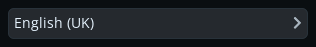

| Attribute | Description |
| --- | --- |
| `bind_options` | Follow a text subject holding the options, one per line |
| `bind_selected` | Follow an int subject for the index of the option chosen; -1 for none |
| `bind_text` | Follow a text subject shown instead of the option chosen, e.g. the filament loaded |
| `title` | The choice dialog's title, if there is no `title_tag` |
| `title_tag` | Translation key for the choice dialog's title |

### ds_cross

An X drawn corner to corner across its content area (inside its padding), in its line style (`line_color`, `line_width`, `line_opa`, `line_rounded`), to cross something out, such as a cancelled object on the bed. Taps pass through it to its parent.

Also takes every `lv_obj` attribute.

```xml
<lv_obj width="120" height="80">
	<ds_cross width="100%" height="100%" style_line_width="2" style_line_color="0x9E9E9E"/>
</lv_obj>
```

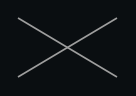

### ds_dialog

A dialog, shown by the dialog surface (`<ds_dialog_host>`) while its subject says so, as the dialog or as the next step of the one open, which the card slides to. Its content stays where it is written, hidden, so its actions go to that view. The surface draws its title, a close button (and a back button on a later step); closed by them, by tapping outside or by the back key, it empties its subject (0, or empty text) and raises `dismissed`, for anything else closing it should do. Closing it by its subject takes any steps opened from it too. The lv_obj attributes apply to its content.

Also takes every `lv_obj` attribute.

```xml
<ds_dialog name="file_dialog" bind_open="source.files.dialog" bind_title="source.files.dialog_title">
	…the dialog's content…
</ds_dialog>
```

| Attribute | Description |
| --- | --- |
| `bind_open` | Open while this subject is non-zero (int) or non-empty (text), or, with `open_value`, equal to it |
| `open_value` | The value `bind_open` must have for the dialog to be open |
| `title` | Its title, as written |
| `title_tag` | Its title, a translation key |
| `bind_title` | Its title, a subject's text |
| `width` | The card's width while it shows: a percentage of the room, or pixels (default 70%); its content always fills the card |
| `height` | The card's height: `content` (default) to fit the content, scrolling once it reaches the room there is, or a percentage or pixels for a card of a set height whose content fills it |
| `blocking` | "true" if it must be answered: no close or back button, and tapping outside or the back key do nothing, for it and the steps under it (default false) |
| `alert` | "true" for an alert: shown before everything else, setting the user's dialog aside until it is answered; alerts wait their turn (default false) |

### ds_dialog_footer

A dialog step's own buttons, written last in a `<ds_dialog>` or a prompt: a row, right-aligned, its main button last (style it `action_btn`). While the step shows they stay at the bottom of the card, below its content, which scrolls on its own. Styled `dialog_footer`.

Also takes every `lv_obj` attribute.

```xml
<ds_dialog_footer>
	<ds_button name="cancel" translation_tag="tr.common.cancel">
		<style name="dialog_button"/>
		<action trigger="clicked" name="actions.dialog.close"/>
	</ds_button>
	<ds_button name="ok" translation_tag="tr.common.ok">
		<style name="dialog_button"/>
		<style name="action_btn"/>
		<action trigger="clicked" name="actions.files.confirm"/>
	</ds_button>
</ds_dialog_footer>
```


### ds_dialog_host

The dialog surface: one card over a dimmed backdrop that every `<ds_dialog>` and prompt on the screen opens in, one step at a time. It fills where it is placed (the home screen puts it over its main window), and is drawn by the component `dialog_host`. A screen without one gets one covering it.

Also takes every `lv_obj` attribute.

### ds_drag_button

A button that must be dragged, not just tapped, to act, such as the E-stop. When let go it raises `value_confirmed` with how far it was dragged, from 0 (a tap) to 1 (all the way, when it shows its `user_1` state).

Also takes every `lv_obj` attribute.

```xml
<ds_drag_button name="estop" translation_tag="tr.estop.label" icon="estop.png"
				 hint_tag="tr.estop.prompt" width="80" height="80">
	<style name="estop"/>
	<action trigger="value_confirmed" name="actions.estop.dragged"/>
</ds_drag_button>
```


| Attribute | Description |
| --- | --- |
| `text` | The text shown, if there is no `translation_tag` |
| `translation_tag` | Translation key for the text |
| `icon` | Icon file from the icon set, e.g. "estop.png" |
| `hint` | Shown curved around the edge until it is held, if there is no `hint_tag` |
| `hint_tag` | Translation key for the hint |

### ds_graph

A line graph of a history, with a legend whose entries show each series' colour, name and latest value, and show and hide it when tapped. Series are coloured by position from the theme's series colours (#series_1, #series_2, …), which follow the theme. Whether a series is drawn is its history row's `shown`, so every graph of a history, and every `<ds_graph_key>` for it, agree. The graph starts with what was recorded before it was built, and follows series being added, removed and renamed.

Also takes every `lv_obj` attribute.

```xml
<ds_graph history="source.temperature.temperatures" seconds="60" y_min="0" y_max="300"
		  bind_y_max="source.temperature.limit" width="400" height="250"/>
```

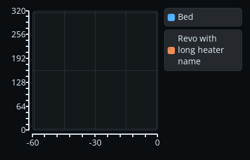

| Attribute | Description |
| --- | --- |
| `history` | The history shown (required), named like a list, e.g. `source.temperature.temperatures` |
| `seconds` | The X axis shows the last this-many seconds, labelled -seconds to 0 (default 60) |
| `y_min` | Bottom of the Y axis (default 0) |
| `y_max` | Top of the Y axis (default 100) |
| `bind_y_max` | Follow an int subject that raises the top of the Y axis above `y_max`, e.g. to fit a heater's limit |
| `legend_format` | How the legend shows a series' latest value: a fmt format with one argument, e.g. `{}°C` (default: no value) |
| `legend` | When the legend shows: `auto` (default) while the graph is at least `legend_min_width` wide, `shown` always, `hidden` never |
| `legend_min_width` | With `legend` auto, show the legend only while the graph is at least this many pixels wide, so a narrow graph keeps its room for the plot (default 0: always shown) |

### ds_graph_key

One series' colour key, drawn as a graph's legend draws it, to put beside what the series measures (e.g. a heater) so it can be matched to its line in a `<ds_graph>` of the same history. The series is the history row whose `row.key` is the key, so it is found however the series are ordered, and its colour follows the theme as the graph's does. Tapping it shows or hides the series in every graph of the history; it is hollow while hidden. It hides itself while no series has the key, and while `enabled` is false (it sets its own `hidden` flag, so `enabled` is how to turn it off). Styled by the theme's graph_legend_swatch and graph_legend_swatch_shown; a tap reaches it from a little way around it (`ext_click_area`).

Also takes every `lv_obj` attribute.

```xml
<ds_graph_key history="source.temperature.temperatures" key="1"/>
```

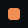

| Attribute | Description |
| --- | --- |
| `history` | The history the series is in (required), named like a list, e.g. `source.temperature.temperatures` |
| `key` | The series' row.key, e.g. a sensor number |
| `bind_key` | Follow an int subject holding the series' row.key, e.g. `om.heat.heaters[{row.value}].sensor\|int` for a heater's series in source.temperature.temperatures |
| `enabled` | `false` hides the key whatever the series, e.g. to leave it to a widget setting (default true) |

### ds_heatmap

A colour map of a surface, such as a bed's height map, with X and Y scales, a grid, a title (with a detail, as a `<ds_plot>`'s), and the colour scale beside it

Also takes every `lv_obj` attribute.

```xml
<ds_heatmap bind_surface="presenter.surface" title_tag="tr.heightmap.mesh" title_style="text_emphasis"
			bind_detail="presenter.file" resolution="200" width="400" height="300"/>
```


| Attribute | Description |
| --- | --- |
| `title` | The title above the area, if there is no `title_tag` |
| `title_tag` | Translation key for the title |
| `bind_title` | Follow a text subject for the title |
| `title_style` | A theme style for the title, e.g. `text_emphasis` |
| `bind_detail` | Follow a text subject shown after the title |
| `bind_surface` | The surface subject to show; redrawn whenever it changes |
| `resolution` | Pixels the map is drawn with along each side, scaled to fit (default 200) |

### ds_hue_slider

A `<ds_slider>` for a hue, 0 to 360, whose track shows every hue at a lightness and chroma, so the slider is a colour picker, e.g. for a theme's primary colour. `min` and `max` default to 0 and 360.

Also takes every `ds_slider` attribute.

```xml
<ds_hue_slider bind_value="presenter.primary_hue" bind_lightness="presenter.primary.lightness" bind_chroma="presenter.primary.chroma"
			   width="100%"/>
```

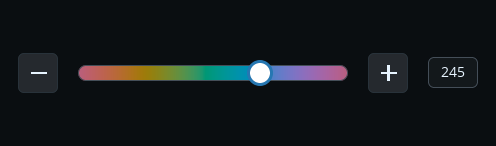

| Attribute | Description |
| --- | --- |
| `bind_lightness` | Follow an int subject for the OKLCH lightness the hues are shown at, in thousandths (0.65 is 650) |
| `bind_chroma` | Follow an int subject for the OKLCH chroma the hues are shown at, in thousandths |

### ds_icon

An icon from the icon set chosen in the settings, coloured by the theme. It follows icon set changes.

Also takes every `lv_image` attribute.

```xml
<ds_icon icon="folder.png" width="72" height="72"/>
```


| Attribute | Description |
| --- | --- |
| `icon` | Icon file from the icon set, e.g. "folder.png" |
| `bind_icon` | Follow a text subject naming the icon file, e.g. a WiFi network's signal |
| `folder` | Take `icon` from this folder of assets/icons instead, whatever the icon set, e.g. "hardware_test" |

### ds_keyboard

An on-screen keyboard with DuetScreen's key layouts. A `<ds_textarea>` brings it up and types into it, so it is usually written `hidden="true"`; or, with `textarea`, it always types into one box. Its OK key raises `ready`.

Also takes every `lv_obj` attribute.

```xml
<ds_keyboard name="serial_keyboard" mode="text_upper" width="100%" height="200"/>
```


| Attribute | Description |
| --- | --- |
| `mode` | Key layout: `text` (default), `text_upper` or `number` |
| `textarea` | Always type into the text box of this name: the nearest one around the keyboard, written before it |

### ds_layout

Shows the widgets the layout of a slot places, which the user can change on the screen. The layout comes from the `layouts/` of the bundles (see docs/XML_UI.md, Layouts). A free layout puts each widget at its rectangle, scaled to this content area; a strip leaves its own layout (e.g. `flex_flow`) to place the widgets in order.

Also takes every `lv_obj` attribute.

```xml
<ds_layout slot="sidebar" flex_flow="column" width="content" height="100%"/>
```


| Attribute | Description |
| --- | --- |
| `slot` | The slot whose layout is shown (required), e.g. `dashboard` |

### ds_list

A container with one component per row of a list. Each item is built in a scope of its own holding its row's fields, so names are found in the row first, then where the list is written. With `windowed`, only the rows on screen are built, so a folder of a thousand files costs a screenful of widgets; every item then has the same size, and the list places them itself (its own layout is ignored), with its style_pad_row and style_pad_column as the gaps. With `key` and `value`, only the rows whose `key` field is `value` are shown, e.g. one fan. Each item is given the list's `item.*` attributes.

Also takes every `lv_obj` attribute.

```xml
<ds_list list="presenter.files" item="file_browser_row" windowed="true" item_height="90" flow="column"/>
```

| Attribute | Description |
| --- | --- |
| `list` | The list shown (required), named like a subject: e.g. `presenter.files`, `source.jog.distance.choices`, `om.fans`, or in a tool's row, its `row.heaters` |
| `item` | The component built for each row (required) |
| `windowed` | "true" to build only the rows on screen, building and deleting rows as the list scrolls (default false) |
| `item_height` | Windowed: each item's height in pixels (required when windowed) |
| `item_width` | Windowed: each item's width in pixels, or `content` for each item's own width (column flow only; the list scrolls sideways); the list's full width if not given |
| `flow` | How the items are placed: `column`, one per line; `row`, side by side; `row_wrap`, as many per line as fit; or `pages`, one at a time, each filling the list, swiped through sideways with a dot per item below (styled by the theme's list_pages, list_page_dot and list_page_dot_current). Without it, a list is laid out by its own flex attributes, and a windowed list in a column. A windowed list takes `column` or `row_wrap`. |
| `limit` | Show only the first this many rows, e.g. a widget's setting: `limit="$count"`; every row if not given or below 0 |
| `follow_end` | "true" to keep a list that isn't windowed showing its last rows as rows are added, like a log, unless the user has scrolled back (default false) |
| `key` | A field of the rows, written `row.<field>`: only the rows whose `key` is `value` are shown, as the data changes. Not with `windowed`. Empty for every row, so a component can leave it to a prop. |
| `value` | With `key`, the value shown rows have, as XML writes one: `2` for an int, the text for a text, e.g. `<ds_list list="om.fans" key="row.index" value="2" item="…"/>` shows fan 2 |
| `bind_value` | With `key`, instead of `value`: follow a subject for the value shown rows have, e.g. `bind_value="om.state.currentTool"` with `key="row.index"` shows the tool in use |
| `item.<attribute>` | Given to every item as if written where it is used: a prop of the item component, e.g. `item.title="row.name"`, or an attribute of its root, e.g. `item.flex_grow="1"`. Its names are looked up in the item's row. |

### ds_move_handle

A grip that moves the widget it is in around that widget's parent when dragged, e.g. a floating toolbar's. The first drag takes the widget out of its parent's layout; it is kept inside its parent. What the grip looks like is the XML inside it.

Also takes every `lv_obj` attribute.

```xml
<lv_obj width="200" height="content" flex_flow="row" style_flex_cross_place="center">
	<ds_move_handle width="content" height="content" style_pad_all="0">
		<ds_icon icon="drag.png" width="32" height="48"/>
	</ds_move_handle>
	<lv_label text="Drag me"/>
</lv_obj>
```


### ds_pages

Pages that share one place, the first shown to start with. Each is a `<ds_pages-page>` inside it. `actions.navigation.open_page` from inside the stack slides the page it names in, under a header with the page's title and a button back to the page it came from; that button, or the back key while the stack is on screen, slides back.

Also takes every `lv_obj` attribute.

```xml
<ds_pages width="100%" height="200">
	<ds_pages-page name="display" title="Display">
		<ds_button text="Colours">
			<action trigger="clicked" name="actions.navigation.open_page" arg="colours"/>
		</ds_button>
	</ds_pages-page>
	<ds_pages-page name="colours" title="Colours">
		<lv_label text="The colours"/>
	</ds_pages-page>
</ds_pages>
```


| Attribute | Description |
| --- | --- |
| `bind_page` | A text subject naming the page shown: setting it shows that page (going back to it if it was opened on the way, else opening it), and moving between pages sets it; empty shows the first |

### ds_pages-page

One page of a `<ds_pages>`, written inside it, opened by its `name`. Its content is the page; the lv_obj attributes apply to the page.

Also takes every `lv_obj` attribute.

| Attribute | Description |
| --- | --- |
| `title` | The page's title, shown over it, if there is no `title_tag` |
| `title_tag` | Translation key for the page's title; follows language changes |

### ds_password_toggle

An eye button that shows what is typed in a password box while it is checked, and hides it again when unchecked. Tapping it doesn't take the focus from the box, so the keyboard stays up.

Also takes every `lv_obj` attribute.

```xml
<lv_obj width="100%" height="content" flex_flow="row" style_pad_all="0">
	<ds_textarea name="password" one_line="true" password_mode="true" flex_grow="1"/>
	<ds_password_toggle textarea="password"/>
</lv_obj>
```


| Attribute | Description |
| --- | --- |
| `textarea` | Name of the password box: the nearest `ds_textarea` of that name around the button, e.g. its sibling |

### ds_plot

An X/Y area with scales and a grid, such as the bed with its objects, whose content is widgets placed by X/Y position. `<ds_plot_layer>`s written inside it are kept over its drawing area, and `<ds_plot_rect>`s inside a layer are kept at their X/Y bounds.

Also takes every `lv_obj` attribute.

```xml
<ds_plot title_tag="tr.object_cancel.current_object_prefix" title_style="text_emphasis" bind_detail="presenter.current"
		 bind_x_min="presenter.x_min" bind_x_max="presenter.x_max" bind_y_min="presenter.y_min" bind_y_max="presenter.y_max" width="400" height="300">
	<ds_plot_layer name="layer">
		<ds_list list="presenter.objects" item="object_cancel_outline" width="100%" height="100%"/>
	</ds_plot_layer>
</ds_plot>
```

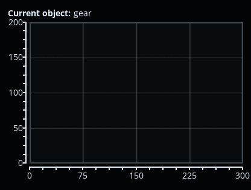

| Attribute | Description |
| --- | --- |
| `title` | The title above the area, if there is no `title_tag` |
| `title_tag` | Translation key for the title |
| `bind_title` | Follow a text subject for the title |
| `title_style` | A theme style for the title, e.g. `text_emphasis` |
| `bind_detail` | Follow a text subject shown after the title |
| `x_min` | Left of the span (default 0) |
| `x_max` | Right of the span (default 100) |
| `y_min` | Bottom of the span (default 0) |
| `y_max` | Top of the span (default 100) |
| `bind_x_min` | Follow an int subject for `x_min` |
| `bind_x_max` | Follow an int subject for `x_max` |
| `bind_y_min` | Follow an int subject for `y_min` |
| `bind_y_max` | Follow an int subject for `y_max` |
| `resolution` | Pixels the grid is drawn with along each side, scaled to fit (default 200) |

### ds_plot_layer

A layer written inside a `<ds_plot>`, kept exactly over its drawing area, for widgets placed by X/Y position such as `<ds_plot_rect>`s. It doesn't scroll and has no padding; the plot sets its position and size.

Also takes every `lv_obj` attribute.

### ds_plot_rect

A rectangle kept at its X/Y bounds over a `<ds_plot>`, e.g. an object on the bed. It is written inside a `<ds_plot_layer>` of the plot, directly or deeper (in a list row, say), and hidden while its bounds are outside the plot's span. It sets its own position and size.

Also takes every `lv_obj` attribute.

```xml
<ds_plot_rect bind_x1="row.x1" bind_y1="row.y1" bind_x2="row.x2" bind_y2="row.y2"/>
```

| Attribute | Description |
| --- | --- |
| `x1` | X of one corner, in the plot's units |
| `y1` | Y of that corner |
| `x2` | X of the opposite corner |
| `y2` | Y of the opposite corner |
| `bind_x1` | Follow an int subject for `x1` |
| `bind_y1` | Follow an int subject for `y1` |
| `bind_x2` | Follow an int subject for `x2` |
| `bind_y2` | Follow an int subject for `y2` |

### ds_scope

Builds one component in a scope where names are relative to an object model element, as in a row of an object model list: `current`, `model.pid.p`, `heaters` as a list. When an index of the path is a subject's value, the names follow the element it points at, without rebuilding.

Also takes every `lv_obj` attribute.

```xml
<ds_scope path="om.tools[{om.state.currentTool}]" item="tools_current" width="300"/>
```

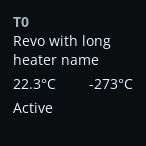

| Attribute | Description |
| --- | --- |
| `path` | The element (required): an `om.` path, whose indices may be `{name}`, a subject's value |
| `item` | The component built (required) |
| `item.<attribute>` | Given to the item as if written where it is used: a prop of the item component, or an attribute of its root. Its names are looked up in the item's scope. |

### ds_setting

One setting, a row: its title, a hint under it if it has one, then its control, the children written inside it, at the end of the row. Tapping the row anywhere works the control as tapping it would, if it is a switch, a button or a `<ds_choice>`. In a group, an `lv_obj` with the `setting_group` style under a label with the `setting_group_title` style. In a dialog's list, add the `dialog_row` style.

Also takes every `lv_obj` attribute.

```xml
<ds_setting title_tag="tr.settings.show_confirmation_dialogs"
			hint="Ask first before actions that change the machine">
	<ds_toggle>
		<bind_state_if_eq subject="source.settings.confirmations" state="checked" ref_value="1"/>
		<action trigger="value_changed" name="actions.settings.set" arg="confirmations"/>
	</ds_toggle>
</ds_setting>
```

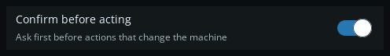

| Attribute | Description |
| --- | --- |
| `title` | The setting's title, if there is no `title_tag` or `bind_title` |
| `title_tag` | Translation key for the title; follows language changes |
| `bind_title` | Follow a text subject for the title |
| `hint` | A line under the title saying more about the setting, if there is no `hint_tag` or `bind_hint` |
| `hint_tag` | Translation key for the hint; follows language changes |
| `badge` | A word after the title saying what sort of setting it is, e.g. "Advanced", if there is no `badge_tag` |
| `badge_tag` | Translation key for the badge; follows language changes |
| `bind_hint` | Follow a text subject for the hint, e.g. how something went; no hint while it is empty |

### ds_setting_group

A group of settings: its title, in capitals, over a box of the rows written inside it (`<ds_setting>`, or a `<ds_list>` of them with the `setting_list` style), with a note at the end of the title's line if it has one. Hiding the group hides its title too.

Also takes every `lv_obj` attribute.

```xml
<ds_setting_group title="Machine control">
	<ds_setting title="Confirm before acting">
		<ds_toggle/>
	</ds_setting>
	<ds_setting title="Absolute moves use machine coordinates">
		<ds_toggle/>
	</ds_setting>
</ds_setting_group>
```

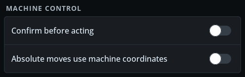

| Attribute | Description |
| --- | --- |
| `title` | The group's title, if there is no `title_tag` |
| `title_tag` | Translation key for the title; follows language changes |
| `note` | A note at the end of the title's line, if there is no `note_tag` |
| `note_tag` | Translation key for the note, e.g. who sets the settings; follows language changes |
| `danger` | "true" for a group whose actions can't be undone, such as erasing every setting: the box is edged in the error colour (`setting_group_danger`) |
| `fill` | "true" for a box that fills the group's height rather than its rows' (give the group a height, or flex_grow), e.g. for a list that scrolls in it |

### ds_slider

A slider with a label, its value and -/+ buttons, and optionally a number pad. Raises `value_confirmed` with the value when the user finishes an edit (releases it, presses -/+ or types a value), or with `send="change"` on every movement. Values written by `bind_value` are not edits and raise nothing, so a view can show live data and send changes without echoing the data back to the printer. Also raises `value_changed` as it is dragged.

Also takes every `lv_obj` attribute.

```xml
<ds_slider label_tag="tr.settings.brightness" min="0" max="100" increment="1" decimals="0" bind_value="source.settings.brightness"
		   numberpad="true" send="change" width="100%">
	<action trigger="value_confirmed" name="actions.settings.set" arg="brightness"/>
</ds_slider>
```


| Attribute | Description |
| --- | --- |
| `min` | Bottom of the range, may have a fraction (default 0) |
| `max` | Top of the range, may have a fraction (default 100) |
| `increment` | Step of the -/+ buttons, may have a fraction, e.g. "0.01" (default 1) |
| `decimals` | Decimal places the value is shown with (default 2) |
| `unit` | Shown after the value, e.g. "%" or "s" |
| `label` | The label, if there is no `label_tag` |
| `label_tag` | Translation key for the label |
| `bind_label` | Follow a text subject for the label |
| `label_shown` | "false" to hide the label, which still heads the number pad (default true) |
| `bind_value` | Follow an int subject for the value |
| `value_scale` | How much `bind_value` is scaled by, for a value with a fraction, e.g. a chroma of 0.02 held as 2 with value_scale="100" (default 1) |
| `send` | `confirmed` to raise `value_confirmed` when an edit is finished (default), or `change` on every movement, for a setting seen as it changes such as brightness |
| `out_of_range` | Let a typed value go past the slider's `upper` end, `lower` end or `both`, e.g. a timeout longer than the slider reaches |
| `lowest` | The least the value may be, dragged, typed or reset, if not the bottom of the range: for a range that moves with the value (`bind_min`), its true limit |
| `highest` | The most the value may be, if not the top of the range (or none past it, with `out_of_range`) |
| `numberpad` | What tapping the value does: `true` types it on a number pad, the next step of the dialog the slider is in or a dialog of its own; `false` types it in place (default) |
| `default` | A value to go back to: a Reset button shows while the value is anything else, and raises `value_confirmed` with it |
| `bind_min` | Follow an int subject for the bottom of the range (scaled by `value_scale`) |
| `bind_max` | Follow an int subject for the top of the range (scaled by `value_scale`) |

### ds_tabs

Tab buttons beside the selected tab's content: a row over it, or a column down its side (`side`). Each tab is a `<ds_tabs-tab>` inside it; the first starts selected.

Also takes every `lv_obj` attribute.

```xml
<ds_tabs width="100%" height="200">
	<ds_tabs-tab name="macros" title_tag="tr.file.macros">
		<lv_label text="The first tab's content"/>
	</ds_tabs-tab>
	<ds_tabs-tab name="jobs" title_tag="tr.file.jobs" bind_disabled="source.machine.job_active">
		<lv_label text="The second tab's content"/>
	</ds_tabs-tab>
</ds_tabs>
```


| Attribute | Description |
| --- | --- |
| `side` | Where the tab buttons are: top (the default), bottom, left or right. Down a side, each tab is a row as wide as the column, its icon before its title |
| `tab_max_width` | The widest a tab may be, in pixels; a title too long for it ends in "…". Down a side, the column is as wide as its widest tab, so no wider than this |

### ds_tabs-tab

One tab of a `<ds_tabs>`, written inside it. Its content is the tab's page; the lv_obj attributes apply to that page.

Also takes every `lv_obj` attribute.

| Attribute | Description |
| --- | --- |
| `title` | The tab button's text, if there is no `title_tag` |
| `icon` | Icon file from the icon set shown on the tab button, e.g. "settings_display.png" |
| `end` | "true" to put the tab, and those after it, at the far end of the tab bar, e.g. the bottom of a bar down a side |
| `title_tag` | Translation key for the tab button's text |
| `bind_disabled` | Disable the tab's button while this int subject is non-zero |
| `bind_shown` | Show the tab only while this int subject is non-zero, e.g. a tab for a part the machine may not have: `bind_shown="om.fans\|count"`. Hiding the selected tab selects the next one |
| `select_on` | Select the tab whenever this subject changes to a non-empty text or non-zero int, e.g. the status tab when a job starts: `select_on="om.job.file.fileName"` |

### ds_textarea

A text box that brings up an on-screen keyboard while it is being edited. The keyboard's own close key always puts it away. Raises `focused`, `defocused`, `ready` and `cancel` as the edit starts and ends, and `value_changed` on every edit; handlers read the text with ActionArgs::text(). Text written by `bind_text` is not an edit and raises nothing, so a handler can store each edit in the subject the box shows.

Also takes every `lv_obj` attribute.

```xml
<ds_textarea name="input" one_line="true" bind_text="presenter.alert.input" bind_keyboard_mode="presenter.alert.keyboard_mode"
			 width="300">
	<action trigger="value_changed" name="presenter.alert.input"/>
</ds_textarea>
```


| Attribute | Description |
| --- | --- |
| `bind_text` | Follow a text subject: the box shows its value whenever it changes to something other than what is in the box, so a presenter that keeps the subject equal to the edits can replace the text at any time |
| `bind_accepted_chars` | Follow a text subject for the characters that may be typed; empty for any |
| `keyboard_mode` | Keyboard layout to show: `text` (default), `text_upper` or `number` |
| `bind_keyboard_mode` | Follow a text subject for the keyboard layout, as `keyboard_mode` |
| `keyboard` | The keyboard to use: the nearest lv_keyboard of that name around the box (e.g. one in the same view), else a C++ view of that name (default `keyboard`, the home screen's); `none` for a box edited another way, such as a number pad |
| `hide_keyboard_on_ready` | Put the keyboard away when its OK key is pressed (default true) |
| `hide_keyboard_on_defocus` | Put the keyboard away when the box loses focus or something outside it is tapped (default true) |
| `one_line` | "true" for a single line of text |
| `password_mode` | "true" to show dots for the characters, e.g. for a password |
| `placeholder` | Text shown while the box is empty |
| `placeholder_tag` | Translation key for the placeholder, instead of `placeholder` |

### ds_thumbnail

An image as tall as its parent's content and as wide as its aspect ratio needs, so a thumbnail beside some text is as large as it can be without making the row taller, and one alone in a box that grows fills its height. It hides while it has no image.

Also takes every `lv_image` attribute.

```xml
<ds_thumbnail bind_src="source.job.thumbnail" height="100%"/>
```

| Attribute | Description |
| --- | --- |
| `bind_src` | Follow a text subject holding an image path; empty shows no image |

### ds_toggle

An on/off setting, drawn as a switch. Raises `value_changed` when it is changed; the action's value is 1 when turned on and 0 when off.

Also takes every `lv_obj` attribute.

```xml
<ds_toggle>
	<bind_state_if_eq subject="source.settings.confirmations" state="checked" ref_value="1"/>
	<action trigger="value_changed" name="actions.settings.set" arg="confirmations"/>
</ds_toggle>
```


### ds_view

A view inside a screen, e.g. a page of the home screen, registered with navigation as its `name` (default: its `view`) so it can be opened with `actions.navigation.open`. A view starts hidden, like any screen that isn't open. Every lv_obj attribute works except `hidden`, which navigation owns.

Also takes every `lv_obj` attribute.

```xml
<ds_view name="dashboard_jobs" view="file_browser" presenter="dashboard_jobs"/>
```

| Attribute | Description |
| --- | --- |
| `view` | The XML component shown, with its presenter |
| `presenter` | Show the component with this registered presenter instead of the one it names, so one component can show different data in different places |
| `home` | "true" to make it a home screen: shown when nothing else is open (default false) |
| `prop_<name>` | A value for the component's prop <name>, e.g. `prop_hide_title="true"`, as an attribute would be where the component is written |
| `shown` | "true" to show it without taking part in navigation, for always-present parts such as a status bar or the page in a tab: shown, and its presenter active, whenever what it is in is shown (default false) |

### lv_obj-action

Written `<action>` inside any widget: run the named action when the widget raises the trigger event. `presenter.<action>` is looked for in the presenters of the views the widget is in, innermost first; `actions.<group>.<action>` is a global action.

```xml
<action trigger="value_confirmed" name="actions.gcode.send" arg="M106 P{row.number} S{event.value}"/>
```

| Attribute | Description |
| --- | --- |
| `name` | The action to run (required): `presenter.<action>` or `actions.<group>.<action>`; empty for none, so a component can leave it to a prop (`name="$tap_action"`) |
| `trigger` | The event that runs it (default `clicked`): an LVGL event name such as `value_changed` or `long_pressed`, `value_confirmed` (a DuetScreen widget's edit is finished) or `dismissed` (a `<ds_dialog>` was closed by the user without answering it) |
| `arg` | Passed to the handler. `{event.value}` is replaced by the edited value, and `{name}` by the current value of the subject `name`, looked up from where the `<action>` is written |

## Layouts

What the user places on the screen, and where; see Layouts in [XML_UI.md](XML_UI.md). A `<ds_layout slot="…">` shows its slot's layout, a file in a bundle's `layouts/`. A free layout places widgets in rectangles of pixels; a strip shows them one after another. Locked items can be moved but not removed.

### Slots

The built-in slots and the layout each shows until the user changes it.

| Slot | Kind | Items (id: widget) |
| --- | --- | --- |
| `dashboard` | free, 920×561 px | `tools`: `tools` at 0,0, 548×277; `temperature_graph`: `temperature_graph` at 0,282, 548×279; `job`: `job` at 553,0, 367×561 |
| `sidebar` | strip | `home`: `page_home`; `control`: `page_control`; `files`: `page_files`; `console`: `page_console`; `settings`: `page_settings`, locked; `estop`: `estop`, locked |
| `status_bar` | strip | none |

### Placed widgets' names

A placed widget's component can use these, as well as its presenter's names and the globals, to fit what it shows to the room it has; any other view has a page's room, every class expanded. E.g. `<bind_flag_if cond="widget.width_class eq 0" flag="hidden"/>` hides a part when the widget is narrow. The breakpoints are the theme's consts `widget_regular_min` and `widget_expanded_min`. See [PlacementScope.h](../src/UI/Xml/Layout/PlacementScope.h) for when to use them.

| Name | Type | Description |
| --- | --- | --- |
| `widget.width_class` | int | How wide the widget's place is: 0 compact, 1 regular, 2 expanded, by the theme's breakpoints (widget_regular_min, widget_expanded_min); always 1 in a strip, and 2 outside a placed widget |
| `widget.height_class` | int | How tall the widget's place is, as `widget.width_class` |
| `widget.size_class` | int | The smaller of `widget.width_class` and `widget.height_class`: how big something that needs both, such as an arc, can be |
| `widget.portrait` | int | 1 if the widget's place is taller than it is wide, else 0 |

### Placeable widgets

Each widget is a component (with its props) and a widget file beside it, which says where it can be placed, its sizes in pixels, and its settings: props the user chooses on the screen. Each is pictured as placed, at its default size in its first slot, with its default settings; a free layout's widget is pictured at its smallest size too.

#### axes

**Axis positions**: Where each axis is

In Motion; placed in `dashboard`; component `move_positions_card` ([axes.json](../assets/ui/widgets/motion/axes.json)). In a free layout it is 365×89 px, and at least 272×89 px.


At its smallest, 272×89 px:


#### babystep

**Babystepping**: Move Z by small steps while printing

In Motion; placed in `dashboard`; component `card_view` ([babystep.json](../assets/ui/widgets/motion/babystep.json)). In a free layout it is 272×372 px, and at least 180×278 px.

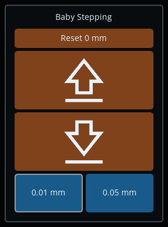

At its smallest, 180×278 px:


#### bed_arc

**Bed arc**: A bed's temperature, heading for its target; tap to set the target

In Temperatures; placed in `dashboard`; component `gauge_beds` ([bed_arc.json](../assets/ui/widgets/gauges/bed_arc.json)). In a free layout it is 180×184 px, and at least 134×136 px.

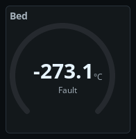

At its smallest, 134×136 px:

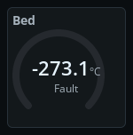

| Setting | Shown as | Takes | Default |
| --- | --- | --- | --- |
| `match` | Bed | a row of `om.heat.bedHeaters`, by its `index`, shown by its `value\|numbered:tr.temperature.bed_number` | `0` |

#### bed_bar

**Bed bar**: A bed's temperature, heading for its target; tap to set the target

In Temperatures; placed in `dashboard`; component `gauge_beds` ([bed_bar.json](../assets/ui/widgets/gauges/bed_bar.json)). In a free layout it is 272×89 px, and at least 180×89 px.


At its smallest, 180×89 px:

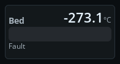

| Setting | Shown as | Takes | Default |
| --- | --- | --- | --- |
| `match` | Bed | a row of `om.heat.bedHeaters`, by its `index`, shown by its `value\|numbered:tr.temperature.bed_number` | `0` |

#### bed_value

**Bed number**: A bed's temperature, heading for its target; tap to set the target

In Temperatures; placed in `dashboard`; component `gauge_beds` ([bed_value.json](../assets/ui/widgets/gauges/bed_value.json)). In a free layout it is 180×89 px, and at least 134×89 px.

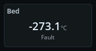

At its smallest, 134×89 px:

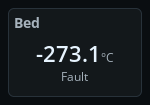

| Setting | Shown as | Takes | Default |
| --- | --- | --- | --- |
| `match` | Bed | a row of `om.heat.bedHeaters`, by its `index`, shown by its `value\|numbered:tr.temperature.bed_number` | `0` |

#### button

**Button**: A button that does what you choose when tapped or held

In Commands; placed in `dashboard`; component `dashboard_button` ([button.json](../assets/ui/widgets/commands/button.json)). In a free layout it is 180×89 px, and at least 88×89 px.

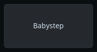

At its smallest, 88×89 px:

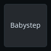

| Setting | Shown as | Takes | Default |
| --- | --- | --- | --- |
| `label` | Label | text, up to 32 bytes | `Babystep` |
| `tap_action` | On tap | an action offered to users, or none | `actions.babystep.open` |
| `tap_arg` | On tap: argument | text, up to 120 bytes | `` |
| `hold_action` | On hold | an action offered to users, or none | `` |
| `hold_arg` | On hold: argument | text, up to 120 bytes | `` |

#### chamber_arc

**Chamber arc**: A chamber's temperature, heading for its target; tap to set the target

In Temperatures; placed in `dashboard`; component `gauge_chambers` ([chamber_arc.json](../assets/ui/widgets/gauges/chamber_arc.json)). In a free layout it is 180×184 px, and at least 134×136 px.

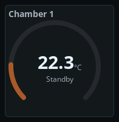

At its smallest, 134×136 px:

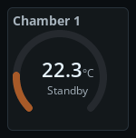

| Setting | Shown as | Takes | Default |
| --- | --- | --- | --- |
| `match` | Chamber | a row of `om.heat.chamberHeaters`, by its `index`, shown by its `value\|numbered:tr.temperature.chamber_number` | `0` |

#### chamber_bar

**Chamber bar**: A chamber's temperature, heading for its target; tap to set the target

In Temperatures; placed in `dashboard`; component `gauge_chambers` ([chamber_bar.json](../assets/ui/widgets/gauges/chamber_bar.json)). In a free layout it is 272×89 px, and at least 180×89 px.

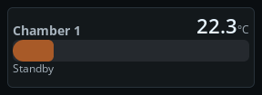

At its smallest, 180×89 px:

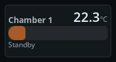

| Setting | Shown as | Takes | Default |
| --- | --- | --- | --- |
| `match` | Chamber | a row of `om.heat.chamberHeaters`, by its `index`, shown by its `value\|numbered:tr.temperature.chamber_number` | `0` |

#### chamber_value

**Chamber number**: A chamber's temperature, heading for its target; tap to set the target

In Temperatures; placed in `dashboard`; component `gauge_chambers` ([chamber_value.json](../assets/ui/widgets/gauges/chamber_value.json)). In a free layout it is 180×89 px, and at least 134×89 px.

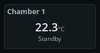

At its smallest, 134×89 px:

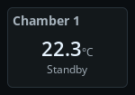

| Setting | Shown as | Takes | Default |
| --- | --- | --- | --- |
| `match` | Chamber | a row of `om.heat.chamberHeaters`, by its `index`, shown by its `value\|numbered:tr.temperature.chamber_number` | `0` |

#### console

**Console**: The console: send G-code and read the replies

In Console; placed in `dashboard`; component `console` ([console.json](../assets/ui/widgets/console/console.json)). In a free layout it is 642×467 px, and at least 458×278 px.

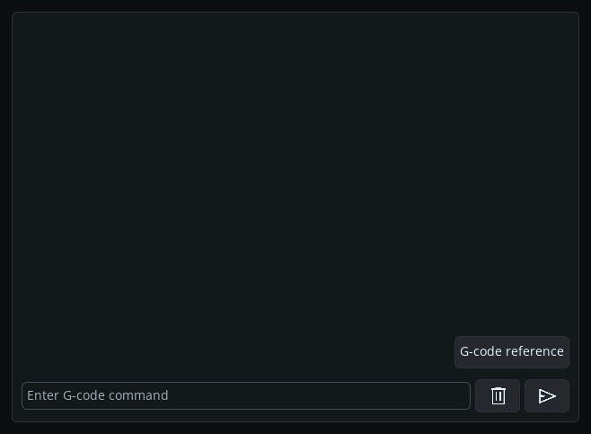

At its smallest, 458×278 px:

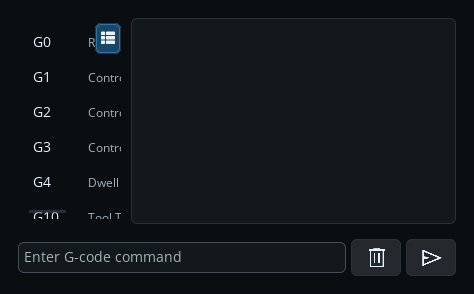

#### console_command_list

**G-code reference**: Every G-code with what it does; tap one to put it in the console's input

In Console; placed in `dashboard`; component `console_command_list` ([console_command_list.json](../assets/ui/widgets/console/console_command_list.json)). In a free layout it is 458×278 px, and at least 272×136 px.


At its smallest, 272×136 px:

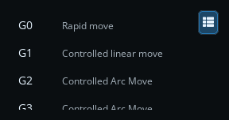

#### console_input

**Console input**: A line to type G-code into and send to the printer

In Console; placed in `dashboard`; component `console_input` ([console_input.json](../assets/ui/widgets/console/console_input.json)). In a free layout it is 300×60 px, and at least 200×40 px.

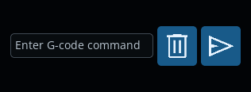

At its smallest, 200×40 px:

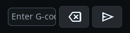

#### console_log

**Console log**: The printer's latest replies; tap to open the console

In Console; placed in `dashboard`; component `console_log` ([console_log.json](../assets/ui/widgets/console/console_log.json)). In a free layout it is 458×278 px, and at least 272×136 px.


At its smallest, 272×136 px:

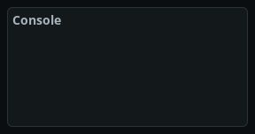

#### current_tool

**Current tool**: The tool in use, with its heaters' temperatures

In Temperatures; placed in `dashboard`; component `dashboard_current_tool` ([current_tool.json](../assets/ui/widgets/temperature/current_tool.json)). In a free layout it is 458×184 px, and at least 458×184 px.


#### custom_arc

**Custom arc**: Any value the printer reports, by its object model name, doing what you choose when tapped or held

In Gauges; placed in `dashboard`; component `gauge_arc` ([custom_arc.json](../assets/ui/widgets/gauges/custom_arc.json)). In a free layout it is 180×184 px, and at least 134×136 px.

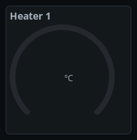

At its smallest, 134×136 px:

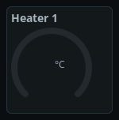

| Setting | Shown as | Takes | Default |
| --- | --- | --- | --- |
| `title` | Title | text, up to 40 bytes, given as a constant | `Heater 1` |
| `value` | Value (a name) | text, up to 120 bytes | `om.heat.heaters[1].current|int` |
| `text` | Value shown (a name) | text, up to 120 bytes | `om.heat.heaters[1].current|fixed:1` |
| `unit` | Unit | text, up to 12 bytes, given as a constant | `°C` |
| `min` | Minimum | int, -100000 to 100000 | `0` |
| `max` | Maximum | int, -100000 to 100000 | `300` |
| `target` | Target (a name) | text, up to 120 bytes | `om.heat.heaters[1]|heater_target` |
| `detail` | Detail | text, up to 40 bytes, given as a constant | `` |
| `tap_action` | On tap | an action offered to users, or none | `` |
| `tap_arg` | On tap: argument | text, up to 120 bytes | `` |
| `hold_action` | On hold | an action offered to users, or none | `` |
| `hold_arg` | On hold: argument | text, up to 120 bytes | `` |

#### custom_bar

**Custom bar**: Any value the printer reports, by its object model name, doing what you choose when tapped or held

In Gauges; placed in `dashboard`; component `gauge_bar` ([custom_bar.json](../assets/ui/widgets/gauges/custom_bar.json)). In a free layout it is 272×89 px, and at least 180×89 px.

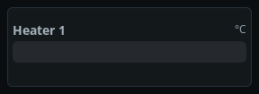

At its smallest, 180×89 px:

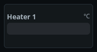

| Setting | Shown as | Takes | Default |
| --- | --- | --- | --- |
| `title` | Title | text, up to 40 bytes, given as a constant | `Heater 1` |
| `value` | Value (a name) | text, up to 120 bytes | `om.heat.heaters[1].current|int` |
| `text` | Value shown (a name) | text, up to 120 bytes | `om.heat.heaters[1].current|fixed:1` |
| `unit` | Unit | text, up to 12 bytes, given as a constant | `°C` |
| `min` | Minimum | int, -100000 to 100000 | `0` |
| `max` | Maximum | int, -100000 to 100000 | `300` |
| `target` | Target (a name) | text, up to 120 bytes | `om.heat.heaters[1]|heater_target` |
| `detail` | Detail | text, up to 40 bytes, given as a constant | `` |
| `tap_action` | On tap | an action offered to users, or none | `` |
| `tap_arg` | On tap: argument | text, up to 120 bytes | `` |
| `hold_action` | On hold | an action offered to users, or none | `` |
| `hold_arg` | On hold: argument | text, up to 120 bytes | `` |

#### custom_gauges

**Custom gauge list**: A gauge for each item of an object model list you choose, by names in the item

In Gauges; placed in `dashboard`; component `gauge_list` ([custom_gauges.json](../assets/ui/widgets/gauges/custom_gauges.json)). In a free layout it is 272×277 px, and at least 180×136 px.

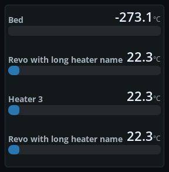

At its smallest, 180×136 px:

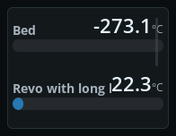

| Setting | Shown as | Takes | Default |
| --- | --- | --- | --- |
| `list` | List (a name) | text, up to 120 bytes | `om.heat.heaters` |
| `title` | Title | text, up to 120 bytes | `om.sensors.analog[{row.sensor}].name|default:tr.temperature.heater:{row.index}` |
| `value` | Value (a name) | text, up to 120 bytes | `row.current|int` |
| `text` | Value shown (a name) | text, up to 120 bytes | `row.current|fixed:1` |
| `unit` | Unit | text, up to 12 bytes, given as a constant | `°C` |
| `min` | Minimum | int, -100000 to 100000 | `0` |
| `max` | Maximum | int, -100000 to 100000 | `300` |
| `target` | Target (a name) | text, up to 120 bytes | `row.value|heater_target` |
| `look` | Look | one of `bar`, `arc`, `value` | `bar` |
| `flow` | Arrangement | one of `column`, `row`, `pages` | `column` |
| `tap_action` | On tap | an action offered to users, or none | `` |
| `tap_arg` | On tap: argument | text, up to 120 bytes | `` |
| `hold_action` | On hold | an action offered to users, or none | `` |
| `hold_arg` | On hold: argument | text, up to 120 bytes | `` |

#### custom_value

**Custom number**: Any value the printer reports, by its object model name, doing what you choose when tapped or held

In Gauges; placed in `dashboard`; component `gauge_value` ([custom_value.json](../assets/ui/widgets/gauges/custom_value.json)). In a free layout it is 180×89 px, and at least 134×89 px.

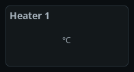

At its smallest, 134×89 px:

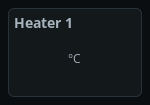

| Setting | Shown as | Takes | Default |
| --- | --- | --- | --- |
| `title` | Title | text, up to 40 bytes, given as a constant | `Heater 1` |
| `value` | Value (a name) | text, up to 120 bytes | `om.heat.heaters[1].current|int` |
| `text` | Value shown (a name) | text, up to 120 bytes | `om.heat.heaters[1].current|fixed:1` |
| `unit` | Unit | text, up to 12 bytes, given as a constant | `°C` |
| `detail` | Detail | text, up to 40 bytes, given as a constant | `` |
| `tap_action` | On tap | an action offered to users, or none | `` |
| `tap_arg` | On tap: argument | text, up to 120 bytes | `` |
| `hold_action` | On hold | an action offered to users, or none | `` |
| `hold_arg` | On hold: argument | text, up to 120 bytes | `` |

#### estop

**E-stop**: Drag across to stop the printer at once

In Safety; placed in `sidebar`, `dashboard`; component `sidebar_estop` ([estop.json](../assets/ui/widgets/safety/estop.json)). In a free layout it is 40×40 px, and at least 40×40 px.


#### extrude

**Extrude**: Extrude or retract with the selected tool

In Motion; placed in `dashboard`; component `card_view` ([extrude.json](../assets/ui/widgets/motion/extrude.json)). In a free layout it is 319×420 px, and at least 272×372 px.


At its smallest, 272×372 px:

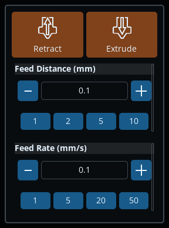

#### extrusion_arc

**Extrusion factor arc**: The extrusion factor; tap to change it

In Motion; placed in `dashboard`; component `gauge_arc` ([extrusion_arc.json](../assets/ui/widgets/gauges/extrusion_arc.json)). In a free layout it is 180×184 px, and at least 134×136 px.

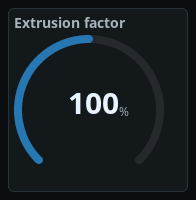

At its smallest, 134×136 px:

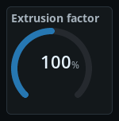

#### extrusion_bar

**Extrusion factor bar**: The extrusion factor; tap to change it

In Motion; placed in `dashboard`; component `gauge_bar` ([extrusion_bar.json](../assets/ui/widgets/gauges/extrusion_bar.json)). In a free layout it is 272×89 px, and at least 180×89 px.

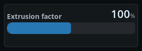

At its smallest, 180×89 px:

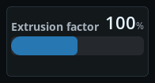

#### extrusion_value

**Extrusion factor number**: The extrusion factor; tap to change it

In Motion; placed in `dashboard`; component `gauge_value` ([extrusion_value.json](../assets/ui/widgets/gauges/extrusion_value.json)). In a free layout it is 180×89 px, and at least 134×89 px.

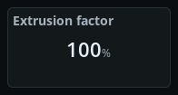

At its smallest, 134×89 px:

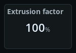

#### fan

**Fan**: One fan's speed, to change it

In Fans; placed in `dashboard`; component `dashboard_fan` ([fan.json](../assets/ui/widgets/fans/fan.json)). In a free layout it is 458×89 px, and at least 365×89 px.


At its smallest, 365×89 px:

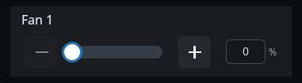

| Setting | Shown as | Takes | Default |
| --- | --- | --- | --- |
| `fan` | Fan | a row of `om.fans`, by its `index`, shown by its `name\|default:tr.fine_tune.fan` | `0` |

#### fan_arc

**Fan arc**: A fan's speed, with its RPM; tap to set the speed

In Fans; placed in `dashboard`; component `gauge_fans` ([fan_arc.json](../assets/ui/widgets/gauges/fan_arc.json)). In a free layout it is 180×184 px, and at least 134×136 px.

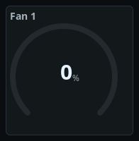

At its smallest, 134×136 px:

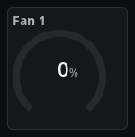

| Setting | Shown as | Takes | Default |
| --- | --- | --- | --- |
| `match` | Fan | a row of `om.fans`, by its `index`, shown by its `name\|default:tr.fine_tune.fan` | `0` |

#### fan_bar

**Fan bar**: A fan's speed, with its RPM; tap to set the speed

In Fans; placed in `dashboard`; component `gauge_fans` ([fan_bar.json](../assets/ui/widgets/gauges/fan_bar.json)). In a free layout it is 272×89 px, and at least 180×89 px.

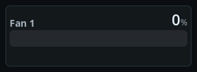

At its smallest, 180×89 px:

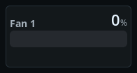

| Setting | Shown as | Takes | Default |
| --- | --- | --- | --- |
| `match` | Fan | a row of `om.fans`, by its `index`, shown by its `name\|default:tr.fine_tune.fan` | `0` |

#### fan_gauges

**Fan gauges**: Every fan's speed, in a column, a row, or one at a time

In Fans; placed in `dashboard`; component `gauge_fans` ([fan_gauges.json](../assets/ui/widgets/gauges/fan_gauges.json)). In a free layout it is 272×277 px, and at least 180×136 px.

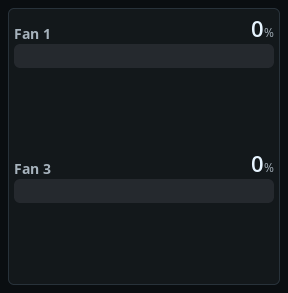

At its smallest, 180×136 px:


| Setting | Shown as | Takes | Default |
| --- | --- | --- | --- |
| `look` | Look | one of `bar`, `arc`, `value` | `bar` |
| `flow` | Arrangement | one of `column`, `row`, `pages` | `column` |

#### fan_value

**Fan number**: A fan's speed, with its RPM; tap to set the speed

In Fans; placed in `dashboard`; component `gauge_fans` ([fan_value.json](../assets/ui/widgets/gauges/fan_value.json)). In a free layout it is 180×89 px, and at least 134×89 px.


At its smallest, 134×89 px:


| Setting | Shown as | Takes | Default |
| --- | --- | --- | --- |
| `match` | Fan | a row of `om.fans`, by its `index`, shown by its `name\|default:tr.fine_tune.fan` | `0` |

#### fans

**Fans**: Every fan's speed, to change them

In Fans; placed in `dashboard`; component `fans` ([fans.json](../assets/ui/widgets/fans/fans.json)). In a free layout it is 458×278 px, and at least 365×184 px.


At its smallest, 365×184 px:


#### files

**Jobs, macros and status**: The jobs, macros and the job's status, as tabs

In Jobs; placed in `dashboard`; component `dashboard_files` ([files.json](../assets/ui/widgets/jobs/files.json)). In a free layout it is 365×561 px, and at least 272×278 px.


At its smallest, 272×278 px:


#### gcode_button

**G-code button**: Sends the G-code you choose, e.g. M98 P"0:/macros/name" to run a macro

In Commands; placed in `dashboard`; component `dashboard_button` ([gcode_button.json](../assets/ui/widgets/commands/gcode_button.json)). In a free layout it is 180×89 px, and at least 88×89 px.


At its smallest, 88×89 px:


| Setting | Shown as | Takes | Default |
| --- | --- | --- | --- |
| `label` | Label | text, up to 32 bytes | `Home` |
| `tap_arg` | G-code | text, up to 120 bytes | `G28` |

#### heater_gauges

**Heater gauges**: Every heater's temperature, in a column, a row, or one at a time

In Temperatures; placed in `dashboard`; component `gauge_heaters` ([heater_gauges.json](../assets/ui/widgets/gauges/heater_gauges.json)). In a free layout it is 272×277 px, and at least 180×136 px.


At its smallest, 180×136 px:


| Setting | Shown as | Takes | Default |
| --- | --- | --- | --- |
| `look` | Look | one of `bar`, `arc`, `value` | `bar` |
| `flow` | Arrangement | one of `column`, `row`, `pages` | `column` |

#### heightmap

**Bed**: The bed's height map, levelling and probing

In Motion; placed in `dashboard`; component `heightmap` ([heightmap.json](../assets/ui/widgets/motion/heightmap.json)). In a free layout it is 642×467 px, and at least 550×372 px.


At its smallest, 550×372 px:


#### job

**Job**: The job: what is ready to start (the last job, the newest jobs and the macros), and the job's status once one starts

In Jobs; placed in `dashboard`; component `dashboard_job` ([job.json](../assets/ui/widgets/jobs/job.json)). In a free layout it is 365×561 px, and at least 272×278 px.


At its smallest, 272×278 px:


| Setting | Shown as | Takes | Default |
| --- | --- | --- | --- |
| `macros` | Macros shown | int, 0 to 20 | `4` |

#### job_progress

**Job progress**: The job's file, progress, time taken and time left

In Jobs; placed in `dashboard`; component `dashboard_job_progress` ([job_progress.json](../assets/ui/widgets/jobs/job_progress.json)). In a free layout it is 365×89 px, and at least 272×89 px.


At its smallest, 272×89 px:


#### job_status

**Status**: The job's progress, times and controls

In Jobs; placed in `dashboard`; component `card_view` ([job_status.json](../assets/ui/widgets/jobs/job_status.json)). In a free layout it is 365×372 px, and at least 365×372 px.


#### jobs

**Jobs**: The jobs on the printer, to start one

In Jobs; placed in `dashboard`; component `card_view` ([jobs.json](../assets/ui/widgets/jobs/jobs.json)). In a free layout it is 365×372 px, and at least 272×184 px.


At its smallest, 272×184 px:


#### jog_choices

**Jog distance and speed**: How far and how fast every jog goes; hold one to change it

In Motion; placed in `dashboard`; component `move_jog_choices` ([jog_choices.json](../assets/ui/widgets/motion/jog_choices.json)). In a free layout it is 642×136 px, and at least 642×136 px.


#### jog_xy

**XY jog**: Jog and home X and Y, home all and disable the motors

In Motion; placed in `dashboard`; component `move_xy_card` ([jog_xy.json](../assets/ui/widgets/motion/jog_xy.json)). In a free layout it is 272×278 px, and at least 180×184 px.


At its smallest, 180×184 px:


#### jog_z

**Z jog**: Jog Z up and down, home it, or move it to a position

In Motion; placed in `dashboard`; component `move_z_card` ([jog_z.json](../assets/ui/widgets/motion/jog_z.json)). In a free layout it is 134×278 px, and at least 88×231 px.


At its smallest, 88×231 px:


#### macros

**Macros**: The printer's macros, to run one

In Jobs; placed in `dashboard`; component `card_view` ([macros.json](../assets/ui/widgets/jobs/macros.json)). In a free layout it is 365×372 px, and at least 272×184 px.


At its smallest, 272×184 px:


#### move

**Move**: The Move tab: jog and home every axis, babystep, and choose the jog distance and speed

In Motion; placed in `dashboard`; component `move` ([move.json](../assets/ui/widgets/motion/move.json)). In a free layout it is 920×467 px, and at least 920×420 px.


At its smallest, 920×420 px:


#### object_cancel

**Objects**: The job's objects, to cancel one

In Jobs; placed in `dashboard`; component `object_cancel` ([object_cancel.json](../assets/ui/widgets/jobs/object_cancel.json)). In a free layout it is 642×467 px, and at least 458×278 px.


At its smallest, 458×278 px:


#### page_console

**Console**: Opens the console; flashes when the printer replies

In Navigation; placed in `sidebar`; component `sidebar_page_button` ([page_console.json](../assets/ui/widgets/navigation/page_console.json)).


#### page_control

**Control**: Opens the controls: moving, temperatures, fans

In Navigation; placed in `sidebar`; component `sidebar_page_button` ([page_control.json](../assets/ui/widgets/navigation/page_control.json)).


#### page_files

**Files**: Opens the jobs and macros

In Navigation; placed in `sidebar`; component `sidebar_page_button` ([page_files.json](../assets/ui/widgets/navigation/page_files.json)).


#### page_home

**Dashboard**: Opens the dashboard

In Navigation; placed in `sidebar`; component `sidebar_page_button` ([page_home.json](../assets/ui/widgets/navigation/page_home.json)).


#### page_settings

**Settings**: Opens the settings

In Navigation; placed in `sidebar`; component `sidebar_page_button` ([page_settings.json](../assets/ui/widgets/navigation/page_settings.json)).


#### progress_arc

**Progress arc**: The job's progress

In Jobs; placed in `dashboard`; component `gauge_arc` ([progress_arc.json](../assets/ui/widgets/gauges/progress_arc.json)). In a free layout it is 180×184 px, and at least 134×136 px.


At its smallest, 134×136 px:


#### progress_bar

**Progress bar**: The job's progress

In Jobs; placed in `dashboard`; component `gauge_bar` ([progress_bar.json](../assets/ui/widgets/gauges/progress_bar.json)). In a free layout it is 272×89 px, and at least 180×89 px.


At its smallest, 180×89 px:


#### progress_value

**Progress number**: The job's progress

In Jobs; placed in `dashboard`; component `gauge_value` ([progress_value.json](../assets/ui/widgets/gauges/progress_value.json)). In a free layout it is 180×89 px, and at least 134×89 px.


At its smallest, 134×89 px:


#### sensor_arc

**Sensor arc**: An analog sensor's reading

In Temperatures; placed in `dashboard`; component `gauge_sensors` ([sensor_arc.json](../assets/ui/widgets/gauges/sensor_arc.json)). In a free layout it is 180×184 px, and at least 134×136 px.


At its smallest, 134×136 px:


| Setting | Shown as | Takes | Default |
| --- | --- | --- | --- |
| `match` | Sensor | a row of `om.sensors.analog`, by its `index`, shown by its `name\|default:tr.widget.gauge_sensor` | `0` |

#### sensor_bar

**Sensor bar**: An analog sensor's reading

In Temperatures; placed in `dashboard`; component `gauge_sensors` ([sensor_bar.json](../assets/ui/widgets/gauges/sensor_bar.json)). In a free layout it is 272×89 px, and at least 180×89 px.


At its smallest, 180×89 px:


| Setting | Shown as | Takes | Default |
| --- | --- | --- | --- |
| `match` | Sensor | a row of `om.sensors.analog`, by its `index`, shown by its `name\|default:tr.widget.gauge_sensor` | `0` |

#### sensor_gauges

**Sensor gauges**: Every analog sensor's reading, in a column, a row, or one at a time

In Temperatures; placed in `dashboard`; component `gauge_sensors` ([sensor_gauges.json](../assets/ui/widgets/gauges/sensor_gauges.json)). In a free layout it is 272×277 px, and at least 180×136 px.


At its smallest, 180×136 px:


| Setting | Shown as | Takes | Default |
| --- | --- | --- | --- |
| `look` | Look | one of `bar`, `arc`, `value` | `bar` |
| `flow` | Arrangement | one of `column`, `row`, `pages` | `column` |

#### sensor_value

**Sensor number**: An analog sensor's reading

In Temperatures; placed in `dashboard`; component `gauge_sensors` ([sensor_value.json](../assets/ui/widgets/gauges/sensor_value.json)). In a free layout it is 180×89 px, and at least 134×89 px.


At its smallest, 134×89 px:


| Setting | Shown as | Takes | Default |
| --- | --- | --- | --- |
| `match` | Sensor | a row of `om.sensors.analog`, by its `index`, shown by its `name\|default:tr.widget.gauge_sensor` | `0` |

#### sidebar_button

**Button**: A sidebar button that does what you choose when tapped or held

In Commands; placed in `sidebar`; component `sidebar_button` ([sidebar_button.json](../assets/ui/widgets/commands/sidebar_button.json)).


| Setting | Shown as | Takes | Default |
| --- | --- | --- | --- |
| `label` | Label | text, up to 32 bytes | `Babystep` |
| `icon` | Icon | one of `send.png`, `home_axis.png`, `macros.png`, `move.png`, `extrude.png`, `retract.png`, `temperature.png`, `fine_tune.png`, `heightmap.png`, `babystep.png`, `disable_motors.png`, `pause.png`, `resume.png`, `cancel.png`, `print_again.png`, `status.png` | `babystep.png` |
| `tap_action` | On tap | an action offered to users, or none | `actions.babystep.open` |
| `tap_arg` | On tap: argument | text, up to 120 bytes | `` |
| `hold_action` | On hold | an action offered to users, or none | `` |
| `hold_arg` | On hold: argument | text, up to 120 bytes | `` |

#### sidebar_gcode

**G-code button**: A sidebar button that sends the G-code you choose

In Commands; placed in `sidebar`; component `sidebar_button` ([sidebar_gcode.json](../assets/ui/widgets/commands/sidebar_gcode.json)).


| Setting | Shown as | Takes | Default |
| --- | --- | --- | --- |
| `label` | Label | text, up to 32 bytes | `Home` |
| `icon` | Icon | one of `send.png`, `home_axis.png`, `macros.png`, `move.png`, `extrude.png`, `retract.png`, `temperature.png`, `fine_tune.png`, `heightmap.png`, `babystep.png`, `disable_motors.png`, `pause.png`, `resume.png`, `cancel.png`, `print_again.png`, `status.png` | `send.png` |
| `tap_arg` | G-code | text, up to 120 bytes | `G28` |

#### speed_arc

**Speed factor arc**: The speed factor; tap to change it

In Motion; placed in `dashboard`; component `gauge_arc` ([speed_arc.json](../assets/ui/widgets/gauges/speed_arc.json)). In a free layout it is 180×184 px, and at least 134×136 px.


At its smallest, 134×136 px:


#### speed_bar

**Speed factor bar**: The speed factor; tap to change it

In Motion; placed in `dashboard`; component `gauge_bar` ([speed_bar.json](../assets/ui/widgets/gauges/speed_bar.json)). In a free layout it is 272×89 px, and at least 180×89 px.


At its smallest, 180×89 px:


#### speed_value

**Speed factor number**: The speed factor; tap to change it

In Motion; placed in `dashboard`; component `gauge_value` ([speed_value.json](../assets/ui/widgets/gauges/speed_value.json)). In a free layout it is 180×89 px, and at least 134×89 px.


At its smallest, 134×89 px:


#### status_button

**Button**: A small button that does what you choose when tapped or held

In Commands; placed in `status_bar`; component `status_bar_button` ([status_button.json](../assets/ui/widgets/commands/status_button.json)).


| Setting | Shown as | Takes | Default |
| --- | --- | --- | --- |
| `label` | Label | text, up to 32 bytes | `Babystep` |
| `tap_action` | On tap | an action offered to users, or none | `actions.babystep.open` |
| `tap_arg` | On tap: argument | text, up to 120 bytes | `` |
| `hold_action` | On hold | an action offered to users, or none | `` |
| `hold_arg` | On hold: argument | text, up to 120 bytes | `` |

#### status_extrusion

**Extrusion factor**: Shows the extrusion factor; tap to change it

In Motion; placed in `status_bar`; component `status_bar_factor_button` ([status_extrusion.json](../assets/ui/widgets/motion/status_extrusion.json)).


#### status_gcode

**G-code button**: A small button that sends the G-code you choose

In Commands; placed in `status_bar`; component `status_bar_button` ([status_gcode.json](../assets/ui/widgets/commands/status_gcode.json)).


| Setting | Shown as | Takes | Default |
| --- | --- | --- | --- |
| `label` | Label | text, up to 32 bytes | `G28` |
| `tap_arg` | G-code | text, up to 120 bytes | `G28` |

#### status_speed

**Speed factor**: Shows the speed factor; tap to change it

In Motion; placed in `status_bar`; component `status_bar_factor_button` ([status_speed.json](../assets/ui/widgets/motion/status_speed.json)).


#### temperature_graph

**Temperature graph**: Every heater's temperature over the last minutes

In Temperatures; placed in `dashboard`; component `dashboard_temperature_graph` ([temperature_graph.json](../assets/ui/widgets/temperature/temperature_graph.json)). In a free layout it is 550×278 px, and at least 272×184 px.


At its smallest, 272×184 px:


| Setting | Shown as | Takes | Default |
| --- | --- | --- | --- |
| `seconds` | Time shown | one of `30`, `60`, `120`, `300`, `600` | `60` |
| `legend` | Legend | one of `auto`, `shown`, `hidden` | `auto` |

#### temperatures

**Temperatures**: The Temperature tab: every tool, bed and chamber, filament, and the extruder

In Temperatures; placed in `dashboard`; component `temperature` ([temperatures.json](../assets/ui/widgets/temperature/temperatures.json)). In a free layout it is 920×561 px, and at least 735×467 px.


At its smallest, 735×467 px:


#### text

**Text**: Text you write, in the size and colour you choose

In Text; placed in `dashboard`; component `dashboard_text` ([text.json](../assets/ui/widgets/text/text.json)). In a free layout it is 272×89 px, and at least 88×42 px.


At its smallest, 88×42 px:


| Setting | Shown as | Takes | Default |
| --- | --- | --- | --- |
| `text` | Value shown (a name) | text, up to 120 bytes | `Printer` |
| `size` | Text size | one of `small`, `normal`, `emphasis`, `header`, `large`, `xlarge`, `huge` | `header` |
| `colour` | Colour | one of `text`, `text_muted`, `primary`, `secondary`, `success`, `warning`, `error` | `text` |
| `align` | Alignment | one of `left`, `center`, `right` | `center` |
| `background` | Background | one of `card`, `base` | `card` |

#### tool

**Tool**: One tool with its heaters' temperatures

In Temperatures; placed in `dashboard`; component `dashboard_tool_card` ([tool.json](../assets/ui/widgets/temperature/tool.json)). In a free layout it is 550×184 px, and at least 458×184 px.


At its smallest, 458×184 px:


| Setting | Shown as | Takes | Default |
| --- | --- | --- | --- |
| `tool` | Tool | a row of `om.tools`, by its `index`, shown by its `name\|default:tr.temperature.default_tool_name` | `0` |

#### tool_arc

**Tool arc**: A tool's heater, heading for its target; tap to set the target

In Temperatures; placed in `dashboard`; component `gauge_tool` ([tool_arc.json](../assets/ui/widgets/gauges/tool_arc.json)). In a free layout it is 180×184 px, and at least 134×136 px.


At its smallest, 134×136 px:


| Setting | Shown as | Takes | Default |
| --- | --- | --- | --- |
| `tool` | Tool | a row of `om.tools`, by its `index`, shown by its `name\|default:tr.temperature.default_tool_name` | `0` |
| `match` | Heater of the tool (from 0) | int, 0 to 7 | `0` |

#### tool_bar

**Tool bar**: A tool's heater, heading for its target; tap to set the target

In Temperatures; placed in `dashboard`; component `gauge_tool` ([tool_bar.json](../assets/ui/widgets/gauges/tool_bar.json)). In a free layout it is 272×89 px, and at least 180×89 px.


At its smallest, 180×89 px:


| Setting | Shown as | Takes | Default |
| --- | --- | --- | --- |
| `tool` | Tool | a row of `om.tools`, by its `index`, shown by its `name\|default:tr.temperature.default_tool_name` | `0` |
| `match` | Heater of the tool (from 0) | int, 0 to 7 | `0` |

#### tool_value

**Tool number**: A tool's heater, heading for its target; tap to set the target

In Temperatures; placed in `dashboard`; component `gauge_tool` ([tool_value.json](../assets/ui/widgets/gauges/tool_value.json)). In a free layout it is 180×89 px, and at least 134×89 px.


At its smallest, 134×89 px:


| Setting | Shown as | Takes | Default |
| --- | --- | --- | --- |
| `tool` | Tool | a row of `om.tools`, by its `index`, shown by its `name\|default:tr.temperature.default_tool_name` | `0` |
| `match` | Heater of the tool (from 0) | int, 0 to 7 | `0` |

#### tools

**Tools and heaters**: Every tool, bed and chamber with its temperatures

In Temperatures; placed in `dashboard`; component `dashboard_tools` ([tools.json](../assets/ui/widgets/temperature/tools.json)). In a free layout it is 550×278 px, and at least 458×184 px.


At its smallest, 458×184 px:


| Setting | Shown as | Takes | Default |
| --- | --- | --- | --- |
| `style` | Style | one of `0`, `1`, `2` | `0` |

## Components

The components of the built-in bundle. A user bundle replaces one by giving its own the same name; a component is used as an element (`<fan_row/>`) or as a list's `item`.

| Component | Presenter | Props | Used by | File |
| --- | --- | --- | --- | --- |
| [`babystep`](#babystep) |  | `hide_title` | `babystep_dialog`, `move` | [babystep.xml](../assets/ui/components/common/babystep.xml) |
| `babystep_dialog` |  |  | `home` | [babystep_dialog.xml](../assets/ui/components/modals/babystep_dialog.xml) |
| `card_view` |  | `view`, `presenter` | `babystep`, `extrude`, `job_status`, `jobs`, `macros` | [card_view.xml](../assets/ui/components/common/card_view.xml) |
| `chevron` |  |  | `customise_setting`, `job_ready`, `job_recent_row` | [chevron.xml](../assets/ui/components/common/chevron.xml) |
| `chevron_button` |  |  | `settings_display`, `settings_wifi_network` | [chevron_button.xml](../assets/ui/components/common/chevron_button.xml) |
| [`console`](#console) | `gcode_reference` |  | `home`, `console` | [console.xml](../assets/ui/components/console/console.xml) |
| `console_command_list` | `gcode_reference` |  | `console_command_list` | [console_command_list.xml](../assets/ui/components/console/console_command_list.xml) |
| `console_gcode` |  |  | `console`, `console_command_list` | [console_gcode.xml](../assets/ui/components/console/console_gcode.xml) |
| `console_input` |  | `keyboard` | `console`, `console_input` | [console_input.xml](../assets/ui/components/console/console_input.xml) |
| `console_line` |  |  | `console`, `console_log` | [console_line.xml](../assets/ui/components/console/console_line.xml) |
| `console_log` |  |  | `console_log` | [console_log.xml](../assets/ui/components/console/console_log.xml) |
| `console_recent` |  |  | `console` | [console_recent.xml](../assets/ui/components/console/console_recent.xml) |
| [`control`](#control) |  |  | `home` | [control.xml](../assets/ui/components/control/control.xml) |
| [`customise`](#home) | `customise` |  | `home` | [customise.xml](../assets/ui/components/customise/customise.xml) |
| `customise_catalogue_category` |  |  | `customise` | [customise_catalogue_category.xml](../assets/ui/components/customise/customise_catalogue_category.xml) |
| `customise_catalogue_item` |  |  | `customise_catalogue_category` | [customise_catalogue_item.xml](../assets/ui/components/customise/customise_catalogue_item.xml) |
| `customise_corner_handle` |  | `key`, `corner` | `customise_free_item` | [customise_corner_handle.xml](../assets/ui/components/customise/customise_corner_handle.xml) |
| `customise_edge_handle` |  | `key`, `edge`, `bar_width`, `bar_height` | `customise_free_item` | [customise_edge_handle.xml](../assets/ui/components/customise/customise_edge_handle.xml) |
| [`customise_free_item`](#customise_free_item) |  | `key` |  | [customise_free_item.xml](../assets/ui/components/customise/customise_free_item.xml) |
| `customise_guide` |  |  |  | [customise_guide.xml](../assets/ui/components/customise/customise_guide.xml) |
| `customise_item` |  | `key` | `customise_free_item` | [customise_item.xml](../assets/ui/components/customise/customise_item.xml) |
| [`customise_missing`](#customise_missing) |  | `widget` |  | [customise_missing.xml](../assets/ui/components/customise/customise_missing.xml) |
| [`customise_place`](#customise_place) |  |  |  | [customise_place.xml](../assets/ui/components/customise/customise_place.xml) |
| `customise_saved_layout` |  |  | `customise` | [customise_saved_layout.xml](../assets/ui/components/customise/customise_saved_layout.xml) |
| `customise_setting` |  |  | `customise` | [customise_setting.xml](../assets/ui/components/customise/customise_setting.xml) |
| [`dashboard`](#home) |  |  | `home` | [dashboard.xml](../assets/ui/components/dashboard/dashboard.xml) |
| `dashboard_button` |  | `label`, `tap_action`, `tap_arg`, `hold_action`, `hold_arg` | `button`, `gcode_button` | [dashboard_button.xml](../assets/ui/components/dashboard/dashboard_button.xml) |
| `dashboard_current_tool` |  |  | `current_tool` | [dashboard_current_tool.xml](../assets/ui/components/dashboard/dashboard_current_tool.xml) |
| `dashboard_fan` |  | `fan` | `fan` | [dashboard_fan.xml](../assets/ui/components/dashboard/dashboard_fan.xml) |
| `dashboard_files` |  |  | `files` | [dashboard_files.xml](../assets/ui/components/dashboard/dashboard_files.xml) |
| `dashboard_job` |  | `macros` | `job` | [dashboard_job.xml](../assets/ui/components/dashboard/dashboard_job.xml) |
| `dashboard_job_progress` |  |  | `job_progress` | [dashboard_job_progress.xml](../assets/ui/components/dashboard/dashboard_job_progress.xml) |
| [`dashboard_job_status`](#home) | `job_status` |  | `dashboard_files`, `dashboard_job` | [dashboard_job_status.xml](../assets/ui/components/dashboard/dashboard_job_status.xml) |
| `dashboard_temperature_graph` |  | `seconds`, `legend` | `temperature_graph` | [dashboard_temperature_graph.xml](../assets/ui/components/dashboard/dashboard_temperature_graph.xml) |
| `dashboard_text` |  | `text`, `size`, `colour`, `align`, `background` | `text` | [dashboard_text.xml](../assets/ui/components/dashboard/dashboard_text.xml) |
| `dashboard_tool_card` |  | `tool` | `tool` | [dashboard_tool_card.xml](../assets/ui/components/dashboard/dashboard_tool_card.xml) |
| `dashboard_tool_tile` |  |  | `dashboard_tools` | [dashboard_tool_tile.xml](../assets/ui/components/dashboard/dashboard_tool_tile.xml) |
| `dashboard_tool_tile_heater` |  |  | `dashboard_tool_tile` | [dashboard_tool_tile_heater.xml](../assets/ui/components/dashboard/dashboard_tool_tile_heater.xml) |
| `dashboard_tools` |  | `style` | `tools` | [dashboard_tools.xml](../assets/ui/components/dashboard/dashboard_tools.xml) |
| `dialog_choice` | `dialog_choice` |  |  | [dialog_choice.xml](../assets/ui/components/dialogs/dialog_choice.xml) |
| `dialog_choice_row` |  |  | `dialog_choice` | [dialog_choice_row.xml](../assets/ui/components/dialogs/dialog_choice_row.xml) |
| [`dialog_host`](#dialog_host) | `dialog_host` |  |  | [dialog_host.xml](../assets/ui/components/dialogs/dialog_host.xml) |
| [`dialog_number`](#dialog_number) | `dialog_number` |  |  | [dialog_number.xml](../assets/ui/components/dialogs/dialog_number.xml) |
| `dialog_number_preset` |  |  | `dialog_number` | [dialog_number_preset.xml](../assets/ui/components/dialogs/dialog_number_preset.xml) |
| [`dialog_question`](#dialog_question) | `dialog_question` |  |  | [dialog_question.xml](../assets/ui/components/dialogs/dialog_question.xml) |
| `fact_row` |  | `title_tag`, `value` | `file_dialog`, `heightmap` | [fact_row.xml](../assets/ui/components/common/fact_row.xml) |
| `factors` |  |  | `home` | [factors.xml](../assets/ui/components/modals/factors.xml) |
| `factors_dialog` |  | `open`, `title`, `factors`, `all`, `all_shown` | `factors` | [factors_dialog.xml](../assets/ui/components/modals/factors_dialog.xml) |
| `factors_preset` |  |  | `factors_row` | [factors_preset.xml](../assets/ui/components/modals/factors_preset.xml) |
| `factors_row` |  |  | `factors_dialog` | [factors_row.xml](../assets/ui/components/modals/factors_row.xml) |
| `fan_row` |  | `automatic` | `dashboard_fan`, `fans` | [fan_row.xml](../assets/ui/components/control/fans/fan_row.xml) |
| [`fans`](#fans) |  |  | `control`, `fans` | [fans.xml](../assets/ui/components/control/fans/fans.xml) |
| [`file_browser`](#files) |  |  | `dashboard_files`, `files` | [file_browser.xml](../assets/ui/components/file_browser/file_browser.xml) |
| `file_browser_crumb` |  |  | `file_browser` | [file_browser_crumb.xml](../assets/ui/components/file_browser/file_browser_crumb.xml) |
| `file_browser_row` |  |  | `file_browser` | [file_browser_row.xml](../assets/ui/components/file_browser/file_browser_row.xml) |
| `file_browser_tile` |  |  | `file_browser` | [file_browser_tile.xml](../assets/ui/components/file_browser/file_browser_tile.xml) |
| `file_dialog` |  |  | `home` | [file_dialog.xml](../assets/ui/components/modals/file_dialog.xml) |
| [`files`](#files) |  |  | `home` | [files.xml](../assets/ui/components/files/files.xml) |
| `flex_pad` |  | `grow` | `dashboard_job_status`, `file_browser`, `file_dialog`, `hardware_test`, `move`, `notifications`, `temperature_tool` | [flex_pad.xml](../assets/ui/components/common/flex_pad.xml) |
| `gauge_arc` |  | `shown`, `title`, `value`, `text`, `unit`, `min`, `max`, `target`, `detail`, `state`, `grow`, `portrait`, `frame`, `tap_action`, `tap_arg`, `hold_action`, `hold_arg` | `custom_arc`, `extrusion_arc`, `progress_arc`, `speed_arc` | [gauge_arc.xml](../assets/ui/components/gauge/gauge_arc.xml) |
| `gauge_bar` |  | `shown`, `title`, `value`, `text`, `unit`, `min`, `max`, `target`, `detail`, `state`, `grow`, `portrait`, `frame`, `tap_action`, `tap_arg`, `hold_action`, `hold_arg` | `custom_bar`, `extrusion_bar`, `progress_bar`, `speed_bar` | [gauge_bar.xml](../assets/ui/components/gauge/gauge_bar.xml) |
| `gauge_beds` |  | `key`, `match`, `look`, `flow`, `grow`, `portrait` | `bed_arc`, `bed_bar`, `bed_value` | [gauge_beds.xml](../assets/ui/components/gauge/gauge_beds.xml) |
| `gauge_chambers` |  | `key`, `match`, `look`, `flow`, `grow`, `portrait` | `chamber_arc`, `chamber_bar`, `chamber_value` | [gauge_chambers.xml](../assets/ui/components/gauge/gauge_chambers.xml) |
| `gauge_fans` |  | `key`, `match`, `look`, `flow`, `grow`, `portrait` | `fan_arc`, `fan_bar`, `fan_gauges`, `fan_value` | [gauge_fans.xml](../assets/ui/components/gauge/gauge_fans.xml) |
| `gauge_heater_slots` |  | `list`, `title`, `key`, `match`, `look`, `flow`, `grow`, `portrait` | `gauge_beds`, `gauge_chambers`, `gauge_tool` | [gauge_heater_slots.xml](../assets/ui/components/gauge/gauge_heater_slots.xml) |
| `gauge_heaters` |  | `key`, `match`, `look`, `flow`, `grow`, `portrait` | `heater_gauges` | [gauge_heaters.xml](../assets/ui/components/gauge/gauge_heaters.xml) |
| `gauge_list` |  | `list`, `key`, `match`, `look`, `flow`, `frame`, `shown`, `title`, `value`, `text`, `unit`, `min`, `max`, `target`, `detail`, `state`, `grow`, `portrait`, `tap_action`, `tap_arg`, `hold_action`, `hold_arg` | `gauge_fans`, `gauge_heater_slots`, `gauge_heaters`, `gauge_sensors`, `custom_gauges` | [gauge_list.xml](../assets/ui/components/gauge/gauge_list.xml) |
| `gauge_reading` |  | `text`, `unit`, `grow` | `gauge_bar`, `gauge_readout` | [gauge_reading.xml](../assets/ui/components/gauge/gauge_reading.xml) |
| `gauge_readout` |  | `text`, `unit`, `grow`, `detail` | `gauge_arc`, `gauge_value` | [gauge_readout.xml](../assets/ui/components/gauge/gauge_readout.xml) |
| `gauge_sensors` |  | `key`, `match`, `look`, `flow`, `grow`, `portrait` | `sensor_arc`, `sensor_bar`, `sensor_gauges`, `sensor_value` | [gauge_sensors.xml](../assets/ui/components/gauge/gauge_sensors.xml) |
| `gauge_tool` |  | `tool`, `key`, `match`, `look`, `flow`, `grow`, `portrait` | `tool_arc`, `tool_bar`, `tool_value` | [gauge_tool.xml](../assets/ui/components/gauge/gauge_tool.xml) |
| `gauge_track` |  | `value`, `min`, `max`, `target`, `state` | `gauge_bar`, `heater_bar` | [gauge_track.xml](../assets/ui/components/gauge/gauge_track.xml) |
| `gauge_value` |  | `shown`, `title`, `value`, `text`, `unit`, `min`, `max`, `target`, `detail`, `state`, `grow`, `portrait`, `frame`, `tap_action`, `tap_arg`, `hold_action`, `hold_arg` | `custom_value`, `extrusion_value`, `progress_value`, `speed_value` | [gauge_value.xml](../assets/ui/components/gauge/gauge_value.xml) |
| [`hardware_test`](#hardware_test) | `hardware_test` |  |  | [hardware_test.xml](../assets/ui/components/hardware_test/hardware_test.xml) |
| `hardware_test_answers` |  | `action`, `usable` | `hardware_test` | [hardware_test_answers.xml](../assets/ui/components/hardware_test/hardware_test_answers.xml) |
| `hardware_test_result` |  |  | `hardware_test` | [hardware_test_result.xml](../assets/ui/components/hardware_test/hardware_test_result.xml) |
| `heater_bar` |  | `heater` | `dashboard_tool_tile_heater`, `dialog_number`, `heater_row` | [heater_bar.xml](../assets/ui/components/common/heater_bar.xml) |
| `heater_row` |  | `label`, `active`, `standby`, `compact` | `tools_slot_heater`, `tools_tool_heater` | [heater_row.xml](../assets/ui/components/common/heater_row.xml) |
| [`heightmap`](#heightmap) | `heightmap` |  | `control`, `heightmap` | [heightmap.xml](../assets/ui/components/control/heightmap/heightmap.xml) |
| [`home`](#home) |  |  |  | [home.xml](../assets/ui/components/home/home.xml) |
| [`home_main_window`](#home) |  |  | `home` | [home_main_window.xml](../assets/ui/components/home/home_main_window.xml) |
| `job_control` |  | `control`, `action`, `look` | `dashboard_job_status` | [job_control.xml](../assets/ui/components/dashboard/job_control.xml) |
| `job_detail` |  | `title_tag`, `value` | `dashboard_job_status` | [job_detail.xml](../assets/ui/components/dashboard/job_detail.xml) |
| `job_macro` |  |  | `job_ready` | [job_macro.xml](../assets/ui/components/dashboard/job_macro.xml) |
| [`job_ready`](#job_ready) |  | `macros` | `dashboard_job` | [job_ready.xml](../assets/ui/components/dashboard/job_ready.xml) |
| `job_recent_row` |  |  | `job_ready` | [job_recent_row.xml](../assets/ui/components/dashboard/job_recent_row.xml) |
| `list_header` |  | `title` | `temperature`, `value_selector` | [list_header.xml](../assets/ui/components/common/list_header.xml) |
| [`move`](#control) |  |  | `control`, `move` | [move.xml](../assets/ui/components/control/move/move.xml) |
| `move_axis` |  | `letter`, `usable`, `plus`, `minus` | `move`, `move_z_card` | [move_axis.xml](../assets/ui/components/control/move/move_axis.xml) |
| `move_axis_choice` |  |  | `move` | [move_axis_choice.xml](../assets/ui/components/control/move/move_axis_choice.xml) |
| `move_home_axis` |  |  | `move_homing` | [move_home_axis.xml](../assets/ui/components/control/move/move_home_axis.xml) |
| `move_homing` |  |  | `move` | [move_homing.xml](../assets/ui/components/control/move/move_homing.xml) |
| `move_jog_button` |  | `usable`, `jog` | `move_axis`, `move_xy` | [move_jog_button.xml](../assets/ui/components/control/move/move_jog_button.xml) |
| `move_jog_choices` |  |  | `move`, `jog_choices` | [move_jog_choices.xml](../assets/ui/components/control/move/move_jog_choices.xml) |
| `move_overrides` |  |  | `move` | [move_overrides.xml](../assets/ui/components/control/move/move_overrides.xml) |
| `move_position` |  |  | `move_positions` | [move_position.xml](../assets/ui/components/control/move/move_position.xml) |
| `move_positions` |  |  | `move`, `move_positions_card` | [move_positions.xml](../assets/ui/components/control/move/move_positions.xml) |
| `move_positions_card` |  |  | `axes` | [move_positions_card.xml](../assets/ui/components/control/move/move_positions_card.xml) |
| `move_work_zero` |  |  | `move` | [move_work_zero.xml](../assets/ui/components/control/move/move_work_zero.xml) |
| `move_workplace` |  | `number`, `column`, `row` | `move_work_zero` | [move_workplace.xml](../assets/ui/components/control/move/move_workplace.xml) |
| `move_xy` |  |  | `move`, `move_xy_card` | [move_xy.xml](../assets/ui/components/control/move/move_xy.xml) |
| `move_xy_card` |  |  | `jog_xy` | [move_xy_card.xml](../assets/ui/components/control/move/move_xy_card.xml) |
| `move_z_card` |  |  | `jog_z` | [move_z_card.xml](../assets/ui/components/control/move/move_z_card.xml) |
| `move_zero_axis` |  |  | `move_work_zero` | [move_zero_axis.xml](../assets/ui/components/control/move/move_zero_axis.xml) |
| [`notifications`](#home) | `notifications` |  | `home` | [notifications.xml](../assets/ui/components/notifications/notifications.xml) |
| `notifications_alert_axis` |  |  | `notifications` | [notifications_alert_axis.xml](../assets/ui/components/notifications/notifications_alert_axis.xml) |
| `notifications_alert_choice` |  |  | `notifications` | [notifications_alert_choice.xml](../assets/ui/components/notifications/notifications_alert_choice.xml) |
| `notifications_alert_jog` |  | `step` | `notifications_alert_axis` | [notifications_alert_jog.xml](../assets/ui/components/notifications/notifications_alert_jog.xml) |
| `numpad` |  | `pad` | `dialog_number`, `notifications` | [numpad.xml](../assets/ui/components/dialogs/numpad.xml) |
| `numpad_key` |  | `key`, `column`, `row`, `pad` | `numpad` | [numpad_key.xml](../assets/ui/components/dialogs/numpad_key.xml) |
| [`object_cancel`](#object_cancel) | `object_cancel` |  | `control`, `object_cancel` | [object_cancel.xml](../assets/ui/components/control/object_cancel/object_cancel.xml) |
| `object_cancel_key` |  | `title_tag`, `current`, `cancelled` | `object_cancel` | [object_cancel_key.xml](../assets/ui/components/control/object_cancel/object_cancel_key.xml) |
| `object_cancel_outline` |  |  | `object_cancel` | [object_cancel_outline.xml](../assets/ui/components/control/object_cancel/object_cancel_outline.xml) |
| `object_cancel_row` |  |  | `object_cancel` | [object_cancel_row.xml](../assets/ui/components/control/object_cancel/object_cancel_row.xml) |
| `option_button` |  | `subject`, `value`, `action`, `arg` | `factors_dialog`, `factors_preset`, `heightmap`, `settings_option`, `tools_current`, `tools_spindle_preset`, `value_selector_choice` | [option_button.xml](../assets/ui/components/common/option_button.xml) |
| [`settings`](#settings) |  |  | `home` | [settings.xml](../assets/ui/components/settings/settings.xml) |
| `settings_button` |  | `label_tag`, `action`, `danger` | `settings_developer`, `settings_display`, `settings_system`, `settings_wifi` | [settings_button.xml](../assets/ui/components/settings/settings_button.xml) |
| `settings_choice` |  | `title_tag`, `setting` | `settings_connection`, `settings_developer`, `settings_display`, `settings_general` | [settings_choice.xml](../assets/ui/components/settings/settings_choice.xml) |
| [`settings_connection`](#settings_connection) |  |  | `settings` | [settings_connection.xml](../assets/ui/components/settings/settings_connection.xml) |
| [`settings_developer`](#settings_developer) |  |  | `settings` | [settings_developer.xml](../assets/ui/components/settings/settings_developer.xml) |
| [`settings_display`](#settings_display) |  |  | `settings` | [settings_display.xml](../assets/ui/components/settings/settings_display.xml) |
| [`settings_general`](#settings) |  |  | `settings` | [settings_general.xml](../assets/ui/components/settings/settings_general.xml) |
| [`settings_notifications`](#settings_notifications) |  |  | `settings` | [settings_notifications.xml](../assets/ui/components/settings/settings_notifications.xml) |
| `settings_option` |  | `setting`, `value` | `settings_connection`, `settings_display`, `settings_general`, `settings_notifications` | [settings_option.xml](../assets/ui/components/settings/settings_option.xml) |
| [`settings_system`](#settings_system) |  |  | `settings` | [settings_system.xml](../assets/ui/components/settings/settings_system.xml) |
| [`settings_theme_preview`](#settings_theme_preview) | `settings_theme_preview` |  | `settings` | [settings_theme_preview.xml](../assets/ui/components/settings/settings_theme_preview.xml) |
| `settings_theme_swatch` |  |  | `settings_theme_preview` | [settings_theme_swatch.xml](../assets/ui/components/settings/settings_theme_swatch.xml) |
| `settings_toggle` |  | `setting` | `settings_developer`, `settings_display`, `settings_general`, `settings_notifications` | [settings_toggle.xml](../assets/ui/components/settings/settings_toggle.xml) |
| `settings_value` |  | `value` | `settings_system`, `settings_wifi` | [settings_value.xml](../assets/ui/components/settings/settings_value.xml) |
| [`settings_wifi`](#settings_connection) | `settings_wifi` |  | `settings_connection` | [settings_wifi.xml](../assets/ui/components/settings/settings_wifi.xml) |
| `settings_wifi_network` |  |  | `settings_wifi` | [settings_wifi_network.xml](../assets/ui/components/settings/settings_wifi_network.xml) |
| [`sidebar`](#home) |  |  | `home` | [sidebar.xml](../assets/ui/components/sidebar/sidebar.xml) |
| `sidebar_button` |  | `label`, `icon`, `tap_action`, `tap_arg`, `hold_action`, `hold_arg` | `sidebar_button`, `sidebar_gcode` | [sidebar_button.xml](../assets/ui/components/sidebar/sidebar_button.xml) |
| `sidebar_estop` |  |  | `estop` | [sidebar_estop.xml](../assets/ui/components/sidebar/sidebar_estop.xml) |
| `sidebar_page_button` |  | `page`, `action`, `label_tag`, `icon`, `flash` | `page_console`, `page_control`, `page_files`, `page_home`, `page_settings` | [sidebar_page_button.xml](../assets/ui/components/sidebar/sidebar_page_button.xml) |
| [`status_bar`](#home) |  |  | `home` | [status_bar.xml](../assets/ui/components/status_bar/status_bar.xml) |
| `status_bar_button` |  | `label`, `tap_action`, `tap_arg`, `hold_action`, `hold_arg` | `status_button`, `status_gcode` | [status_bar_button.xml](../assets/ui/components/status_bar/status_bar_button.xml) |
| `status_bar_factor_button` |  | `value`, `action` | `status_extrusion`, `status_speed` | [status_bar_factor_button.xml](../assets/ui/components/status_bar/status_bar_factor_button.xml) |
| `temperature` | `temperature` |  | `temperatures` | [temperature.xml](../assets/ui/components/control/temperature/temperature.xml) |
| `temperature_extruder` |  |  | `temperature_tool` | [temperature_extruder.xml](../assets/ui/components/control/temperature/temperature_extruder.xml) |
| [`temperature_extrusion`](#temperature_extrusion) |  |  | `temperature` | [temperature_extrusion.xml](../assets/ui/components/control/temperature/temperature_extrusion.xml) |
| `temperature_heater` |  | `label`, `active`, `standby` | `temperature_heater_card`, `temperature_tool_heater` | [temperature_heater.xml](../assets/ui/components/control/temperature/temperature_heater.xml) |
| `temperature_heater_card` |  | `label_tag` | `temperature` | [temperature_heater_card.xml](../assets/ui/components/control/temperature/temperature_heater_card.xml) |
| `temperature_tool` |  |  | `temperature` | [temperature_tool.xml](../assets/ui/components/control/temperature/temperature_tool.xml) |
| `temperature_tool_heater` |  |  | `temperature_tool` | [temperature_tool_heater.xml](../assets/ui/components/control/temperature/temperature_tool_heater.xml) |
| `thumbnail_box` |  | `src` | `dashboard_job_status`, `job_ready`, `job_recent_row` | [thumbnail_box.xml](../assets/ui/components/common/thumbnail_box.xml) |
| [`tools`](#tools) |  |  | `control` | [tools.xml](../assets/ui/components/control/tools/tools.xml) |
| `tools_beds` |  | `compact` | `dashboard_tools`, `tools_list` | [tools_beds.xml](../assets/ui/components/control/tools/tools_beds.xml) |
| `tools_current` |  |  | `tools` | [tools_current.xml](../assets/ui/components/control/tools/tools_current.xml) |
| `tools_extrusion_factor` |  |  | `tools_current` | [tools_extrusion_factor.xml](../assets/ui/components/control/tools/tools_extrusion_factor.xml) |
| `tools_list` |  | `compact` | `dashboard_tools`, `tools` | [tools_list.xml](../assets/ui/components/control/tools/tools_list.xml) |
| `tools_slot_heater` |  | `label_tag`, `compact` | `tools_beds` | [tools_slot_heater.xml](../assets/ui/components/control/tools/tools_slot_heater.xml) |
| `tools_spindle_preset` |  |  | `tools_current` | [tools_spindle_preset.xml](../assets/ui/components/control/tools/tools_spindle_preset.xml) |
| `tools_tool` |  | `compact` | `dashboard_current_tool`, `dashboard_tool_card`, `dashboard_tools`, `tools_list` | [tools_tool.xml](../assets/ui/components/control/tools/tools_tool.xml) |
| `tools_tool_heater` |  | `compact` | `tools_tool` | [tools_tool_heater.xml](../assets/ui/components/control/tools/tools_tool_heater.xml) |
| `value_button` |  | `title_tag`, `value`, `value_style` | `dashboard_job_status`, `heater_row` | [value_button.xml](../assets/ui/components/common/value_button.xml) |
| `value_selector` |  | `selector`, `title`, `value`, `choices` | `temperature_extrusion` | [value_selector.xml](../assets/ui/components/common/value_selector.xml) |
| `value_selector_choice` |  | `format` | `value_selector_presets` | [value_selector_choice.xml](../assets/ui/components/common/value_selector_choice.xml) |
| `value_selector_presets` |  | `choices` | `babystep`, `move_jog_choices`, `tools_current`, `value_selector` | [value_selector_presets.xml](../assets/ui/components/common/value_selector_presets.xml) |

### Views

The components shown as views of their own, drawn with sample printer data in the `duetscreen` theme. A view that shows in another's picture (the status bar in the home screen's) is pictured only there.

#### babystep


#### console


#### control

Also shows `move`.


#### customise_free_item


#### customise_missing


#### customise_place


#### dialog_host


#### dialog_number


#### dialog_question


#### fans


#### files

Also shows `file_browser`.


#### hardware_test


#### heightmap


#### home

Also shows `customise`, `dashboard`, `dashboard_job_status`, `home_main_window`, `notifications`, `sidebar`, `status_bar`.


#### job_ready


#### object_cancel


#### settings

Also shows `settings_general`.


#### settings_connection

Also shows `settings_wifi`.


#### settings_developer


#### settings_display


#### settings_notifications


#### settings_system


#### settings_theme_preview


#### temperature_extrusion


#### tools


## Theme

Themes are described in [XML_UI.md](XML_UI.md#themes), and every built-in theme, with what it changes and how it looks, in [XML_UI_THEMES.md](XML_UI_THEMES.md). Everything here follows theme changes.

### Styles

Used with `<style name="…"/>`. The definition is the one in the `base` theme, which every theme extends; other themes change some of them.

The swatch is a box with some text, with the style added, in the `duetscreen` theme; a style that changes nothing on its own (a state's, or a part's) has none.

| Style | Swatch | Definition in `base` |
| --- | --- | --- |
| `base` |  | bg_opa=0 border_post=true |
| `bg_dark` |  | bg_color=#bg_dark bg_opa=100% bg_grad_dir=none |
| `bg` |  | bg_color=#bg bg_opa=100% bg_grad_dir=none |
| `bg_light` |  | bg_color=#bg_light bg_opa=100% bg_grad_dir=none |
| `bg_color_primary` |  | bg_color=#primary bg_opa=100% bg_grad_dir=none |
| `bg_color_primary_muted` |  | bg_color=#primary_muted bg_opa=100% bg_grad_dir=none |
| `bg_color_secondary` |  | bg_color=#secondary bg_opa=100% bg_grad_dir=none |
| `bg_color_secondary_muted` |  | bg_color=#secondary_muted bg_opa=100% bg_grad_dir=none |
| `bg_color_success` |  | bg_color=#success bg_opa=100% bg_grad_dir=none |
| `bg_color_warning` |  | bg_color=#warning bg_opa=100% bg_grad_dir=none |
| `bg_color_error` |  | bg_color=#error bg_opa=100% bg_grad_dir=none |
| `bg_color_header` |  | bg_color=#bg_light bg_opa=100% |
| `bg_color_list_item` |  | bg_color=#bg bg_opa=100% bg_grad_color=#bg_light |
| `text` |  | text_color=#text text_font=font_normal |
| `text_muted` |  | text_color=#text_muted text_font=font_subdued |
| `text_emphasis` |  | text_color=#text text_font=font_emphasis |
| `text_header` |  | text_color=#text_header text_font=font_header |
| `text_warning` |  | text_color=#error text_font=font_emphasis |
| `border` |  | border_color=#border border_width=#border_width border_opa=100% border_side=full |
| `border_muted` |  | border_color=#border_muted border_width=#border_width border_opa=100% border_side=full |
| `border_highlight` |  | border_color=#highlight border_width=#border_width border_opa=100% border_side=full |
| `border_color_primary` |  | border_color=#primary border_width=#border_width border_opa=100% border_side=full |
| `border_color_secondary` |  | border_color=#secondary border_width=#border_width border_opa=100% border_side=full |
| `border_color_card` |  | *(not set)* |
| `screen` |  | bg_color=#bg_dark bg_opa=100% |
| `scrollbar` |  | bg_color=#border border_width=0 radius=circle pad_all=7dpx width=4dpx bg_opa=50% |
| `scrollbar_scrolled` |  | bg_opa=100% |
| `card` |  | radius=#radius pad_all=#pad pad_row=#pad_small pad_column=#pad_small bg_opa=100% bg_color=#bg border_color=#border_muted border_width=#border_width border_opa=100% border_side=full |
| `tab_card` |  | *(not set)* |
| `btn` |  | radius=#radius bg_opa=100% bg_color=#bg_light text_color=#text border_color=#border_muted border_width=#border_width border_opa=100% border_side=full min_width=25 min_height=25 |
| `btn_checked` |  | bg_color=#primary_muted bg_opa=100% bg_grad_dir=none outline_color=#primary outline_width=#outline_width outline_pad=-#outline_width outline_opa=100% |
| `icon` |  | *(not set)* |
| `icon_recolor` |  | recolor=#text recolor_opa=100% |
| `pressed` |  | recolor=0x000000 recolor_opa=35 |
| `disabled` |  | recolor=#bg recolor_opa=50% |
| `pad_base` |  | pad_all=#pad pad_row=#pad pad_column=#pad |
| `pad_zero` |  | pad_all=0 pad_row=0 pad_column=0 |
| `pad_tiny` |  | pad_all=#pad_tiny pad_row=#pad_tiny pad_column=#pad_tiny |
| `pad_small` |  | pad_all=#pad_small pad_gap=#pad_small |
| `pad_normal` |  | pad_all=#pad pad_row=#pad pad_column=#pad |
| `pad_large` |  | pad_all=#pad_large pad_row=#pad_large pad_column=#pad_large |
| `pad_gap` |  | pad_row=10dpx pad_column=10dpx |
| `line_space_large` |  | text_line_space=20dpx |
| `text_align_center` |  | text_align=center |
| `outline_primary` |  | outline_color=#primary outline_width=#outline_width outline_pad=#outline_width outline_opa=50% |
| `outline_secondary` |  | outline_color=#secondary outline_width=#outline_width outline_opa=50% |
| `circle` |  | radius=circle |
| `no_radius` |  | radius=0 |
| `no_border` |  | border_width=0 |
| `clip_corner` |  | clip_corner=true border_post=true |
| `rotary_scroll` |  | rotary_sensitivity=8192 |
| `grow` |  | transform_width=3dpx transform_height=3dpx |
| `transition_delayed` |  | *(not set)* |
| `transition_normal` |  | *(not set)* |
| `anim` |  | anim_duration=200 |
| `anim_fast` |  | anim_duration=120 |
| `action_btn` |  | bg_opa=100% bg_color=#primary border_color=#primary |
| `danger_btn` |  | bg_opa=100% bg_color=#error border_color=#error |
| `danger_outline_btn` |  | border_color=#error border_width=2 border_opa=100% text_color=#error |
| `input` |  | border_color=#border border_width=1 pad_hor=20 pad_ver=0 text_align=center |
| `long_press` |  | *(not set)* |
| `draggable` |  | transition_props=transform_width transform_height transition_duration=200ms transition_easing=ease_in_out transition_delay=100ms |
| `dragging` |  | transform_width=20 transform_height=20 border_color=0xffffff border_opa=30% border_width=20 transition_props=outline_width transition_duration=#transition_time transition_easing=ease_in_out |
| `drag_complete` |  | outline_color=0xffffff outline_width=3 |
| `knob` |  | bg_color=#primary bg_opa=100% pad_all=6dpx radius=circle |
| `arc_indic` |  | arc_color=#highlight arc_width=12dpx arc_rounded=true |
| `arc_indic_primary` |  | arc_color=#primary |
| `bar` |  | bg_color=#highlight bg_opa=100% radius=circle |
| `bar_indic` |  | radius=circle text_color=#text |
| `btnm_bg` |  | *(not set)* |
| `btnm_btn` |  | merge=border_muted bg_color=#bg_light bg_grad_dir=none shadow_width=0 radius=#radius |
| `btnm_btn_checked` |  | bg_color=#primary bg_opa=100% text_color=#text |
| `chart_series` |  | line_width=3dpx radius=3dpx width=8dpx height=8dpx pad_column=2dpx |
| `chart_indic` |  | radius=circle width=8dpx height=8dpx bg_color=#primary bg_opa=100% |
| `chart_bg` |  | border_width=#border_width border_color=#border_muted border_opa=100% border_post=false pad_column=10dpx line_color=#highlight line_opa=60% |
| `dropdown` |  | pad_ver=#pad |
| `dropdown_list` |  | max_height=260 |
| `cb_marker` |  | pad_all=3dpx border_width=2 border_color=#primary bg_color=#bg bg_opa=100% radius=3 |
| `cb_marker_checked` |  | bg_image_src=symbol_ok |
| `bg_switch` |  | bg_color=#highlight bg_opa=100% radius=circle |
| `switch_knob` |  | pad_all=-4dpx bg_color=0xffffff radius=circle shadow_width=4 shadow_offset_y=1 shadow_color=0x000000 shadow_opa=30% border_color=#border border_width=#border_width border_opa=100% |
| `line` |  | line_width=1 line_color=#highlight |
| `table` |  | radius=0 |
| `table_cell` |  | bg_color=#bg bg_opa=100% text_color=#text border_width=1dpx border_color=#border_muted border_side=top\|bottom |
| `text_area` |  | pad_all=#pad |
| `ta_cursor` |  | border_color=#text border_width=2dpx pad_left=-1dpx border_side=left anim_duration=400 |
| `ta_placeholder` |  | text_color=#text_muted |
| `calendar_btnm_bg` |  | pad_all=#pad_small pad_gap=1 |
| `calendar_btnm_day` |  | border_width=1dpx border_color=#highlight bg_color=#bg bg_opa=20% |
| `calendar_header` |  | pad_hor=#pad_small pad_top=#pad_small pad_bottom=#pad_tiny pad_gap=#pad_small |
| `canvas` |  | merge=bg merge=border |
| `menu_bg` |  | pad_all=0 pad_gap=0 radius=0 clip_corner=true border_side=none |
| `menu_cont` |  | pad_hor=#pad_small pad_ver=#pad_small pad_gap=#pad_small border_width=1dpx border_opa=10% border_color=#text border_side=none |
| `menu_sidebar_cont` |  | pad_all=0 pad_gap=0 border_width=1dpx border_opa=10% border_color=#text border_side=right |
| `menu_main_cont` |  | pad_all=0 pad_gap=0 |
| `menu_page` |  | pad_hor=0 pad_gap=0 |
| `menu_header_cont` |  | pad_hor=#pad_small pad_ver=#pad_tiny pad_gap=#pad_small |
| `menu_header_btn` |  | pad_hor=#pad_tiny pad_ver=#pad_tiny shadow_opa=0 bg_opa=0 text_color=#text |
| `menu_section` |  | radius=#radius clip_corner=true bg_opa=100% bg_color=#bg text_color=#text |
| `menu_pressed` |  | bg_opa=20% bg_color=#bg_light |
| `menu_separator` |  | bg_opa=0 pad_ver=#pad_tiny |
| `msgbox_backdrop_bg` |  | *(not set)* |
| `keyboard_button` |  | merge=border_muted bg_color=#bg_light shadow_width=0 radius=#radius |
| `keyboard_button_checked_bg` |  | bg_color=#primary bg_opa=100% text_color=#text |
| `list_bg` |  | pad_hor=#pad pad_ver=0 pad_gap=0 clip_corner=true |
| `list_btn` |  | border_width=1 border_color=#border_muted border_side=bottom pad_all=#pad_small pad_column=#pad_small |
| `list_item_grow` |  | transform_width=#pad |
| `tab_bg_focus` |  | outline_pad=-#border_width |
| `tab_btn` |  | border_color=#primary border_width=3 border_side=bottom outline_width=0 |
| `led` |  | bg_opa=100% bg_color=0xffffff bg_grad_color=#bg_dark radius=circle shadow_width=15dpx shadow_color=0xffffff shadow_spread=5dpx |
| `scale` |  | line_color=#text line_width=2dpx arc_color=#text arc_width=2dpx length=6dpx |
| `slider` |  | height=16 bg_color=#highlight bg_opa=100% radius=circle |
| `slider_indic` |  | bg_color=#primary radius=circle |
| `slider_knob` |  | radius=circle bg_color=0xffffff border_color=#primary border_width=3 |
| `sidebar` |  | *(not set)* |
| `sidebar_btn` |  | *(not set)* |
| `console_btn_anim` |  | recolor=#secondary |
| `estop` |  | bg_color=0xf44336 text_color=0xffffff radius=circle |
| `file` |  | merge=btn merge=bg_light merge=border |
| `folder` |  | copy=btn border_color=#primary border_width=#border_width border_opa=100% border_side=full |
| `folder_icon` |  | recolor=#primary recolor_opa=100% |
| `file_crumb` |  | bg_color=#bg bg_opa=100% border_color=#primary border_width=#border_width border_opa=100% border_side=full pad_all=#pad |
| `file_crumb_current` |  | pad_all=#pad border_width=#border_width border_opa=0 border_side=full |
| `console_line` |  | bg_opa=0 radius=0 border_side=left border_width=3 border_opa=0 shadow_width=0 outline_width=0 pad_left=5 pad_right=#pad pad_ver=#pad_small pad_column=#pad_large |
| `console_line_command` |  | text_font=font_emphasis |
| `console_line_success` |  | border_side=left border_width=3 border_color=#success border_opa=100% |
| `console_line_warning` |  | border_side=left border_width=3 border_color=#warning border_opa=100% bg_color=#warning bg_opa=12% |
| `console_line_error` |  | border_side=left border_width=3 border_color=#error border_opa=100% bg_color=#error bg_opa=15% |
| `console_time` |  | text_color=#text_muted text_font=font_subdued pad_top=1 |
| `unhomed` |  | bg_color=#secondary border_color=#secondary |
| `axis_tile` |  | bg_color=#bg_light bg_opa=100% radius=#radius border_color=#border_muted border_width=#border_width border_opa=100% pad_hor=#pad_large pad_ver=#pad pad_row=#pad_small |
| `axis_tile_unhomed` |  | outline_color=#secondary outline_width=#outline_width outline_pad=-#outline_width outline_opa=100% |
| `axis_tile_letter` |  | text_color=#text_muted text_font=font_emphasis |
| `axis_tile_not_homed` |  | text_color=#secondary text_font=font_small |
| `jog_step` |  | bg_opa=0 border_color=#border_muted border_width=#border_width border_opa=100% radius=#radius text_color=#text_muted text_font=font_subdued |
| `tool_tile` |  | bg_color=#bg_light bg_opa=100% radius=#radius pad_all=#pad pad_row=2 border_width=4 border_side=left border_color=#border_muted border_opa=100% |
| `tool_tile_active` |  | border_color=#primary |
| `tool_tile_standby` |  | border_color=#secondary |
| `tool_tile_fault` |  | border_color=#error |
| `reading` |  | text_color=#text text_font=font_large |
| `reading_large` |  | text_color=#text text_font=font_xlarge |
| `temperature_bar` |  | bg_opa=100% bg_color=0x2196f3 bg_grad_color=0xf44336 bg_grad_dir=hor |
| `temperature_bar_indic` |  | bg_color=#border bg_opa=100% |
| `tool_list` |  | *(not set)* |
| `tool_list_tool` |  | copy=card |
| `tool_list_heater` |  | pad_all=0 |
| `tool_selected` |  | border_color=#primary outline_color=#primary outline_opa=100% outline_width=1 outline_pad=0 |
| `heater_standby` |  | bg_color=#secondary border_color=#secondary |
| `heater_off` |  | bg_color=#bg_light border_color=#border_muted text_color=#text |
| `heater_fault` |  | bg_color=#error border_color=#error |
| `tab_button` |  | merge=tab_btn |
| `tab_bar_side` |  | bg_color=#bg bg_opa=100% radius=#radius pad_all=8 pad_row=4 border_color=#border_muted border_width=#border_width border_opa=100% |
| `tab_button_side` |  | width=100% height=content min_width=content min_height=52 pad_hor=12 pad_ver=8 pad_column=12 bg_opa=0 border_width=0 shadow_width=0 text_color=#text text_font=font_title |
| `tab_button_top` |  | merge=text_header width=15% height=100% min_width=content min_height=content |
| `slider_buttons` |  | width=40 height=40 |
| `list_header` |  | *(not set)* |
| `list_title` |  | merge=text_emphasis |
| `list_pages` |  | pad_top=#pad pad_column=#pad |
| `list_page_dot` |  | width=8 height=8 radius=circle bg_color=#border_muted bg_opa=100% |
| `list_page_dot_current` |  | bg_color=#primary |
| `graph_legend` |  | width=30% min_width=130 max_width=220 pad_all=0 pad_row=#pad |
| `graph_legend_item` |  | pad_all=#pad pad_column=#pad text_color=#text_muted |
| `graph_legend_item_shown` |  | text_color=#text |
| `graph_legend_swatch` |  | width=12 height=12 radius=3 border_width=2 border_opa=100% bg_opa=0 |
| `graph_legend_swatch_shown` |  | bg_opa=100% |
| `graph_legend_value` |  | text_font=font_emphasis |
| `bar_label_bg` |  | bg_color=#bg bg_opa=80% radius=#radius pad_hor=#pad |
| `bar_label` |  | text_color=#text |
| `widget_title` |  | text_color=#text_muted text_font=font_emphasis |
| `widget_value` |  | text_color=#text text_font=font_large |
| `widget_value_large` |  | text_font=font_xlarge |
| `widget_value_huge` |  | text_font=font_huge |
| `widget_detail` |  | text_color=#text_muted text_font=font_small |
| `dialog` |  | pad_all=0 pad_row=0 clip_corner=true border_color=#border shadow_width=32 shadow_spread=2 shadow_offset_y=6 shadow_color=0x000000 shadow_opa=40% |
| `dialog_backdrop` |  | bg_color=#bg_dark bg_opa=75% pad_all=#pad_large |
| `dialog_header` |  | bg_color=#bg_light bg_opa=100% pad_ver=8 pad_left=14 pad_right=8 pad_column=10 |
| `dialog_title` |  | text_color=#text_header text_font=font_header |
| `dialog_from` |  | text_color=#text_muted text_font=font_subdued |
| `dialog_icon_button` |  | width=40 height=40 pad_all=8 |
| `dialog_body` |  | pad_hor=14 pad_ver=12 |
| `dialog_footer` |  | width=100% height=content layout=flex flex_flow=row flex_main_place=end pad_hor=14 pad_top=0 pad_bottom=12 pad_column=8 |
| `dialog_button` |  | min_width=120 min_height=40 pad_hor=16 |
| `dialog_row` |  | min_height=44 pad_hor=4 pad_ver=4 pad_column=10 radius=0 bg_opa=0 border_side=bottom border_width=1 border_color=#border_muted border_opa=100% |
| `dialog_row_chosen` |  | text_color=#primary |
| `setting_page` |  | pad_all=16 pad_row=16 |
| `setting_section` |  | width=100% height=content layout=flex flex_flow=column pad_all=0 pad_row=6 bg_opa=0 border_width=0 |
| `setting_group` |  | width=100% height=content layout=flex flex_flow=column pad_all=0 pad_row=#border_width bg_color=#border_muted bg_opa=100% radius=#radius clip_corner=true border_color=#border_muted border_width=#border_width border_opa=100% |
| `setting_group_title` |  | text_color=#text_muted text_font=font_emphasis text_letter_space=1 pad_left=4 |
| `setting_group_danger` |  | bg_color=#error border_color=#error |
| `setting_list` |  | width=100% height=content layout=flex flex_flow=column pad_all=0 pad_row=#border_width bg_opa=0 border_width=0 |
| `setting_row` |  | width=100% min_height=56 pad_hor=14 pad_ver=8 pad_column=16 radius=0 bg_color=lighten(#bg, 0.025) bg_opa=100% border_width=0 |
| `setting_row_compact` |  | min_height=40 pad_hor=10 pad_ver=4 |
| `setting_title` |  | text_color=#text text_font=font_title |
| `setting_hint` |  | text_color=#text_muted text_font=font_subdued |
| `setting_badge` |  | text_color=#text_muted text_font=font_small text_letter_space=1 pad_hor=6 pad_ver=1 radius=#radius border_color=#border border_width=#border_width border_opa=100% |
| `chip` |  | text_color=#text_muted text_font=font_small radius=circle pad_hor=10 pad_ver=2 border_color=#border border_width=#border_width border_opa=100% |
| `chip_accent` |  | text_color=#text bg_color=#primary_muted bg_opa=100% border_width=0 outline_color=#primary outline_width=1 outline_opa=100% outline_pad=-1 |
| `setting_control` |  | min_height=40 min_width=64 pad_hor=12 |
| `setting_value` |  | min_height=40 pad_hor=4 pad_column=8 bg_opa=0 border_width=0 shadow_width=0 outline_width=0 text_color=#text_muted |
| `setting_options` |  | width=content height=content layout=flex flex_flow=row pad_all=0 pad_column=#border_width bg_color=#border_muted bg_opa=100% radius=#radius clip_corner=true border_color=#border_muted border_width=#border_width border_opa=100% |
| `setting_option` |  | min_height=40 min_width=64 pad_hor=14 radius=0 border_width=0 shadow_width=0 |
| `numpad` |  | pad_row=8 pad_column=8 |
| `numpad_readout` |  | bg_color=#bg_dark bg_opa=100% border_color=#primary border_width=1 border_opa=100% radius=#radius pad_hor=12 pad_ver=6 pad_column=12 |
| `numpad_value` |  | text_color=#text text_font=font_xlarge |
| `numpad_unit` |  | text_color=#text_muted text_font=font_large pad_left=6 |
| `numpad_key` |  | text_font=font_large pad_all=0 |
| `numpad_key_side` |  | bg_color=#bg |
| `gauge_arc` |  | arc_color=#bg_light arc_width=10dpx arc_rounded=true bg_opa=0 pad_all=0 |
| `gauge_arc_indic` |  | arc_color=#primary arc_width=10dpx arc_rounded=true |
| `gauge_arc_target` |  | arc_color=#primary_muted |
| `gauge_bar` |  | bg_color=#bg_light bg_opa=100% radius=#radius pad_all=0 |
| `gauge_bar_indic` |  | bg_color=#primary bg_opa=100% radius=#radius |
| `gauge_bar_target` |  | bg_color=#primary_muted |
| `gauge_standby` |  | arc_color=#secondary bg_color=#secondary |
| `gauge_standby_target` |  | arc_color=#secondary_muted bg_color=#secondary_muted |
| `gauge_off` |  | arc_color=#text_muted bg_color=#text_muted |
| `gauge_fault` |  | arc_color=#error bg_color=#error |
| `customise_frame` |  | bg_color=#primary bg_opa=12% radius=#radius border_color=#primary border_opa=60% border_width=#border_width border_side=full |
| `customise_frame_selected` |  | bg_opa=22% border_opa=100% border_width=2 |
| `customise_handle` |  | bg_color=#primary bg_opa=100% radius=0 pad_all=0 border_width=0 |
| `customise_guide` |  | bg_color=#text bg_opa=100% radius=0 border_width=0 pad_all=0 |
| `customise_place` |  | bg_color=#primary bg_opa=25% radius=#radius border_color=#primary border_width=2 border_opa=100% border_side=full |
| `object_shape` |  | bg_color=#bg_light bg_opa=100% border_color=#border border_width=1 border_opa=100% radius=3 |
| `object_shape_now` |  | bg_color=#primary border_color=#primary |
| `object_shape_cancelled` |  | bg_opa=0 border_color=#border_muted |
| `object_cross` |  | line_color=#text_muted line_width=2 line_opa=100% line_rounded=true pad_all=4 |
| `object_shape_chosen` |  | outline_color=#text outline_width=2 outline_opa=100% outline_pad=1 |
| `object_name_cancelled` |  | text_color=#text_muted text_decor=strikethrough |
| `debug_borders` |  | outline_color=#text outline_width=1 outline_opa=100% |

### Colours

Palette colours, used as attribute values, e.g. `style_bg_color="#primary"`:

`#bg_dark`, `#bg`, `#bg_light`, `#primary`, `#primary_muted`, `#secondary`, `#secondary_muted`, `#text`, `#text_muted`, `#text_header`, `#border`, `#border_muted`, `#highlight`, `#shadow`, `#success`, `#warning`, `#error`, `#series_1`, `#series_2`, `#series_3`, `#series_4`, `#series_5`, `#series_6`, `#series_7`, `#series_8`


### Consts

Used as attribute values, e.g. `style_radius="#radius"`.

| Const | Value in `base` |
| --- | --- |
| `#border_width` | 1 |
| `#outline_width` | 2 |
| `#radius` | 6 |
| `#pad_large` | 10 |
| `#pad` | 5 |
| `#pad_small` | 2 |
| `#pad_tiny` | 1 |
| `#shadow_offset` | 3 |
| `#transition_time` | 80 |
| `#widget_regular_min` | 180 |
| `#widget_expanded_min` | 400 |
| `#widget_gap` | 5 |
| `#data_colours` | colour |

### Fonts

Used as `style_text_font="…"`: `font_header`, `font_title`, `font_normal`, `font_emphasis`, `font_subdued`, `font_small`, `font_large`, `font_xlarge`, `font_huge`


### Images

Used as image sources, e.g. `style_bg_image_src="…"`: `symbol_ok`

