# XML UI API reference

<!-- Generated from the code by tests/src/test_cases/UI/test_xml_ui_api.cpp. Don't edit it: change the code, run the tests (which rewrite this file when it is out of date) and commit the result. -->

Every name the firmware provides to XML, for UI API version 1.0. How to write XML with them is in [XML_UI.md](XML_UI.md).

Every name starts with where it comes from, so a reader knows where to look ([Names.h](../src/UI/Xml/Binding/Names.h)), and is only looked for there:

| Written | Is | Where |
| --- | --- | --- |
| `om.<path>` | the printer's object model | [Object model](#object-model) |
| `source.<source>.<field>` | a data source's | [Global data](#global-data), `<Source>Source.cpp` |
| `presenter.<field>` | the presenter of the view the widget is in | [Presenters](#presenters) |
| `row.<field>` | the list row (or `<ds_scope>` item) the widget is in | its list |
| `parent.<field>` | the row around that one (`parent.parent.…` further out) | its list |
| `widget.<field>` | the room the widget's place gives it | [Placed widgets' names](#placed-widgets-names) |
| `tr.<key>` | a translation, in `translation_tag`, the `*_tag` attributes and converter arguments | [en-GB.json](../assets/i18n/en-GB.json) |
| `presenter.<action>` | an action of the presenter of an enclosing view | [Presenters](#presenters) |
| `actions.<group>.<action>` | a global action, added in `<Group>Actions.cpp` | [Global actions](#global-actions) |
| `{event.value}` | in an action's `arg`, the edited value | |

- [Object model](#object-model)
- [Global data](#global-data)
- [Global actions](#global-actions)
- [Presenters](#presenters)
- [Widgets](#widgets)
- [Layouts](#layouts)
- [Components](#components)
- [Theme](#theme)

## Object model

Every field of the printer's object model has a name, written as RepRapFirmware writes its path after `om.`: `om.heat.heaters[1].current`, `om.move.axes[0].userPosition`, `om.state.status`. The names need no code: a field a newer firmware adds can be used as soon as the printer sends it. Every field is listed in [XML_UI_OBJECT_MODEL.md](XML_UI_OBJECT_MODEL.md); see also [ObjectModel/Tree](../src/ObjectModel/Tree) and [src/UI/Xml/Om](../src/UI/Xml/Om).

- A name binds before the printer has sent the field, and follows it: while the field isn't there (or is null) its subject holds empty text, or 0.
- An array is a list: `<ds_list list="om.heat.heaters" item="…">` makes a row per item, nulls included, so a row's `row.index` is the item's index (the heater number). Inside a row, the item's fields are `row.*`, `row.current` or `row.model.pid.p`, and its arrays are lists: `<ds_list list="row.heaters">` in a row of `om.tools`. The row around it is `parent.*`, so in a row of a tool's `heaters`, `parent.active[{row.index}]` is the tool's target for that heater.
- An index can be another subject's value, written `{name}`, which joins one part of the object model to another: `om.heat.heaters[{row.value}].current` in a row of a tool's heaters, or `om.tools[{om.state.currentTool}].name`. The name follows when the index changes; nothing is rebuilt.
- `<ds_scope path="om.…" item="…">` builds a component in a row of one item: its fields are `row.*`, as in a list row.
- The name sets what the subject holds: the value as text, or after `|` what a converter makes of it: `om.fans[0].actualValue|percent`. A converter's argument follows `:`, as in `|fixed:1`.

Each row of an object model list:

| Name | Type | Description |
| --- | --- | --- |
| `row.index` | int | Position in the list, from 0 |
| `row.value` | text | The item as text, if it isn't an object (e.g. a heater number); `value\|int` etc. convert it (see Converters) |
| `row.exists` | int | 1 unless the item is null, so `<bind_flag_if_eq subject="exists" ref_value="0" flag="hidden"/>` hides the gaps |
| `row.`*a field of the item* | text | e.g. `row.current`; converters apply, as in `row.current\|fixed:1` |

### Converters

| Converter | Gives | Argument | Description |
| --- | --- | --- | --- |
| *none* | text |  | The value as text, as the printer sent it; empty for null, an object or an array |
| `\|int` | int |  | The value rounded to a whole number: a bool is 1 or 0, anything else not a number is 0 |
| `\|percent` | int |  | The value × 100, rounded, for a fraction such as a fan's speed (0-1) |
| `\|scale` | int | The factor | The value × the argument, rounded, e.g. `scale:10` for tenths |
| `\|fixed` | text | Decimals, 0-9 | A number with the argument's number of decimals, e.g. `fixed:1` gives 61.2; empty for anything not a number |
| `\|count` | int |  | The number of items of an array; 0 for anything else |
| `\|exists` | int |  | 1 if the field is there and not null, else 0 |
| `\|eq` | int | The value compared with | 1 if the value is the argument, else 0, e.g. `state\|eq:fault` |
| `\|duration` | text |  | Seconds as h:mm:ss, or m:ss under an hour |
| `\|bytes` | text |  | A number of bytes as B, KB, MB or GB |
| `\|default` | text | The translation key of the default, `tr.<key>`; `{:d}` in it is the number | The value, or if it is empty, the translation of the argument with the item's number (the last index in the path): `name\|default:tr.fine_tune.fan` gives "Fan 2" for fan 2 if it has no name |
| `\|translate` | text | The translation key the value is added to, `tr.<key>` | The translation of `<argument>.<value>`, or the value if there is none, e.g. `state\|translate:tr.heater.state` |

## Global data

Printer data published by the data sources in [src/UI/Xml/Data](../src/UI/Xml/Data), each source's as `source.<source>.<field>`, from `<Source>Source.cpp`. Any view can bind to these. A list is shown with `<ds_list list="…">`; inside each row, the row's fields are `row.*`.

### console

From [ConsoleSource.cpp](../src/UI/Xml/Data/ConsoleSource.cpp).

| Name | Type | Description |
| --- | --- | --- |
| `source.console.lines` | list | What the console shows, oldest first, at most MAX_RESPONSE_LINES |

Each row of `source.console.lines`:

| Name | Type | Description |
| --- | --- | --- |
| `row.index` | int | Position in the list, from 0 |
| `row.time` | text | When it arrived, e.g. "[12:34:56]   " |
| `row.command` | text | A command sent, e.g. "> M115"; empty for a response |
| `row.text` | text | A response or log message; empty for a command |

### customise

From [CustomiseSource.cpp](../src/UI/Xml/Data/CustomiseSource.cpp).

| Name | Type | Description |
| --- | --- | --- |
| `source.customise.editing` | int | 1 while the user is customising the screen, else 0 |
| `source.customise.selected` | text | The selected widget, as "slot/id" (e.g. "dashboard/tools"), or empty if none is |
| `source.customise.has_item` | int | 1 if a widget is selected, else 0 |
| `source.customise.can_remove` | int | 1 if the selected widget can be removed (it isn't locked) |
| `source.customise.can_configure` | int | 1 if the selected widget has settings the user can change |
| `source.customise.can_undo` | int | 1 if there is a change to undo |
| `source.customise.is_free` | int | 1 if new widgets go into a free layout, whose widgets can snap |
| `source.customise.snap` | int | 1 if dragged widgets snap to the edges near them, in that free layout |
| `source.customise.title` | text | The selected widget's name, translated; empty if none is selected |

### gauge

From [GaugeSource.cpp](../src/UI/Xml/Data/GaugeSource.cpp).

| Name | Type | Description |
| --- | --- | --- |
| `source.gauge.gauges` | list | Every value a gauge can show, one row each, all with the same fields: the heaters, fans, analog sensors that no heater uses, the job's progress and the speed and extrusion factors |

Each row of `source.gauge.gauges`:

| Name | Type | Description |
| --- | --- | --- |
| `row.index` | int | Position in the list, from 0 |
| `row.id` | text | What it shows: bed.N, chamber.N, tool.T.H (tool T's Hth heater, from 0), fan.N, sensor.N, job.progress, speed_factor or extrusion_factor (as `row.id`) |
| `row.name` | text | Display name, e.g. "Bed" or "Tool 0" |
| `row.kind` | text | heater, fan, sensor or percent |
| `row.value` | int | The value, whole units, e.g. °C or percent |
| `row.min` | int | Bottom of its scale, e.g. 0 |
| `row.max` | int | Top of its scale: a heater's maximum, 100 for a fan or the job, 200 for a factor |
| `row.text` | text | The value as shown, without its unit, e.g. "61.2" |
| `row.unit` | text | The value's unit, e.g. "°C" or "%" |
| `row.target` | int | What it is heading for, e.g. a heater's target; `min` if nothing |
| `row.detail` | text | A line about the value, e.g. "Target 215°C", "Off" or "1200 RPM"; empty if there is none |
| `row.state` | text | A heater's status key: active, standby, off, fault, tuning, offline; else empty |
| `row.editable` | int | 1 if actions.gauge.edit changes it: a heater's target, a fan's speed, a factor |

### tool

From [ToolSource.cpp](../src/UI/Xml/Data/ToolSource.cpp).

| Name | Type | Description |
| --- | --- | --- |
| `source.tool.tools` | list | One row per tool, in slot order |
| `source.tool.current.shown` | int | 1 if there is a current tool with heaters, else 0 |
| `source.tool.current.label` | text | The current tool, e.g. "T0:", or empty if it has no heaters |
| `source.tool.current.heaters` | text | The current tool's heaters' current and target temperatures, e.g. " 210°C/215°C 60°C/60°C" |
| `source.tool.current.fault` | int | 1 if any of the current tool's heaters has a fault, else 0 |

Each row of `source.tool.tools`:

| Name | Type | Description |
| --- | --- | --- |
| `row.index` | int | Position in the list, from 0 |
| `row.number` | int | Tool number, as used by T; the tool's own fields are om.tools[{number}] |
| `row.heaters` | list | One row per heater of the tool |

Each row of `source.tool.tools` › `row.heaters`:

| Name | Type | Description |
| --- | --- | --- |
| `row.index` | int | Position in the list, from 0 |
| `row.heater` | int | Heater number |
| `row.name` | text | Display name, e.g. "Heater 1" or "Bed" |
| `row.scale_min` | int | Bottom of a temperature scale, °C: the heater's minimum, or 0 if that is below 0 |
| `row.scale_max` | int | Top of a temperature scale, °C: the heater's maximum |
| `row.active` | int | Active target temperature, °C |
| `row.standby` | int | Standby target temperature, °C |

### heat

From [HeatSource.cpp](../src/UI/Xml/Data/HeatSource.cpp).

| Name | Type | Description |
| --- | --- | --- |
| `source.heat.beds` | list | One row per bed, in slot order |
| `source.heat.chambers` | list | One row per chamber, in slot order |

Each row of `source.heat.beds`:

| Name | Type | Description |
| --- | --- | --- |
| `row.index` | int | Position in the list, from 0 |
| `row.number` | int | Bed or chamber number, as used by M140/M141 P |
| `row.heater` | int | Heater number |
| `row.name` | text | Display name, e.g. "Heater 1" or "Bed" |
| `row.scale_min` | int | Bottom of a temperature scale, °C: the heater's minimum, or 0 if that is below 0 |
| `row.scale_max` | int | Top of a temperature scale, °C: the heater's maximum |
| `row.active` | int | Active target temperature, °C |
| `row.standby` | int | Standby target temperature, °C |

Each row of `source.heat.chambers`:

| Name | Type | Description |
| --- | --- | --- |
| `row.index` | int | Position in the list, from 0 |
| `row.number` | int | Bed or chamber number, as used by M140/M141 P |
| `row.heater` | int | Heater number |
| `row.name` | text | Display name, e.g. "Heater 1" or "Bed" |
| `row.scale_min` | int | Bottom of a temperature scale, °C: the heater's minimum, or 0 if that is below 0 |
| `row.scale_max` | int | Top of a temperature scale, °C: the heater's maximum |
| `row.active` | int | Active target temperature, °C |
| `row.standby` | int | Standby target temperature, °C |

### job

From [JobSource.cpp](../src/UI/Xml/Data/JobSource.cpp).

| Name | Type | Description |
| --- | --- | --- |
| `source.job.latest_file` | text | The latest job's file: the current job's, or the last job's when it has finished |
| `source.job.finished` | int | 1 when the latest job is the last one, finished, else 0 |
| `source.job.thumbnail` | text | The latest job's thumbnail path, or empty until it arrives |
| `source.job.progress` | int | The current job's progress, percent 0-100, through the file or the expected time as set in the settings |
| `source.job.elapsed` | text | How long the current job has been running, e.g. "00:03:43" |
| `source.job.remaining` | text | The current job's expected time left, e.g. "00:45:03" |
| `source.job.elapsed_text` | text | `source.job.elapsed` in a sentence, translated, e.g. "Elapsed: 00:03:43" |
| `source.job.remaining_text` | text | `source.job.remaining` in a sentence, translated, e.g. "Remaining: 00:45:03" |
| `source.job.pause_control` | int | Pausing the job (actions.job.pause): 0 hidden, 1 disabled, 2 usable |
| `source.job.resume_control` | int | Resuming the job (actions.job.resume): 0 hidden, 1 disabled, 2 usable |
| `source.job.print_again_control` | int | Printing the last job again (actions.job.print_again): 0 hidden, 1 disabled, 2 usable |
| `source.job.cancel_control` | int | Cancelling the job: 0 hidden, 1 disabled, 2 usable |

### jog

From [JogSource.cpp](../src/UI/Xml/Data/JogSource.cpp).

| Name | Type | Description |
| --- | --- | --- |
| `source.jog.distance_title` | text | The distances' title, with the unit, e.g. "Move Distance (mm)" |
| `source.jog.feedrate_title` | text | The speeds' title, with the unit |
| `source.jog.distances` | list | The jog distances to choose from (actions.jog.distance, actions.jog.edit_distance) |
| `source.jog.feedrates` | list | The jog speeds to choose from (actions.jog.feedrate, actions.jog.edit_feedrate) |

Each row of `source.jog.distances`:

| Name | Type | Description |
| --- | --- | --- |
| `row.index` | int | Position in the list, from 0 |
| `row.text` | text | The value, e.g. "0.1" |
| `row.selected` | int | 1 for the one in use |

Each row of `source.jog.feedrates`:

| Name | Type | Description |
| --- | --- | --- |
| `row.index` | int | Position in the list, from 0 |
| `row.text` | text | The value, e.g. "0.1" |
| `row.selected` | int | 1 for the one in use |

### machine

From [MachineSource.cpp](../src/UI/Xml/Data/MachineSource.cpp).

| Name | Type | Description |
| --- | --- | --- |
| `source.machine.status` | text | State key, e.g. idle, processing, paused; translated under state.* |
| `source.machine.printing` | int | 1 while a job is running and not paused, else 0: controls that would change the job are disabled |
| `source.machine.job_active` | int | 1 while there is a job (running, pausing, paused, resuming or simulating), else 0 |
| `source.machine.connection` | text | How the screen is connected to the printer, e.g. "USB" |
| `source.machine.state` | text | The printer's state, translated, e.g. "Idle" |
| `source.machine.summary` | text | The connection and the state, e.g. "USB - Idle" |

### move

From [MoveSource.cpp](../src/UI/Xml/Data/MoveSource.cpp).

| Name | Type | Description |
| --- | --- | --- |
| `source.move.speed_factor` | text | The speed override, e.g. "100%" |
| `source.move.extrusion_factor` | text | The extrusion override of the current tool's extruders (every extruder's, if there is no current tool), e.g. "100%" |
| `source.move.babystep` | text | The Z babystep, e.g. "0.05 mm" |
| `source.move.speed_text` | text | The current move's top and requested speeds, e.g. "0/0 mm/s" |
| `source.move.speed_top` | int | The current move's top speed, in thousandths of the fastest axis' maximum (0-1000), for a gauge |
| `source.move.speed_requested` | int | The current move's requested speed, in thousandths of the fastest axis' maximum (0-1000) |
| `source.move.flow_text` | text | The volumetric flow, e.g. "0.0 mm³/s" |
| `source.move.flow` | int | The volumetric flow, in thousandths of the current tool's fastest extruder's maximum (0-1000) |

### navigation

From [NavigationSource.cpp](../src/UI/Xml/Data/NavigationSource.cpp).

| Name | Type | Description |
| --- | --- | --- |
| `source.navigation.screen` | text | Name of the open screen, or empty when the home screens are showing |

### response

From [ResponseSource.cpp](../src/UI/Xml/Data/ResponseSource.cpp).

| Name | Type | Description |
| --- | --- | --- |
| `source.response.count` | int | Number of responses received; changes with every response |

### temperature

From [TemperatureSource.cpp](../src/UI/Xml/Data/TemperatureSource.cpp).

| Name | Type | Description |
| --- | --- | --- |
| `source.temperature.temperatures` | history | One series per heater, in slot order, sampled every model tick, whole °C. Heaters sharing a sensor are shown once. |
| `source.temperature.limit` | int | Highest maximum temperature of any heater, °C (0 with no heaters), e.g. for a graph's axis |

Each row of `source.temperature.temperatures`:

| Name | Type | Description |
| --- | --- | --- |
| `row.index` | int | Position in the list, from 0 |
| `row.name` | text | Name of the series, e.g. for a legend |

## Global actions

Actions any view can raise with `<action name="actions.<group>.<action>">`, whatever its presenter. A group's actions are added in `<Group>Actions.cpp`. A presenter's own actions are written `presenter.<action>`.

| Action | Description | Added in |
| --- | --- | --- |
| `actions.babystep.open` | Open the shared babystepping dialog | [BabystepActions.cpp](../src/UI/Presenters/Modals/BabystepActions.cpp) |
| `actions.customise.open_catalogue` | While customising, open the widget pool to add a widget where the user chose | [CustomiseActions.cpp](../src/UI/Presenters/Customise/CustomiseActions.cpp) |
| `actions.customise.start` | Go to the home screen and start customising it: its widgets can be moved, resized, added and removed, and their settings changed | [CustomiseActions.cpp](../src/UI/Presenters/Customise/CustomiseActions.cpp) |
| `actions.estop.dragged` | Emergency stop the printer when a ds_drag_button was dragged all the way (`value_confirmed` 1); if it was only tapped, say to drag it | [EStopActions.cpp](../src/UI/Presenters/Sidebar/EStopActions.cpp) |
| `actions.factors.extrusion` | Open the dialog to change extrusion factors: the tool's, from a row of a list of tools, else every extruder's | [FactorsActions.cpp](../src/UI/Presenters/Modals/FactorsActions.cpp) |
| `actions.factors.speed` | Open the dialog to change the speed factor | [FactorsActions.cpp](../src/UI/Presenters/Modals/FactorsActions.cpp) |
| `actions.gauge.edit` | Change the value a row of `gauges` shows: a heater's target (its standby one while on standby) or a fan's speed, to the edited value (`value_confirmed`) or `arg`, else asking for it on the number pad; or open the speed or extrusion factor dialog. Does nothing for a row that isn't `editable`. | [GaugeActions.cpp](../src/UI/Presenters/Gauge/GaugeActions.cpp) |
| `actions.gcode.send` | Send `arg` to the printer as G-code, e.g. `arg="M106 P{number} S{event.value}"` | [GcodeActions.cpp](../src/UI/Xml/Runtime/GcodeActions.cpp) |
| `actions.heater.set_active` | Set the heater's active temperature to the edited value (`value_confirmed`), else ask for it with a number pad. From the same rows as `actions.heater.toggle`. | [HeaterActions.cpp](../src/UI/Presenters/Control/Temperature/HeaterActions.cpp) |
| `actions.heater.set_standby` | As `actions.heater.set_active`, for the standby temperature | [HeaterActions.cpp](../src/UI/Presenters/Control/Temperature/HeaterActions.cpp) |
| `actions.heater.toggle` | Cycle the heater through active, standby and off. From a tool's `heaters` row, or a row of `beds` or `chambers`. | [HeaterActions.cpp](../src/UI/Presenters/Control/Temperature/HeaterActions.cpp) |
| `actions.job.ask_cancel` | Ask whether to cancel the job; it is cancelled, which also turns the heaters off, only if the user says so | [JobActions.cpp](../src/UI/Presenters/Dashboard/JobActions.cpp) |
| `actions.job.pause` | Pause the job | [JobActions.cpp](../src/UI/Presenters/Dashboard/JobActions.cpp) |
| `actions.job.print_again` | Start the last job again | [JobActions.cpp](../src/UI/Presenters/Dashboard/JobActions.cpp) |
| `actions.job.resume` | Resume the paused job | [JobActions.cpp](../src/UI/Presenters/Dashboard/JobActions.cpp) |
| `actions.jog.distance` | Use that jog distance. From a row of `jog.distances`. | [JogActions.cpp](../src/UI/Presenters/Control/Move/JogActions.cpp) |
| `actions.jog.edit_distance` | Ask for a new value for that jog distance with a number pad, and use it. From a row of `jog.distances`. | [JogActions.cpp](../src/UI/Presenters/Control/Move/JogActions.cpp) |
| `actions.jog.edit_feedrate` | Ask for a new value for that jog speed with a number pad, and use it. From a row of `jog.feedrates`. | [JogActions.cpp](../src/UI/Presenters/Control/Move/JogActions.cpp) |
| `actions.jog.feedrate` | Use that jog speed. From a row of `jog.feedrates`. | [JogActions.cpp](../src/UI/Presenters/Control/Move/JogActions.cpp) |
| `actions.navigation.back` | Close the top modal, or else go back a screen | [NavigationActions.cpp](../src/UI/Xml/Runtime/NavigationActions.cpp) |
| `actions.navigation.home` | Close every screen and show the home screens | [NavigationActions.cpp](../src/UI/Xml/Runtime/NavigationActions.cpp) |
| `actions.navigation.open` | Open the screen registered as `arg`, e.g. `arg="control"` | [NavigationActions.cpp](../src/UI/Xml/Runtime/NavigationActions.cpp) |
| `actions.tool.toggle` | Select the tool, or deselect it if selected. From a row of `tools`. | [ToolActions.cpp](../src/UI/Presenters/Control/Temperature/ToolActions.cpp) |

An action runs when its widget raises its `trigger` (default `clicked`): `all`, `pressed`, `pressing`, `press_lost`, `short_clicked`, `single_clicked`, `double_clicked`, `triple_clicked`, `long_pressed`, `long_pressed_repeat`, `clicked`, `released`, `scroll_begin`, `scroll_throw_begin`, `scroll_end`, `scroll`, `gesture`, `key`, `rotary`, `focused`, `defocused`, `leave`, `hit_test`, `indev_reset`, `hover_over`, `hover_leave`, `cover_check`, `refr_ext_draw_size`, `draw_main_begin`, `draw_main`, `draw_main_end`, `draw_post_begin`, `draw_post`, `draw_post_end`, `draw_task_added`, `value_changed`, `insert`, `refresh`, `ready`, `cancel`, `state_changed`, `create`, `delete`, `child_changed`, `child_created`, `child_deleted`, `screen_unload_start`, `screen_load_start`, `screen_loaded`, `screen_unloaded`, `size_changed`, `style_changed`, `layout_changed`, `get_self_size`, `invalidate_area`, `resolution_changed`, `color_format_changed`, `refr_request`, `refr_start`, `refr_ready`, `render_start`, `render_ready`, `flush_start`, `flush_finish`, `flush_wait_start`, `flush_wait_finish`, `vsync`, `value_confirmed`, `dismissed`, `value_tapped`

## Presenters

A component names its presenter with `<component presenter="…">`. Its view can then bind to the presenter's names and raise its actions, as well as the global ones.

### babystep

Used by `babystep`.

| Name | Type | Description |
| --- | --- | --- |
| `presenter.usable` | int | 1 if there is a Z axis and the printer is connected |
| `presenter.reset_text` | text | The reset button's text, with the current offset, e.g. "Reset 0.02 mm" |
| `presenter.steps` | list | Step sizes |

Each row of `presenter.steps`:

| Name | Type | Description |
| --- | --- | --- |
| `row.index` | int | Position in the list, from 0 |
| `row.text` | text | E.g. "0.01 mm" |
| `row.selected` | int | 1 for the step in use |

| Action | Description |
| --- | --- |
| `presenter.babystep.down` | Move Z down by the chosen step (M290) |
| `presenter.babystep.edit` | Ask for a new size for that step with a number pad, and remember it. From a row of `steps`. |
| `presenter.babystep.reset` | Undo all babystepping |
| `presenter.babystep.select` | Use that step. From a row of `steps`. |
| `presenter.babystep.up` | Move Z up by the chosen step (M290) |

### babystep_dialog

Used by `babystep_dialog`.

| Name | Type | Description |
| --- | --- | --- |
| `presenter.open` | int | 1 while the dialog is open |

| Action | Description |
| --- | --- |
| `presenter.babystep.close` | Close the babystepping dialog |

### console

Used by `console`, `console_command_list`, `console_input`.

| Name | Type | Description |
| --- | --- | --- |
| `presenter.input` | text | What is typed, kept equal to the text box so picking a G-code can replace it |
| `presenter.commands_shown` | int | 1 when the G-code list is showing, 0 when it is folded away; remembered |
| `presenter.shell_available` | int | 1 if this build can run shell commands (ENABLE_CONSOLE_SHELL, e.g. developer builds) |
| `presenter.shell` | int | 1 while what is sent goes to the shell instead of the Duet |
| `presenter.gcodes` | list | The G-codes starting with the first word typed |

Each row of `presenter.gcodes`:

| Name | Type | Description |
| --- | --- | --- |
| `row.index` | int | Position in the list, from 0 |
| `row.gcode` | text | The G-code, e.g. "G28" |
| `row.description` | text | What it does, e.g. "Home" |

| Action | Description |
| --- | --- |
| `presenter.console.clear` | Empty the text box |
| `presenter.console.input` | What is typed changed to the text box's text (`value_changed` on it): narrow the G-code list to match |
| `presenter.console.pick` | Put the G-code in the text box. From a row of `gcodes`. |
| `presenter.console.send` | Send what is typed: to the shell while `shell` is 1, else to the printer as G-code |
| `presenter.console.shell` | Send to the shell while the edited value is non-zero (`value_changed` on a checkbox), if `shell_available` |
| `presenter.console.toggle_commands` | Show or fold away the G-code list, and remember which |

### customise

Used by `customise`.

| Name | Type | Description |
| --- | --- | --- |
| `presenter.dialog_open` | int | 1 while any of the dialogs below is open, else 0 |
| `presenter.catalogue` | list | The widgets that can be added where the user chose, by category |
| `presenter.catalogue_open` | int | 1 while the widget pool is open |
| `presenter.settings` | list | The selected widget's settings |
| `presenter.settings_open` | int | 1 while the selected widget's settings are open |
| `presenter.options` | list | The values the setting being changed can take |
| `presenter.options_open` | int | 1 while they are shown |
| `presenter.options_title` | text | The name of the setting they are for |
| `presenter.keyboard` | int | 1 while the keyboard is up for typed text, so the dialog moves above it |
| `presenter.can_save` | int | 1 if layouts can be saved (not in safe mode), else 0 |
| `presenter.save_open` | int | 1 while asking for a name to save the layouts as |
| `presenter.save_name` | text | The name typed so far |
| `presenter.save_problem` | text | Why the name typed can't be used, translated; empty if it can |
| `presenter.load_open` | int | 1 while the saved layouts are listed |
| `presenter.saved` | list | The saved layouts, by name |
| `presenter.has_saved` | int | 1 if there are any saved layouts, else 0 |
| `presenter.confirm_delete` | int | 1 while asking whether to delete a saved layout |
| `presenter.delete_title` | text | That question's title |
| `presenter.delete_text` | text | That question, naming the layout |

Each row of `presenter.catalogue`:

| Name | Type | Description |
| --- | --- | --- |
| `row.index` | int | Position in the list, from 0 |
| `row.title` | text | The category's name, translated |
| `row.widgets` | list | Its widgets that fit where one is being added, by name |

Each row of `presenter.catalogue` › `row.widgets`:

| Name | Type | Description |
| --- | --- | --- |
| `row.index` | int | Position in the list, from 0 |
| `row.id` | text | The widget's id |
| `row.title` | text | Its name, translated |
| `row.description` | text | What it shows, translated |
| `row.icon` | text | Its icon, e.g. "fan.png"; empty for none |

Each row of `presenter.settings`:

| Name | Type | Description |
| --- | --- | --- |
| `row.index` | int | Position in the list, from 0 |
| `row.name` | text | The setting's name |
| `row.title` | text | Its name as shown, translated |
| `row.kind` | text | How it is chosen: int, bool, text, choice or row |
| `row.control` | text | What changes it: `button` (showing the value; it opens the number pad or the values), `switch` or `text` (typed in place) |
| `row.value` | text | Its value as shown, e.g. "Fan 1" |
| `row.on` | int | For a bool, 1 when on, else 0 |

Each row of `presenter.options`:

| Name | Type | Description |
| --- | --- | --- |
| `row.index` | int | Position in the list, from 0 |
| `row.value` | text | The value |
| `row.title` | text | The value as shown, translated |
| `row.chosen` | int | 1 for the setting's current value, else 0 |

Each row of `presenter.saved`:

| Name | Type | Description |
| --- | --- | --- |
| `row.index` | int | Position in the list, from 0 |
| `row.name` | text | The saved layout's name |

| Action | Description |
| --- | --- |
| `presenter.customise.add` | Add the widget of the widget pool's row where it was asked for, and close the pool |
| `presenter.customise.ask_delete` | Ask whether to delete the saved layout of the row |
| `presenter.customise.cancel` | Stop customising and throw the changes away |
| `presenter.customise.choose` | Set the setting being changed to the value of the row, and close the values |
| `presenter.customise.close_catalogue` | Close the widget pool |
| `presenter.customise.close_delete` | Close the question without deleting |
| `presenter.customise.close_load` | Close the saved layouts |
| `presenter.customise.close_options` | Close the values without changing the setting |
| `presenter.customise.close_save` | Close the question without saving |
| `presenter.customise.close_settings` | Close the settings |
| `presenter.customise.configure` | Show the selected widget's settings |
| `presenter.customise.delete_saved` | Delete the saved layout the question is about |
| `presenter.customise.done` | Stop customising and keep the changes |
| `presenter.customise.edit_setting` | Change the setting of the row: on the number pad, a choice of its values, or typed |
| `presenter.customise.keyboard` | Set `keyboard` to `arg`: 1 when the keyboard comes up for a text setting, 0 when it goes away |
| `presenter.customise.load` | List the saved layouts, to load one |
| `presenter.customise.load_saved` | Show the saved layout of the row, as one change, and close the list |
| `presenter.customise.remove` | Remove the selected widget |
| `presenter.customise.reset` | Put the selected widget's slot (else the dashboard) back as it was before any customising |
| `presenter.customise.save` | Ask for a name, to save every slot's layout as it is now under it |
| `presenter.customise.save_name` | The name being typed changed (the text area's text) |
| `presenter.customise.save_ok` | Save under the name typed |
| `presenter.customise.set_text` | Set the text setting of the row to the text typed (the text area's), e.g. when the keyboard's OK is pressed |
| `presenter.customise.snap` | Turn snapping of dragged widgets on or off, in the selected widget's slot (else the dashboard) |
| `presenter.customise.toggle_setting` | Turn the on or off setting of the row the other way |
| `presenter.customise.undo` | Undo the last change |

### dashboard_jobs, dashboard_macros, files_jobs, files_macros

| Name | Type | Description |
| --- | --- | --- |
| `presenter.files` | list | One row per file and folder in the open folder, in the chosen order |
| `presenter.crumbs` | list | The open folder's path from the base folder down, e.g. "0:/gcodes", "parts" |
| `presenter.sort` | int | Order: 0 by name, 1 by date, 2 by size |
| `presenter.sort_name` | text | The name-order button's text, with an arrow showing the direction when it is in use |
| `presenter.sort_date` | text | As `sort_name`, for the date order |
| `presenter.sort_size` | text | As `sort_name`, for the size order |
| `presenter.tiles` | int | 1 when files are shown as tiles, 0 as a list |
| `presenter.mode_icon` | text | Symbol for the other way of showing files |
| `presenter.dialog` | text | What the dialog asks: "start_print", "run_macro" or "delete"; empty when it is closed |
| `presenter.dialog_title` | text | Dialog title |
| `presenter.dialog_text` | text | Dialog message |
| `presenter.dialog_image` | text | Thumbnail shown in the dialog, or empty |
| `presenter.dialog_has_image` | int | 1 if there is a thumbnail, else 0 |
| `presenter.dialog_can_delete` | int | 1 if the dialog offers to delete the file (starting a job does), else 0 |
| `presenter.info_shown` | int | 1 if the job's details (the info_* fields) are known, else 0 |
| `presenter.info_date` | text | Job modification date |
| `presenter.info_size` | text | Job size |
| `presenter.info_generated_by` | text | Slicer |
| `presenter.info_print_time` | text | Estimated print time |
| `presenter.info_height` | text | Object height |
| `presenter.info_layer_height` | text | Layer height |

Each row of `presenter.files`:

| Name | Type | Description |
| --- | --- | --- |
| `row.index` | int | Position in the list, from 0 |
| `row.name` | text | Shown name; a macro's "12_" ordering prefix is left out |
| `row.date` | text | Modification date, e.g. "2025-03-18 18:21:58" |
| `row.thumbnail` | text | Thumbnail image path, or empty if there is none (yet) |
| `row.is_folder` | int | 1 for a folder, else 0 |

Each row of `presenter.crumbs`:

| Name | Type | Description |
| --- | --- | --- |
| `row.index` | int | Position in the list, from 0 |
| `row.name` | text | The folder's name |
| `row.last` | int | 1 for the open folder, else 0 (the others can be tapped to go back up) |

| Action | Description |
| --- | --- |
| `presenter.files.ask_delete` | Ask to delete the file the dialog is about |
| `presenter.files.close_dialog` | Close the dialog without doing anything |
| `presenter.files.confirm` | Do what the dialog asks (start the job, run the macro or delete the file), and close it |
| `presenter.files.crumb` | Open that folder. From a row of `crumbs`. |
| `presenter.files.open` | Open the folder, or ask to start the job or run the macro. From a row of `files`. |
| `presenter.files.refresh` | Close the dialog and read the folder again |
| `presenter.files.sort` | Sort by `arg`: `name`, `date` or `size`; choosing the order in use reverses it. Remembered. |
| `presenter.files.toggle_mode` | Show tiles instead of a list, or the other way round. Remembered. |

### factors

Used by `factors`.

| Name | Type | Description |
| --- | --- | --- |
| `presenter.speed_dialog.open` | int | 1 while the dialog is open |
| `presenter.speed_dialog.title` | text | Above the sliders, e.g. "Speed Factor" |
| `presenter.speed_dialog.factors` | list | The percentages, each with `label`, `value`, `min` and `max` |
| `presenter.speed_dialog.pad_shown` | int | 1 while the number pad is shown, for the factor being typed |
| `presenter.speed_dialog.pad.header` | text | What is asked for, e.g. "T0 heater 1 active"; empty for nothing |
| `presenter.speed_dialog.pad.text` | text | What has been typed |
| `presenter.speed_dialog.pad.accepted` | text | The characters the box takes, for `bind_accepted_chars` |
| `presenter.speed_dialog.pad.confirmable` | int | 1 if what has been typed can be confirmed: a number within the limits, or any text |
| `presenter.speed_dialog.pad.signed` | int | 1 if the number may be negative, so the +/- key works |
| `presenter.extrusion_dialog.open` | int | 1 while the dialog is open |
| `presenter.extrusion_dialog.title` | text | Above the sliders, e.g. "Speed Factor" |
| `presenter.extrusion_dialog.factors` | list | The percentages, each with `label`, `value`, `min` and `max` |
| `presenter.extrusion_dialog.pad_shown` | int | 1 while the number pad is shown, for the factor being typed |
| `presenter.extrusion_dialog.pad.header` | text | What is asked for, e.g. "T0 heater 1 active"; empty for nothing |
| `presenter.extrusion_dialog.pad.text` | text | What has been typed |
| `presenter.extrusion_dialog.pad.accepted` | text | The characters the box takes, for `bind_accepted_chars` |
| `presenter.extrusion_dialog.pad.confirmable` | int | 1 if what has been typed can be confirmed: a number within the limits, or any text |
| `presenter.extrusion_dialog.pad.signed` | int | 1 if the number may be negative, so the +/- key works |

Each row of `presenter.speed_dialog.factors`:

| Name | Type | Description |
| --- | --- | --- |
| `row.index` | int | Position in the list, from 0 |
| `row.label` | text | What it is, e.g. "Extruder 0" |
| `row.value` | int | The percentage, e.g. 100 |
| `row.min` | int | The bottom of its slider |
| `row.max` | int | The top of its slider |

Each row of `presenter.extrusion_dialog.factors`:

| Name | Type | Description |
| --- | --- | --- |
| `row.index` | int | Position in the list, from 0 |
| `row.label` | text | What it is, e.g. "Extruder 0" |
| `row.value` | int | The percentage, e.g. 100 |
| `row.min` | int | The bottom of its slider |
| `row.max` | int | The top of its slider |

| Action | Description |
| --- | --- |
| `presenter.factor.close` | Close the dialog named by `arg` (its id), e.g. when it is dismissed |
| `presenter.factor.dragged` | The slider moved (`value_changed`): the number pad follows it if it is for that factor. From a row of `factors`. |
| `presenter.factor.edit` | Type a percentage for the factor on the dialog's number pad (`value_tapped`). From a row of `factors`. |
| `presenter.factor.set` | Use the slider's edited percentage (`value_confirmed`) for its factor. From a row of `factors`. |
| `presenter.numberpad.clear` | Empty the box of the entry named by `arg` (its id) |
| `presenter.numberpad.confirm` | Confirm what has been typed in the entry named by `arg` (its id), if it can be. From the keys' `ready` (their OK key). |
| `presenter.numberpad.typed` | What has been typed in the box of the entry named by `arg` (its id) changed. From the box's `value_changed`. |

### fans

Used by `dashboard_fan`, `fans`.

| Action | Description |
| --- | --- |
| `presenter.fans.set_speed` | Set the fan's speed in percent: the edited value (`value_confirmed`), else `arg`. From a row of `om.fans`. |

### hardware_test

Used by `hardware_test`.

| Name | Type | Description |
| --- | --- | --- |
| `presenter.stage` | text | The stage shown: `serial`, `touch`, `colours`, `command`, `usb`, `buzzer`, `speaker` or `results` |
| `presenter.version` | text | The firmware version and build date |
| `presenter.serial` | text | The serial number to start with |
| `presenter.serial_invalid` | int | 1 if the serial number typed isn't valid |
| `presenter.target_x` | int | Left of the touch target, to be centred on the point to tap |
| `presenter.target_y` | int | Top of the touch target |
| `presenter.colour_shown` | int | 1 while the screen is filled with a test colour |
| `presenter.colour` | colour | The test colour |
| `presenter.message` | text | What the memory, WiFi, USB or speaker test is doing or asks for |
| `presenter.output` | text | What the memory, WiFi or speaker test's commands wrote |
| `presenter.usb_drives` | text | The mounted USB drives and the one in use |
| `presenter.usb_button_shown` | int | 1 while the USB test waits for the user |
| `presenter.usb_button` | text | What the USB test's button says |
| `presenter.speaker_answerable` | int | 1 once the speaker has played, so it can be answered |
| `presenter.passed` | list | The tests that passed, each with `name` and `output` |
| `presenter.failed` | list | The tests that failed, each with `name` and `output` |
| `presenter.exit_shown` | int | 1 if the results can be left with Exit |

Each row of `presenter.passed`:

| Name | Type | Description |
| --- | --- | --- |
| `row.index` | int | Position in the list, from 0 |
| `row.name` | text | The test, e.g. "UsbTest" |
| `row.output` | text | What it found, as JSON |
| `row.passed` | int | 1 if it passed |

Each row of `presenter.failed`:

| Name | Type | Description |
| --- | --- | --- |
| `row.index` | int | Position in the list, from 0 |
| `row.name` | text | The test, e.g. "UsbTest" |
| `row.output` | text | What it found, as JSON |
| `row.passed` | int | 1 if it passed |

| Action | Description |
| --- | --- |
| `presenter.hardware_test.buzzer_heard` | Whether the buzzer was heard: `arg` 1 for yes, 0 for no |
| `presenter.hardware_test.colour_tapped` | The screen was tapped while showing a colour (`clicked`): the right half for no dead pixels, the left for some |
| `presenter.hardware_test.exit` | Leave the hardware test |
| `presenter.hardware_test.play_buzzer` | Sound the buzzer again |
| `presenter.hardware_test.play_speaker` | Play a tone on the speaker; then it can be said whether it was heard |
| `presenter.hardware_test.restart` | Run every test again, from the serial number |
| `presenter.hardware_test.serial` | Use the serial number typed in the box (`ready`) and start the tests, else say it is invalid |
| `presenter.hardware_test.speaker_heard` | Whether the speaker was heard: `arg` 1 for yes, 0 for no |
| `presenter.hardware_test.start_colours` | Fill the screen with each test colour in turn |
| `presenter.hardware_test.touched` | The screen was tapped during the touch test: record where (`clicked`) |
| `presenter.hardware_test.usb_continue` | The user has done what the USB test asked |

### heightmap

Used by `heightmap`.

| Name | Type | Description |
| --- | --- | --- |
| `presenter.surface` | surface | The height map shown, sampled for <ds_heatmap> |
| `presenter.title` | text | E.g. "Heightmap: heightmap.csv" |
| `presenter.maps` | list | The height map files |
| `presenter.stats.points` | text | Number of points, as text, e.g. "Number of points: 0;" |
| `presenter.stats.area` | text | Probed area, as text |
| `presenter.stats.min` | text | Lowest deviation, as text |
| `presenter.stats.max` | text | Highest deviation, as text |
| `presenter.stats.mean` | text | Mean error, as text |
| `presenter.stats.rms` | text | RMS error, as text |
| `presenter.mode` | int | How values are coloured: 0 fixed (±0.25 mm), 1 auto (the map's own range) |
| `presenter.levelling_usable` | int | 1 if the bed can be levelled or probed: connected and no job running |

Each row of `presenter.maps`:

| Name | Type | Description |
| --- | --- | --- |
| `row.index` | int | Position in the list, from 0 |
| `row.name` | text | File name |
| `row.loaded` | int | 1 for the one the printer is using |
| `row.load_text` | text | "Load", or "Unload" for the one in use |

| Action | Description |
| --- | --- |
| `presenter.heightmap.mode` | Colour values by `arg`: `fixed` (±0.25 mm) or `auto` (the map's own range) |
| `presenter.heightmap.show` | Show that height map. From a row of `maps`. |
| `presenter.heightmap.toggle` | Make the printer use that height map, or stop using it, and show it. From a row of `maps`. |

### job_cancel

Used by `job_cancel`.

| Name | Type | Description |
| --- | --- | --- |
| `presenter.confirm` | int | 1 while asking whether to cancel the job |

| Action | Description |
| --- | --- |
| `presenter.job.cancel` | Cancel the job, which also turns the heaters off, and close the question |
| `presenter.job.close_cancel` | Close the question without cancelling the job |

### move

Used by `move`, `move_xy_card`, `move_z_card`.

| Name | Type | Description |
| --- | --- | --- |
| `presenter.connected` | int | 1 while connected |
| `presenter.x.label` | text | Position in the displayed unit, e.g. "X: 0.00" |
| `presenter.x.homed` | int | 1 when homed |
| `presenter.x.jog_usable` | int | 1 if the axis can be jogged or set (homed, or moves before homing allowed) |
| `presenter.x.home_usable` | int | 1 if it can be homed |
| `presenter.y.label` | text | Position in the displayed unit, e.g. "X: 0.00" |
| `presenter.y.homed` | int | 1 when homed |
| `presenter.y.jog_usable` | int | 1 if the axis can be jogged or set (homed, or moves before homing allowed) |
| `presenter.y.home_usable` | int | 1 if it can be homed |
| `presenter.z.label` | text | Position in the displayed unit, e.g. "X: 0.00" |
| `presenter.z.homed` | int | 1 when homed |
| `presenter.z.jog_usable` | int | 1 if the axis can be jogged or set (homed, or moves before homing allowed) |
| `presenter.z.home_usable` | int | 1 if it can be homed |
| `presenter.xy.homed` | int | 1 when X and Y are homed |
| `presenter.xy.home_usable` | int | 1 if X and Y can be homed |
| `presenter.home_all_usable` | int | 1 if all axes can be homed |
| `presenter.disable_motors_usable` | int | 1 if the motors can be disabled |
| `presenter.axes` | list | The axes other than X, Y and Z |
| `presenter.axes_shown` | int | 1 if there are other axes |
| `presenter.confirm` | int | 1 while asking before homing or disabling the motors |
| `presenter.confirm_title` | text | The question's title |
| `presenter.confirm_text` | text | The question |

Each row of `presenter.axes`:

| Name | Type | Description |
| --- | --- | --- |
| `row.index` | int | Position in the list, from 0 |
| `row.letter` | text | Axis letter |
| `row.label` | text | Position in the displayed unit, e.g. "U: 0.00" |
| `row.homed` | int | 1 when homed |
| `row.jog_usable` | int | 1 if the axis can be jogged or set (homed, or moves before homing allowed) |
| `row.home_usable` | int | 1 if it can be homed |

| Action | Description |
| --- | --- |
| `presenter.move.close_dialog` | Answer no to the question (`confirm`): close it without doing anything |
| `presenter.move.confirm` | Answer yes to the question (`confirm`): close it and do what it asked |
| `presenter.move.disable_motors` | Disable the motors (M18), asking first if confirmations are on |
| `presenter.move.home` | Home: `arg` is `X`, `Y`, `Z`, `XY` or `all`, or raise it from a row of `axes`. Asks first if confirmations are on. |
| `presenter.move.jog` | Jog by the chosen distance at the chosen speed. `arg` is `X+`, `Z-`, …; from a row of `axes`, `+` or `-`. |
| `presenter.move.set_position` | Ask for a position and move there. `arg` is the axis letter, or raise it from a row of `axes`. |

### notifications

Used by `notifications`.

| Name | Type | Description |
| --- | --- | --- |
| `presenter.response.open` | int | 1 while a response is showing |
| `presenter.response.title` | text | "Info", "Success", "Warning" or "Error" |
| `presenter.response.text` | text | The response |
| `presenter.response.type` | int | 0 info, 1 success, 2 warning, 3 error |
| `presenter.response.progress` | int | Time left before it closes itself, 0-100 |
| `presenter.update.open` | int | 1 while an update is offered or its result shown |
| `presenter.update.title` | text | Title |
| `presenter.update.text` | text | Text |
| `presenter.update.ok_text` | text | OK button text |
| `presenter.update.can_cancel` | int | 1 if the update can be declined |
| `presenter.alert.open` | int | 1 while an M291 alert is showing |
| `presenter.alert.title` | text | Title |
| `presenter.alert.text` | text | Text |
| `presenter.alert.ok` | int | The OK button: 0 hidden, 1 disabled (the input isn't valid), 2 usable |
| `presenter.alert.ok_text` | text | "Ok", or "Close" for a message that only needs closing |
| `presenter.alert.cancel` | int | The Cancel button: 0 hidden, 2 usable |
| `presenter.alert.footer_shown` | int | 1 if there is an OK or Cancel button |
| `presenter.alert.choices` | list | The choices offered, each with `text` |
| `presenter.alert.choices_shown` | int | 1 if choices are offered |
| `presenter.alert.axes` | list | The axes the user may jog, each with `label` and `homed` |
| `presenter.alert.axes_shown` | int | 1 if there are axes to jog |
| `presenter.alert.input_shown` | int | 1 if a value is asked for |
| `presenter.alert.input` | text | The value to start with |
| `presenter.alert.accepted_chars` | text | Characters the value may contain; empty for any |
| `presenter.alert.keyboard_mode` | text | "number" or "text" |
| `presenter.alert.min` | text | Lower limit shown beside the value; empty if none |
| `presenter.alert.max` | text | Upper limit shown beside the value; empty if none |
| `presenter.alert.warning` | text | Why the value isn't valid; empty if it is |
| `presenter.alert.keyboard` | int | 1 while the keyboard is up, so the alert moves out of its way |
| `presenter.alert.progress` | int | Time left before the alert closes itself, 0-100 |
| `presenter.alert.progress_shown` | int | 1 if the alert closes itself |

Each row of `presenter.alert.choices`:

| Name | Type | Description |
| --- | --- | --- |
| `row.index` | int | Position in the list, from 0 |
| `row.text` | text | The choice |

Each row of `presenter.alert.axes`:

| Name | Type | Description |
| --- | --- | --- |
| `row.index` | int | Position in the list, from 0 |
| `row.label` | text | Axis and position, e.g. "X = 0.00" |
| `row.homed` | int | 1 if the axis can be jogged |

| Action | Description |
| --- | --- |
| `presenter.alert.cancel` | Answer the alert with Cancel (M292 P1) if it can be cancelled, and close it |
| `presenter.alert.choose` | Answer the alert with the choice, and close it. From a row of `alert.choices`. |
| `presenter.alert.dismissed` | Close the alert without an answer, e.g. on `dismissed` from its `<ds_modal>` |
| `presenter.alert.input` | Check the text edited (`value_changed` on the value's text box), setting `alert.warning` and `alert.ok` |
| `presenter.alert.jog` | Move the axis by the edited value, or else `arg`, in mm. From a row of `alert.axes`. |
| `presenter.alert.keyboard` | Set `alert.keyboard` to `arg`, 1 when the keyboard comes up and 0 when it goes away |
| `presenter.alert.ok` | Answer the alert with OK (M292), with the value typed if one was asked for, and close it |
| `presenter.response.close` | Close the response showing and show the next |
| `presenter.response.open_console` | Forget every response and open the console |
| `presenter.update.close` | Close the update prompt without installing |
| `presenter.update.confirm` | Install the update offered (nothing when a result is showing), and close |

### numberpad

Used by `numberpad`.

| Name | Type | Description |
| --- | --- | --- |
| `presenter.open` | int | 1 while the dialog is open |
| `presenter.pad.header` | text | What is asked for, e.g. "T0 heater 1 active"; empty for nothing |
| `presenter.pad.text` | text | What has been typed |
| `presenter.pad.accepted` | text | The characters the box takes, for `bind_accepted_chars` |
| `presenter.pad.confirmable` | int | 1 if what has been typed can be confirmed: a number within the limits, or any text |
| `presenter.pad.signed` | int | 1 if the number may be negative, so the +/- key works |

| Action | Description |
| --- | --- |
| `presenter.numberpad.clear` | Empty the box of the entry named by `arg` (its id) |
| `presenter.numberpad.close` | Close the dialog without answering, e.g. when it is dismissed |
| `presenter.numberpad.confirm` | Confirm what has been typed in the entry named by `arg` (its id), if it can be. From the keys' `ready` (their OK key). |
| `presenter.numberpad.typed` | What has been typed in the box of the entry named by `arg` (its id) changed. From the box's `value_changed`. |

### object_cancel

Used by `object_cancel`.

| Name | Type | Description |
| --- | --- | --- |
| `presenter.current_object` | text | Name of the object being printed, or "None" |
| `presenter.x_min` | int | Lowest X of the bed, whole mm: the X axis' travel allowing for the tool's offset, or the objects' bounds with a margin if the axes aren't known |
| `presenter.x_max` | int | Highest X of the bed, whole mm; as `x_min` |
| `presenter.y_min` | int | Lowest Y of the bed, whole mm; as `x_min` |
| `presenter.y_max` | int | Highest Y of the bed, whole mm; as `x_min` |
| `presenter.objects` | list | The job's objects |
| `presenter.confirmations` | int | 1 if actions are confirmed first (the setting) |
| `presenter.confirm` | int | 1 while asking; `confirm_title` and `confirm_text` are the question |
| `presenter.confirm_title` | text | Question title |
| `presenter.confirm_text` | text | Question |

Each row of `presenter.objects`:

| Name | Type | Description |
| --- | --- | --- |
| `row.index` | int | Position in the list, from 0 |
| `row.number` | int | Object number |
| `row.label` | text | E.g. "[2]: gear (Instance 37)" |
| `row.x1` | int | Lowest X of its bounds, whole mm |
| `row.y1` | int | Lowest Y of its bounds, whole mm |
| `row.x2` | int | Highest X of its bounds, whole mm |
| `row.y2` | int | Highest Y of its bounds, whole mm |
| `row.current` | int | 1 if it is being printed |
| `row.cancelled` | int | 1 if it has been cancelled |

| Action | Description |
| --- | --- |
| `presenter.object_cancel.cancel_current` | Cancel the object being printed, asking first if confirmations are on |
| `presenter.object_cancel.close_dialog` | Answer no to the question (`confirm`): close it without doing anything |
| `presenter.object_cancel.confirm` | Answer yes to the question (`confirm`): close it and do what it asked |
| `presenter.object_cancel.select` | Cancel the object, or resume it if cancelled, asking first. From a row of `objects`. |

### settings_connection

Used by `settings_connection`.

| Name | Type | Description |
| --- | --- | --- |
| `presenter.connection_methods` | text | Connection methods offered (USB, UART or network), one per line |
| `presenter.connection_method` | int | Index of the one in use, in `connection_methods` |
| `presenter.usb_modes` | text | Modes of the USB-C port offered, one per line |
| `presenter.usb_mode` | int | Index of the one in use, in `usb_modes` |
| `presenter.poll_interval` | int | ms between polls of the Duet |
| `presenter.network_shown` | int | 1 if the Duet is reached over the network, so its IP address and password are shown |
| `presenter.duet_ip` | text | The Duet's IP address |
| `presenter.duet_password` | text | The Duet's password |

| Action | Description |
| --- | --- |
| `presenter.settings.connection_method` | Connect to the Duet by the method at the edited index of `connection_methods`, setting the USB-C mode to suit |
| `presenter.settings.duet_ip` | Ask for the Duet's IP address with the number pad, and use it |
| `presenter.settings.duet_password` | Use the text edited (e.g. a `<ds_textarea>`'s) as the Duet's password |
| `presenter.settings.poll_interval` | Poll the Duet every edited value ms |
| `presenter.settings.usb_mode` | Use the USB-C port in the mode at the edited index of `usb_modes` |

### settings_developer

Used by `settings_developer`.

| Name | Type | Description |
| --- | --- | --- |
| `presenter.debug_levels` | text | Log levels offered, one per line |
| `presenter.debug_level` | int | Index of the one in use, in `debug_levels` |
| `presenter.advanced_settings` | int | 1 if advanced settings are shown |
| `presenter.second_usb_channel` | int | 1 if the second USB channel is used |
| `presenter.system_logging` | int | 1 if system messages are logged to the console |
| `presenter.debug_borders_shown` | int | 1 if the build has debug borders |
| `presenter.debug_borders` | int | 1 if debug borders are on (builds with debug borders) |
| `presenter.developer_mode` | int | 1 in developer mode (SSH, ADB, setup) |
| `presenter.ssh` | int | 1 if SSH is on (developer mode builds) |
| `presenter.adb` | int | 1 if ADB is on (developer mode builds) |
| `presenter.system_monitor_shown` | int | 1 if the build has the system monitor |
| `presenter.system_monitor` | int | 1 if the system monitor is on |
| `presenter.storage_info` | text | Storage used, e.g. "256.00 MB / 16.00 GB (1%)" |
| `presenter.cache_size` | text | Size of the cache, e.g. "10.00 KB (100 files)" |

| Action | Description |
| --- | --- |
| `presenter.settings.adb` | Turn ADB on (edited value 1) or off (0) (developer mode builds) |
| `presenter.settings.advanced_settings` | Show advanced settings if the edited value is 1, else hide them |
| `presenter.settings.buildroot_setup` | Restart the system's setup service (developer mode builds) |
| `presenter.settings.clear_cache` | Delete the cached settings and file information, then show the storage used again |
| `presenter.settings.debug_borders` | Show debug borders if the edited value is 1, else hide them (builds with debug borders) |
| `presenter.settings.debug_level` | Log at the level at the edited index of `debug_levels` |
| `presenter.settings.erase_and_restart` | Erase every setting, then restart |
| `presenter.settings.hardware_test` | Open the hardware test |
| `presenter.settings.reboot` | Reboot the screen |
| `presenter.settings.restart` | Restart the DuetScreen program |
| `presenter.settings.second_usb_channel` | Use the second USB channel if the edited value is 1, else not |
| `presenter.settings.send_config` | Upload the screen's settings to the Duet as duetscreen.json in its system directory |
| `presenter.settings.ssh` | Turn SSH on (edited value 1) or off (0) (developer mode builds) |
| `presenter.settings.system_logging` | Log system messages to the console if the edited value is 1, else not |
| `presenter.settings.system_monitor` | Show the system monitor if the edited value is 1, else hide it |
| `presenter.settings.upgrade_from_github` | Upgrade to the latest release on GitHub, reporting an error if it fails to start |

### settings_display

Used by `settings_display`.

| Name | Type | Description |
| --- | --- | --- |
| `presenter.themes` | text | Themes offered, one per line |
| `presenter.theme` | int | Index of the theme in use |
| `presenter.fonts` | text | Typefaces offered, one per line |
| `presenter.font` | int | Index of the typeface in use |
| `presenter.icon_sets` | text | Icon sets offered, one per line |
| `presenter.icon_set` | int | Index of the icon set in use |
| `presenter.rotations` | text | Screen rotations offered, one per line |
| `presenter.rotation` | int | Index of the rotation in use |
| `presenter.animations` | int | 1 if the UI animates |

| Action | Description |
| --- | --- |
| `presenter.settings.animations` | Turn UI animations on (edited value 1) or off (0) |
| `presenter.settings.font` | Use the typeface at the edited index of `fonts` |
| `presenter.settings.icon_set` | Use the icon set at the edited index of `icon_sets` |
| `presenter.settings.rotation` | Rotate the screen as the edited index of `rotations` says |
| `presenter.settings.theme` | Use the theme at the edited index of `themes` |

### settings_general

Used by `settings_general`.

| Name | Type | Description |
| --- | --- | --- |
| `presenter.firmware` | text | Firmware version and build time |
| `presenter.buildroot` | text | Buildroot version |
| `presenter.languages` | text | Languages offered, one per line |
| `presenter.language` | int | Index of the language in use, in `languages` |
| `presenter.keyboard_layouts` | text | USB keyboard layouts, one per line |
| `presenter.keyboard_layout` | int | Index of the layout in use, in `keyboard_layouts` |
| `presenter.brightness` | int | Brightness, 0-100 |
| `presenter.screensaver_timeout` | int | Screensaver timeout, s |
| `presenter.confirmations` | int | 1 if actions are confirmed first |
| `presenter.machine_position_mode` | int | 1 if absolute moves use machine coordinates (G53) |
| `presenter.progress_sources` | text | How a job's progress can be worked out, one per line |
| `presenter.progress_source` | int | Index of the one used, in `progress_sources` |
| `presenter.connected_message` | int | 1 if a message is shown on connecting |
| `presenter.notification_levels` | text | Notification levels, one per line |
| `presenter.notification_level` | int | Index of the lowest level shown, in `notification_levels` |
| `presenter.notification_timeout` | int | ms before a notification closes itself |
| `presenter.error_notifications_stay` | int | 1 if error notifications stay until closed |
| `presenter.language_confirm` | int | 1 while asking to restart in another language |
| `presenter.language_confirm_title` | text | The language question's title |
| `presenter.language_confirm_text` | text | The language question |

| Action | Description |
| --- | --- |
| `presenter.settings.brightness` | Set the screen brightness to the edited value, 0-100 |
| `presenter.settings.confirmations` | Turn confirmation dialogs on (edited value 1) or off (0) |
| `presenter.settings.connected_message` | Show a message on connecting if the edited value is 1, else not |
| `presenter.settings.error_notifications_stay` | Keep error notifications open until closed if the edited value is 1, else not |
| `presenter.settings.keep_language` | Answer no to `language_confirm`: keep the language in use |
| `presenter.settings.keyboard_layout` | Use the USB keyboard layout at the edited index of `keyboard_layouts` |
| `presenter.settings.language` | Ask whether to restart in the language at the edited index of `languages` |
| `presenter.settings.machine_position_mode` | Use machine coordinates (G53) for absolute moves if the edited value is 1, else not |
| `presenter.settings.notification_level` | Show notifications from the level at the edited index of `notification_levels` up |
| `presenter.settings.notification_timeout` | Close notifications after the edited value, in ms |
| `presenter.settings.progress_source` | Work out job progress with the source at the edited index of `progress_sources` |
| `presenter.settings.restart_in_language` | Answer yes to `language_confirm`: store the language picked and restart |
| `presenter.settings.screensaver_timeout` | Set the screensaver timeout to the edited value, in seconds |

### settings_theme_preview

Used by `settings_theme_preview`.

| Name | Type | Description |
| --- | --- | --- |
| `presenter.swatches` | list | A swatch of each colour of the theme |
| `presenter.controls_shown` | int | 1 if the palette can be changed here |
| `presenter.primary_hue` | int | Primary hue, 0-360 |
| `presenter.secondary_hue` | int | Secondary hue, 0-360 |
| `presenter.chroma` | int | Chroma, 0-0.4, in hundredths (0.02 is 2) |
| `presenter.dark` | int | 1 in dark mode |
| `presenter.primary.lightness` | int | The primary colour's OKLCH lightness, in thousandths, to show hues at (`<ds_hue_slider>`) |
| `presenter.primary.chroma` | int | The primary colour's OKLCH chroma, in thousandths, to show hues at |
| `presenter.secondary.lightness` | int | The secondary colour's OKLCH lightness, in thousandths, to show hues at |
| `presenter.secondary.chroma` | int | The secondary colour's OKLCH chroma, in thousandths, to show hues at |

Each row of `presenter.swatches`:

| Name | Type | Description |
| --- | --- | --- |
| `row.index` | int | Position in the list, from 0 |
| `row.label` | text | The style's name, e.g. "Primary" |
| `row.color` | colour | Its colour, e.g. for `<bind_style_prop>` |
| `row.text_style` | int | For the text styles, so their names show them: 1 muted, 2 emphasis, 3 header; else 0 |

| Action | Description |
| --- | --- |
| `presenter.preview.chroma` | Set the palette's chroma to the edited value, e.g. 0.02 |
| `presenter.preview.dark` | Use the dark palette if the edited value is 1, else the light one |
| `presenter.preview.primary_hue` | Set the palette's primary hue to the edited value, 0-360 |
| `presenter.preview.secondary_hue` | Set the palette's secondary hue to the edited value, 0-360 |

### settings_wifi

Used by `settings_wifi`.

| Name | Type | Description |
| --- | --- | --- |
| `presenter.ip` | text | E.g. "IP Address: 192.168.1.100" |
| `presenter.status` | text | How the last connection attempt went, or empty |
| `presenter.networks` | list | The networks found |
| `presenter.password_open` | int | 1 while asking for a network's password |
| `presenter.password_title` | text | The password question |
| `presenter.password` | text | The password typed |
| `presenter.keyboard` | int | 1 while the keyboard is up, so the question moves out of its way |

Each row of `presenter.networks`:

| Name | Type | Description |
| --- | --- | --- |
| `row.index` | int | Position in the list, from 0 |
| `row.ssid` | text | Network name |
| `row.signal` | text | Signal level, e.g. "75 dBm" |
| `row.known` | int | 1 if the screen has joined it before, so it can be forgotten |
| `row.connected` | int | 1 if the screen is on it |
| `row.connect_text` | text | "Disconnect" (connected), "Connect" (known) or "Join" |

| Action | Description |
| --- | --- |
| `presenter.wifi.close_password` | Stop asking for a password |
| `presenter.wifi.connect` | Disconnect from the network if on it, connect to it if known, else ask for its password to join it. From a row of `networks`. |
| `presenter.wifi.forget` | Forget the network. From a row of `networks`. |
| `presenter.wifi.join` | Join the network asked about with the password typed |
| `presenter.wifi.keyboard` | Set `keyboard` to `arg`, 1 when the keyboard comes up and 0 when it goes away |
| `presenter.wifi.password` | Store the text edited (`value_changed` on the password's text box) as the password |
| `presenter.wifi.refresh` | Scan for networks now |

### temperature

Used by `temperature`.

| Name | Type | Description |
| --- | --- | --- |
| `presenter.tools` | list | The tools with heaters; each row also has the fields of a global `tools` row |
| `presenter.filaments` | text | The filaments the printer knows, one per line |
| `presenter.selected_tool` | text | E.g. "Selected Tool: Tool 0" |

Each row of `presenter.tools`:

| Name | Type | Description |
| --- | --- | --- |
| `row.index` | int | Position in the list, from 0 |
| `row.number` | int | Tool number, as used by T; the tool's own fields are om.tools[{number}] |
| `row.heaters` | list | One row per heater of the tool |
| `row.filament_shown` | int | 1 if the tool takes filament |
| `row.filament_text` | text | The filament picked or loaded, or "No Filament Loaded" |
| `row.filament_loaded` | int | 1 if filament is loaded, so it can be unloaded |
| `row.change_shown` | int | 1 if a filament other than the loaded one has been picked |
| `row.change_text` | text | "Load", or "Change" when filament is loaded |

Each row of `presenter.tools` › `row.heaters`:

| Name | Type | Description |
| --- | --- | --- |
| `row.index` | int | Position in the list, from 0 |
| `row.heater` | int | Heater number |
| `row.name` | text | Display name, e.g. "Heater 1" or "Bed" |
| `row.scale_min` | int | Bottom of a temperature scale, °C: the heater's minimum, or 0 if that is below 0 |
| `row.scale_max` | int | Top of a temperature scale, °C: the heater's maximum |
| `row.active` | int | Active target temperature, °C |
| `row.standby` | int | Standby target temperature, °C |

| Action | Description |
| --- | --- |
| `presenter.temperature.change_filament` | Load the filament picked, unloading any loaded first. From a row of `tools`. |
| `presenter.temperature.pick_filament` | Pick the dropdown's chosen filament (`value_changed`) to load next. From a row of `tools`. |
| `presenter.temperature.unload_filament` | Unload the tool's filament. From a row of `tools`. |

### temperature_extrusion

Used by `temperature_extrusion`.

| Name | Type | Description |
| --- | --- | --- |
| `presenter.extrude_usable` | int | 1 if the selected tool can extrude: there is one, it is hot enough (or cold extrusion is allowed), and no job is running |
| `presenter.retract_usable` | int | 1 if the selected tool can retract: there is one, it is hot enough (or cold extrusion is allowed), and no job is running |
| `presenter.distance.title` | text | The title, e.g. "Feed Distance (mm)" |
| `presenter.distance.value` | text | The value, e.g. "0.1" |
| `presenter.distance.choices` | list | The presets, each with `text` |
| `presenter.feedrate.title` | text | The title, e.g. "Feed Distance (mm)" |
| `presenter.feedrate.value` | text | The value, e.g. "0.1" |
| `presenter.feedrate.choices` | list | The presets, each with `text` |

Each row of `presenter.distance.choices`:

| Name | Type | Description |
| --- | --- | --- |
| `row.index` | int | Position in the list, from 0 |
| `row.text` | text | The preset, e.g. "10" |

Each row of `presenter.feedrate.choices`:

| Name | Type | Description |
| --- | --- | --- |
| `row.index` | int | Position in the list, from 0 |
| `row.text` | text | The preset, e.g. "10" |

| Action | Description |
| --- | --- |
| `presenter.extruder.extrude` | Extrude the chosen distance at the chosen feed rate with the selected tool |
| `presenter.extruder.retract` | Retract the chosen distance at the chosen feed rate with the selected tool |
| `presenter.selector.decrement` | Step the selector named by `arg` (its id) down |
| `presenter.selector.edit` | Ask for a value for the selector named by `arg` (its id) with a number pad |
| `presenter.selector.edit_choice` | Ask for a new value for the preset with a number pad, and use it. From a row of a selector's `choices`. |
| `presenter.selector.increment` | Step the selector named by `arg` (its id) up |
| `presenter.selector.pick` | Use the preset. From a row of a selector's `choices`. |

## Widgets

DuetScreen's own elements, in addition to LVGL's `lv_*` widgets and the helix-xml elements (see [helix-xml's README](../libraries/helix-xml/README.md)). An element registered as `parent-child` is written inside a `parent`; `lv_obj-child` is written `<child>` inside any widget.

### ds_arc

An arc that shows a value, such as a gauge's: a read-only lv_arc, without a knob, whose value and range follow subjects. The track is the main part's arc, the value the indicator's. Takes every lv_arc attribute but `bind_value`, which this replaces.

Also takes every `lv_arc` attribute.

```xml
<ds_arc bind_value="presenter.temperature" bind_max="presenter.limit" bg_start_angle="135" bg_end_angle="45"
		width="120" height="120">
	<style name="gauge_arc"/>
	<style name="gauge_arc_indic" selector="indicator"/>
</ds_arc>
```


| Attribute | Description |
| --- | --- |
| `bind_value` | Follow an int subject for the value |
| `bind_min` | Follow an int subject for the bottom of the range, e.g. a heater's minimum |
| `bind_max` | Follow an int subject for the top of the range, e.g. a heater's maximum |

### ds_bar

A progress bar that draws its value as text, inside the filled part when it fits

Also takes every `lv_obj` attribute.

```xml
<ds_bar min="0" max="100" label_format="{}%" bind_value="presenter.progress"/>
```

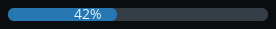

| Attribute | Description |
| --- | --- |
| `min` | Bottom of the range (default 0) |
| `max` | Top of the range (default 100) |
| `bind_min` | Follow an int subject for the bottom of the range, e.g. a heater's minimum |
| `bind_max` | Follow an int subject for the top of the range, e.g. a heater's maximum |
| `bind_value` | Follow an int subject for the value |
| `label_format` | fmt format for the value's text (default "{}"); empty for no text, e.g. under a value shown beside it |

### ds_bar_marker

A value marked on a bar, such as a heater's target temperature above its current-temperature bar: a button showing the value, placed along the bar where the value falls and pointing at it with a triangle (the indicator part's background colour). Its x position is set from the value; set its y with `align` and `y`. Drag it along the bar to choose a value, raising `value_confirmed` with it when released (the marker shows the dragged value until the subject changes), or tap it to raise `clicked`; a drag doesn't raise `clicked`.

Also takes every `lv_obj` attribute.

```xml
<lv_obj width="400" height="100" scrollable="false">
	<ds_bar name="current" bind_value="presenter.current_value" bind_min="presenter.scale_min" bind_max="presenter.scale_max"
			width="100%" height="15" align="center"/>
	<ds_bar_marker name="target" bar="current" bind_value="presenter.active" bind_min="presenter.scale_min" bind_max="presenter.scale_max"
				   label_format="{} °C" align="left_mid" y="-30">
		<style name="input"/>
		<action trigger="clicked" name="actions.heater.set_active"/>
		<action trigger="value_confirmed" name="actions.heater.set_active"/>
	</ds_bar_marker>
</lv_obj>
```

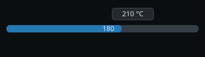

| Attribute | Description |
| --- | --- |
| `bar` | Name of the sibling bar it marks, written before the marker. The bar spans its parent's width (e.g. width="100%"), as the marker is placed by percentages of that width |
| `min` | Bottom of the scale the value is on (default 0) |
| `max` | Top of the scale the value is on (default 100) |
| `bind_min` | Follow an int subject for the bottom of the scale |
| `bind_max` | Follow an int subject for the top of the scale |
| `bind_value` | Follow an int subject for the value marked |
| `label_format` | fmt format for the value's text (default "{}") |

### ds_button

A button showing text, an icon or both

Also takes every `lv_obj` attribute.

```xml
<ds_button translation_tag="tr.fan.max" icon="fan.png">
	<action trigger="clicked" name="presenter.fans.set_speed" arg="100"/>
</ds_button>
```


| Attribute | Description |
| --- | --- |
| `text` | The text shown, if there is no `translation_tag` |
| `translation_tag` | Translation key for the text; follows language changes |
| `bind_text` | Follow a text or int subject for the text |
| `bind_text-fmt` | printf format for `bind_text`, e.g. "%d°C" (default "%s" for text, "%d" for an int) |
| `icon` | Icon file from the icon set, e.g. "fan.png" |
| `checkable` | "true" to make the button toggle its `checked` state when clicked |
| `long_mode` | What the label does with text too long for it: wrap, dots, scroll, scroll_circular or clip |
| `flash_on` | Flash the button briefly, in its `user_1` state, whenever this subject changes, e.g. `source.response.count`; style the flash with `<style … selector="user_1"/>` |

### ds_drag_button

A button that must be dragged, not just tapped, to act, such as the E-stop. When let go it raises `value_confirmed` with how far it was dragged, from 0 (a tap) to 1 (all the way, when it shows its `user_1` state).

Also takes every `lv_obj` attribute.

```xml
<ds_drag_button name="estop" translation_tag="tr.estop.label" icon="estop.png"
				 hint_tag="tr.estop.prompt" width="80" height="80">
	<style name="estop"/>
	<action trigger="value_confirmed" name="actions.estop.dragged"/>
</ds_drag_button>
```

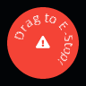

| Attribute | Description |
| --- | --- |
| `text` | The text shown, if there is no `translation_tag` |
| `translation_tag` | Translation key for the text |
| `icon` | Icon file from the icon set, e.g. "estop.png" |
| `hint` | Shown curved around the edge until it is held, if there is no `hint_tag` |
| `hint_tag` | Translation key for the hint |

### ds_dropdown

A drop-down list whose options and text follow subjects. The option chosen reaches a `value_changed` action as its text (ActionArgs::text()) and its index (ActionArgs::value()).

Also takes every `lv_dropdown` attribute.

```xml
<ds_dropdown bind_options="presenter.filaments" bind_text="presenter.filament_text">
	<action trigger="value_changed" name="presenter.temperature.pick_filament"/>
</ds_dropdown>
```

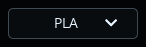

| Attribute | Description |
| --- | --- |
| `bind_options` | Follow a text subject holding the options, one per line |
| `bind_text` | Follow a text subject shown on the button instead of the chosen option, e.g. what is loaded |
| `bind_selected` | Follow an int subject for the index of the option shown chosen, kept when the options change |

### ds_graph

A line graph of a history, with a legend whose buttons show and hide series. Series are coloured by position from LVGL's palette (red, pink, purple, …). The graph starts with what was recorded before it was built, and follows series being added, removed and renamed.

Also takes every `lv_obj` attribute.

```xml
<ds_graph history="source.temperature.temperatures" seconds="60" y_min="0" y_max="300"
		  bind_y_max="source.temperature.limit" width="400" height="250"/>
```


| Attribute | Description |
| --- | --- |
| `history` | The history shown (required), named like a list, e.g. `source.temperature.temperatures` |
| `seconds` | The X axis shows the last this-many seconds, labelled -seconds to 0 (default 60) |
| `y_min` | Bottom of the Y axis (default 0) |
| `y_max` | Top of the Y axis (default 100) |
| `bind_y_max` | Follow an int subject that raises the top of the Y axis above `y_max`, e.g. to fit a heater's limit |
| `legend_min_width` | Show the legend only while the graph is at least this many pixels wide, so a narrow graph keeps its room for the plot (default 0: always shown) |

### ds_heatmap

A colour map of a surface, such as a bed's height map, with X and Y scales, a grid, a title, and the colour scale beside it

Also takes every `lv_obj` attribute.

```xml
<ds_heatmap bind_surface="presenter.surface" bind_title="presenter.title" resolution="200" width="400" height="300"/>
```

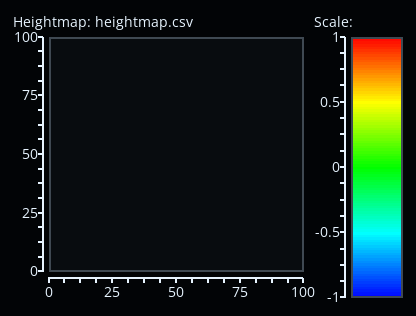

| Attribute | Description |
| --- | --- |
| `bind_surface` | The surface subject to show; redrawn whenever it changes |
| `bind_title` | Follow a text subject for the title shown above the map |
| `resolution` | Pixels the map is drawn with along each side, scaled to fit (default 200) |

### ds_hue_slider

A `<ds_slider>` for a hue, 0 to 360, whose track shows every hue at a lightness and chroma, so the slider is a colour picker, e.g. for a theme's primary colour. `min` and `max` default to 0 and 360.

Also takes every `ds_slider` attribute.

```xml
<ds_hue_slider bind_value="presenter.primary_hue" bind_lightness="presenter.primary.lightness" bind_chroma="presenter.primary.chroma"
			   width="100%"/>
```


| Attribute | Description |
| --- | --- |
| `bind_lightness` | Follow an int subject for the OKLCH lightness the hues are shown at, in thousandths (0.65 is 650) |
| `bind_chroma` | Follow an int subject for the OKLCH chroma the hues are shown at, in thousandths |

### ds_icon

An icon from the icon set chosen in the settings, coloured by the theme. It follows icon set changes.

Also takes every `lv_image` attribute.

```xml
<ds_icon icon="folder.png" width="72" height="72"/>
```


| Attribute | Description |
| --- | --- |
| `icon` | Icon file from the icon set, e.g. "folder.png" |
| `folder` | Take `icon` from this folder of assets/icons instead, whatever the icon set, e.g. "hardware_test" |

### ds_keyboard

An on-screen keyboard with DuetScreen's key layouts. A `<ds_textarea>` brings it up and types into it, so it is usually written `hidden="true"`; or, with `textarea`, it always types into one box, as the number pad's keys do. Its OK key raises `ready`.

Also takes every `lv_obj` attribute.

```xml
<ds_keyboard name="console_keyboard" mode="text_upper" width="100%" height="200"/>
```

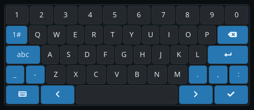

| Attribute | Description |
| --- | --- |
| `mode` | Key layout: `text` (default), `text_upper`, `number` or `numberpad` |
| `textarea` | Always type into the text box of this name: the nearest one around the keyboard, written before it |
| `bind_ok_enabled` | Follow an int subject: the OK key works only while it is non-zero |
| `bind_sign_enabled` | Follow an int subject: the `numberpad` layout's +/- key works only while it is non-zero |

### ds_layout

Shows the widgets the layout of a slot places, which the user can change on the screen. The layout comes from the `layouts/` of the bundles (see docs/XML_UI.md, Layouts). A free layout puts each widget at its rectangle, scaled to this content area; a strip leaves its own layout (e.g. `flex_flow`) to place the widgets in order.

Also takes every `lv_obj` attribute.

```xml
<ds_layout slot="sidebar" flex_flow="column" width="content" height="100%"/>
```

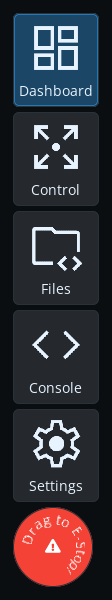

| Attribute | Description |
| --- | --- |
| `slot` | The slot whose layout is shown (required), e.g. `dashboard` |

### ds_list

A container with one component per row of a list. Each item is built in a scope of its own holding its row's fields, so names are found in the row first, then where the list is written. With `windowed`, only the rows on screen are built, so a folder of a thousand files costs a screenful of widgets; every item then has the same size, and the list places them itself (its own layout is ignored), with its style_pad_row and style_pad_column as the gaps. With `key` and `value`, only the rows whose `key` field is `value` are shown, e.g. one fan.

Also takes every `lv_obj` attribute.

```xml
<ds_list list="presenter.files" item="file_browser_row" windowed="true" item_height="90" flow="column"/>
```

| Attribute | Description |
| --- | --- |
| `list` | The list shown (required), named like a subject: e.g. `presenter.files`, `source.gauge.gauges`, `om.fans`, or in a tool's row, its `row.heaters` |
| `item` | The component built for each row (required) |
| `windowed` | "true" to build only the rows on screen, building and deleting rows as the list scrolls (default false) |
| `item_height` | Windowed: each item's height in pixels (required when windowed) |
| `item_width` | Windowed: each item's width in pixels, or `content` for each item's own width (column flow only; the list scrolls sideways); the list's full width if not given |
| `flow` | Windowed: `column` for one item per line (default), `row_wrap` for as many per line as fit |
| `follow_end` | "true" to keep a list that isn't windowed showing its last rows as rows are added, like a log, unless the user has scrolled back (default false) |
| `key` | A field of the rows, written `row.<field>`: only the rows whose `key` is `value` are shown, as the data changes. Not with `windowed`. |
| `value` | With `key`, the value shown rows have, as XML writes one: `2` for an int, the text for a text, e.g. `<ds_list list="om.fans" key="row.index" value="2" item="…"/>` shows fan 2 |

### ds_modal

A dialog over the main window with a dimmed backdrop. Its subject alone decides whether it is open, so a presenter opens and closes it by setting a subject. Closed any other way (tapped outside, the back button, navigation closing every modal), it raises `dismissed` so the presenter can update the subject; closing it by its subject raises nothing. The content is laid out in the dialog's card, which the lv_obj attributes apply to. Unless `in_place`, it is deleted with the widget it was written in.

Also takes every `lv_obj` attribute.

```xml
<ds_modal name="file_dialog" bind_open="presenter.dialog" width="70%" height="content">
	<action trigger="dismissed" name="presenter.files.close_dialog"/>
	…the dialog's content…
</ds_modal>
```

| Attribute | Description |
| --- | --- |
| `bind_open` | Open while this subject is non-zero (int) or non-empty (text), or, with `open_value`, equal to it |
| `open_value` | The value `bind_open` must have for the dialog to be open |
| `blocking` | "true" so that tapping outside doesn't close it (default false) |
| `in_place` | "true" to stay in the widget it is written in rather than move to the main window, so the backdrop covers only that widget, e.g. alerts covering the whole screen (default false) |

### ds_move_handle

A grip that moves the widget it is in around that widget's parent when dragged, e.g. a floating toolbar's. The first drag takes the widget out of its parent's layout; it is kept inside its parent. What the grip looks like is the XML inside it.

Also takes every `lv_obj` attribute.

```xml
<lv_obj width="200" height="content" flex_flow="row" style_flex_cross_place="center">
	<ds_move_handle width="content" height="content" style_pad_all="0">
		<ds_icon icon="drag.png" width="32" height="48"/>
	</ds_move_handle>
	<lv_label text="Drag me"/>
</lv_obj>
```


### ds_password_toggle

An eye button that shows what is typed in a password box while it is checked, and hides it again when unchecked. Tapping it doesn't take the focus from the box, so the keyboard stays up.

Also takes every `lv_obj` attribute.

```xml
<lv_obj width="100%" height="content" flex_flow="row" style_pad_all="0">
	<ds_textarea name="password" one_line="true" password_mode="true" flex_grow="1"/>
	<ds_password_toggle textarea="password"/>
</lv_obj>
```

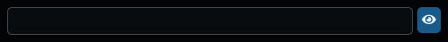

| Attribute | Description |
| --- | --- |
| `textarea` | Name of the password box: the nearest `ds_textarea` of that name around the button, e.g. its sibling |

### ds_plot

An X/Y area with scales and a grid, such as the bed with its objects, whose content is widgets placed by X/Y position. `<ds_plot_layer>`s written inside it are kept over its drawing area, and `<ds_plot_rect>`s inside a layer are kept at their X/Y bounds.

Also takes every `lv_obj` attribute.

```xml
<ds_plot title_tag="tr.object_cancel.current_object_prefix" title_style="text_emphasis" bind_detail="presenter.current"
		 bind_x_min="presenter.x_min" bind_x_max="presenter.x_max" bind_y_min="presenter.y_min" bind_y_max="presenter.y_max" width="400" height="300">
	<ds_plot_layer name="layer">
		<ds_list list="presenter.objects" item="object_cancel_outline" width="100%" height="100%"/>
	</ds_plot_layer>
</ds_plot>
```


| Attribute | Description |
| --- | --- |
| `title` | The title above the area, if there is no `title_tag` |
| `title_tag` | Translation key for the title |
| `bind_title` | Follow a text subject for the title |
| `title_style` | A theme style for the title, e.g. `text_emphasis` |
| `bind_detail` | Follow a text subject shown after the title |
| `x_min` | Left of the span (default 0) |
| `x_max` | Right of the span (default 100) |
| `y_min` | Bottom of the span (default 0) |
| `y_max` | Top of the span (default 100) |
| `bind_x_min` | Follow an int subject for `x_min` |
| `bind_x_max` | Follow an int subject for `x_max` |
| `bind_y_min` | Follow an int subject for `y_min` |
| `bind_y_max` | Follow an int subject for `y_max` |
| `resolution` | Pixels the grid is drawn with along each side, scaled to fit (default 200) |

### ds_plot_layer

A layer written inside a `<ds_plot>`, kept exactly over its drawing area, for widgets placed by X/Y position such as `<ds_plot_rect>`s. It doesn't scroll and has no padding; the plot sets its position and size.

Also takes every `lv_obj` attribute.

### ds_plot_rect

A rectangle kept at its X/Y bounds over a `<ds_plot>`, e.g. an object on the bed. It is written inside a `<ds_plot_layer>` of the plot, directly or deeper (in a list row, say), and hidden while its bounds are outside the plot's span. It sets its own position and size.

Also takes every `lv_obj` attribute.

```xml
<ds_plot_rect bind_x1="row.x1" bind_y1="row.y1" bind_x2="row.x2" bind_y2="row.y2"/>
```

| Attribute | Description |
| --- | --- |
| `x1` | X of one corner, in the plot's units |
| `y1` | Y of that corner |
| `x2` | X of the opposite corner |
| `y2` | Y of the opposite corner |
| `bind_x1` | Follow an int subject for `x1` |
| `bind_y1` | Follow an int subject for `y1` |
| `bind_x2` | Follow an int subject for `x2` |
| `bind_y2` | Follow an int subject for `y2` |

### ds_scope

Builds one component in a scope where names are relative to an object model element, as in a row of an object model list: `current`, `model.pid.p`, `heaters` as a list. When an index of the path is a subject's value, the names follow the element it points at, without rebuilding.

Also takes every `lv_obj` attribute.

```xml
<ds_scope path="om.tools[{om.state.currentTool}]" item="dashboard_current_tool_card"/>
```


| Attribute | Description |
| --- | --- |
| `path` | The element (required): an `om.` path, whose indices may be `{name}`, a subject's value |
| `item` | The component built (required) |

### ds_slider

A slider with a label, its value and -/+ buttons, and optionally a number pad. Raises `value_confirmed` with the value when the user finishes an edit (releases it, presses -/+ or types a value), or with `send="change"` on every movement. Values written by `bind_value` are not edits and raise nothing, so a view can show live data and send changes without echoing the data back to the printer. Also raises `value_changed` as it is dragged.

Also takes every `lv_obj` attribute.

```xml
<ds_slider label_tag="tr.settings.brightness" min="0" max="100" increment="1" decimals="0" bind_value="presenter.brightness"
		   numberpad="true" send="change" width="100%">
	<action trigger="value_confirmed" name="presenter.settings.brightness"/>
</ds_slider>
```

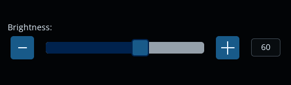

| Attribute | Description |
| --- | --- |
| `min` | Bottom of the range, may have a fraction (default 0) |
| `max` | Top of the range, may have a fraction (default 100) |
| `increment` | Step of the -/+ buttons, may have a fraction, e.g. "0.01" (default 1) |
| `decimals` | Decimal places the value is shown with (default 2) |
| `label` | The label, if there is no `label_tag` |
| `label_tag` | Translation key for the label |
| `bind_label` | Follow a text subject for the label |
| `label_shown` | "false" to hide the label, which still heads the number pad (default true) |
| `bind_value` | Follow an int subject for the value |
| `value_scale` | How much `bind_value` is scaled by, for a value with a fraction, e.g. a chroma of 0.02 held as 2 with value_scale="100" (default 1) |
| `send` | `confirmed` to raise `value_confirmed` when an edit is finished (default), or `change` on every movement, for a setting seen as it changes such as brightness |
| `out_of_range` | Let a typed value go past the slider's `upper` end, `lower` end or `both`, e.g. a timeout longer than the slider reaches |
| `numberpad` | What tapping the value does: `true` types it on the shared number pad, `own` raises `value_tapped` with the value for the view to show its own, `false` types it in place (default) |
| `default` | A value to go back to: a Reset button shows while the value is anything else, and raises `value_confirmed` with it |
| `bind_min` | Follow an int subject for the bottom of the range (scaled by `value_scale`) |
| `bind_max` | Follow an int subject for the top of the range (scaled by `value_scale`) |

### ds_tabs

A row of tab buttons over the selected tab's content. Each tab is a `<ds_tabs-tab>` inside it; the first starts selected.

Also takes every `lv_obj` attribute.

```xml
<ds_tabs width="100%" height="200">
	<ds_tabs-tab name="macros" title_tag="tr.file.macros">
		<lv_label text="The first tab's content"/>
	</ds_tabs-tab>
	<ds_tabs-tab name="jobs" title_tag="tr.file.jobs" bind_disabled="source.machine.job_active">
		<lv_label text="The second tab's content"/>
	</ds_tabs-tab>
</ds_tabs>
```

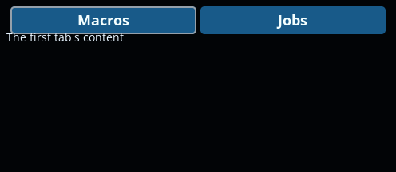

### ds_tabs-tab

One tab of a `<ds_tabs>`, written inside it. Its content is the tab's page; the lv_obj attributes apply to that page.

Also takes every `lv_obj` attribute.

| Attribute | Description |
| --- | --- |
| `title` | The tab button's text, if there is no `title_tag` |
| `title_tag` | Translation key for the tab button's text |
| `bind_disabled` | Disable the tab's button while this int subject is non-zero |
| `select_on` | Select the tab whenever this subject changes to a non-empty text or non-zero int, e.g. the status tab when a job starts: `select_on="om.job.file.fileName"` |

### ds_textarea

A text box that brings up an on-screen keyboard while it is being edited. The keyboard's own close key always puts it away. Raises `focused`, `defocused`, `ready` and `cancel` as the edit starts and ends, and `value_changed` on every edit; handlers read the text with ActionArgs::text(). Text written by `bind_text` is not an edit and raises nothing, so a handler can store each edit in the subject the box shows.

Also takes every `lv_obj` attribute.

```xml
<ds_textarea name="input" one_line="true" bind_text="presenter.alert.input" bind_keyboard_mode="presenter.alert.keyboard_mode"
			 width="300">
	<action trigger="value_changed" name="presenter.alert.input"/>
</ds_textarea>
```

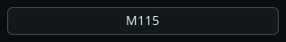

| Attribute | Description |
| --- | --- |
| `bind_text` | Follow a text subject: the box shows its value whenever it changes to something other than what is in the box, so a presenter that keeps the subject equal to the edits can replace the text at any time |
| `bind_accepted_chars` | Follow a text subject for the characters that may be typed; empty for any |
| `keyboard_mode` | Keyboard layout to show: `text` (default), `text_upper` or `number` |
| `bind_keyboard_mode` | Follow a text subject for the keyboard layout, as `keyboard_mode` |
| `keyboard` | The keyboard to use: the nearest lv_keyboard of that name around the box (e.g. one in the same view), else a C++ view of that name (default `keyboard`, the home screen's); `none` for a box edited another way, such as a number pad |
| `hide_keyboard_on_ready` | Put the keyboard away when its OK key is pressed (default true) |
| `hide_keyboard_on_defocus` | Put the keyboard away when the box loses focus (default true) |
| `one_line` | "true" for a single line of text |
| `password_mode` | "true" to show dots for the characters, e.g. for a password |
| `placeholder` | Text shown while the box is empty |
| `placeholder_tag` | Translation key for the placeholder, instead of `placeholder` |

### ds_thumbnail

An image as tall as its parent's content and as wide as its aspect ratio needs, so a thumbnail beside some text is as large as it can be without making the row taller. With no image it takes no width.

Also takes every `lv_image` attribute.

```xml
<ds_thumbnail bind_src="source.job.thumbnail" height="100%"/>
```

| Attribute | Description |
| --- | --- |
| `bind_src` | Follow a text subject holding an image path; empty shows no image |

### ds_toggle

An on/off setting, drawn as the build's toggle (a check box or a switch), so every setting looks the same. Raises `value_changed` when it is changed; the action's value is 1 when turned on and 0 when off.

Also takes every `lv_obj` attribute.

```xml
<ds_toggle>
	<bind_state_if_eq subject="presenter.confirmations" state="checked" ref_value="1"/>
	<action trigger="value_changed" name="presenter.settings.confirmations"/>
</ds_toggle>
```


### ds_view

A view inside a screen, e.g. a page of the home screen, registered with navigation as its `name` (default: its `view`) so it can be opened with `actions.navigation.open`. A view starts hidden, like any screen that isn't open. Every lv_obj attribute works except `hidden`, which navigation owns.

Also takes every `lv_obj` attribute.

```xml
<ds_view name="dashboard_jobs" view="file_browser" presenter="dashboard_jobs"/>
```

| Attribute | Description |
| --- | --- |
| `view` | The XML component shown, with its presenter |
| `presenter` | Show the component with this registered presenter instead of the one it names, so one component can show different data in different places |
| `home` | "true" to make it a home screen: shown when nothing else is open (default false) |
| `shown` | "true" to show it without taking part in navigation, for always-present parts such as a status bar or the page in a tab: shown, and its presenter active, whenever what it is in is shown (default false) |

### lv_obj-action

Written `<action>` inside any widget: run the named action when the widget raises the trigger event. `presenter.<action>` is looked for in the presenters of the views the widget is in, innermost first; `actions.<group>.<action>` is a global action.

```xml
<action trigger="value_confirmed" name="actions.gcode.send" arg="M106 P{row.number} S{event.value}"/>
```

| Attribute | Description |
| --- | --- |
| `name` | The action to run (required): `presenter.<action>` or `actions.<group>.<action>` |
| `trigger` | The event that runs it (default `clicked`): an LVGL event name such as `value_changed` or `long_pressed`, `value_confirmed` (a DuetScreen widget's edit is finished), `value_tapped` (a `<ds_slider numberpad="own">`'s value was tapped to type one) or `dismissed` (a `<ds_modal>` was closed by the user) |
| `arg` | Passed to the handler. `{event.value}` is replaced by the edited value, and `{name}` by the current value of the subject `name`, looked up from where the `<action>` is written |

## Layouts

What the user places on the screen, and where; see Layouts in [XML_UI.md](XML_UI.md). A `<ds_layout slot="…">` shows its slot's layout, a file in a bundle's `layouts/`. A free layout places widgets in rectangles of pixels; a strip shows them one after another. Locked items can be moved but not removed.

### Slots

The built-in slots and the layout each shows until the user changes it.

| Slot | Kind | Items (id: widget) |
| --- | --- | --- |
| `dashboard` | free, 920×561 px | `tools`: `tools` at 0,0, 548×277; `temperature_graph`: `temperature_graph` at 0,282, 548×279; `files`: `files` at 553,0, 367×561 |
| `sidebar` | strip | `home`: `page_home`; `control`: `page_control`; `files`: `page_files`; `console`: `page_console`; `settings`: `page_settings`, locked; `estop`: `estop`, locked |
| `status_bar` | strip | none |

### Placed widgets' names

A placed widget's component can use these, as well as its presenter's names and the globals, to fit what it shows to the room it has; any other view has a page's room, every class expanded. E.g. `<bind_flag_if cond="widget.width_class eq 0" flag="hidden"/>` hides a part when the widget is narrow. The breakpoints are the theme's consts `widget_regular_min` and `widget_expanded_min`. See [PlacementScope.h](../src/UI/Xml/Layout/PlacementScope.h) for when to use them.

| Name | Type | Description |
| --- | --- | --- |
| `widget.width_class` | int | How wide the widget's place is: 0 compact, 1 regular, 2 expanded, by the theme's breakpoints (widget_regular_min, widget_expanded_min); always 1 in a strip, and 2 outside a placed widget |
| `widget.height_class` | int | How tall the widget's place is, as `widget.width_class` |
| `widget.size_class` | int | The smaller of `widget.width_class` and `widget.height_class`: how big something that needs both, such as an arc, can be |
| `widget.portrait` | int | 1 if the widget's place is taller than it is wide, else 0 |

### Placeable widgets

Each widget is a component (with its props) and a widget file beside it, which says where it can be placed, its sizes in pixels, and its settings: props the user chooses on the screen. Each is pictured as placed, at its default size in its first slot, with its default settings; a free layout's widget is pictured at its smallest size too.

#### arc_gauge

**Arc gauge**: One value on an arc, such as a heater's temperature with its target; tap to change it

In Gauges; placed in `dashboard`; component `gauge_arc` ([arc_gauge.json](../assets/ui/widgets/gauges/arc_gauge.json)). In a free layout it is 180×184 px, and at least 134×136 px.

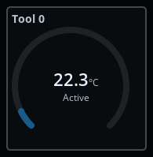

At its smallest, 134×136 px:

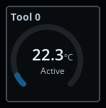

| Setting | Shown as | Takes | Default |
| --- | --- | --- | --- |
| `source` | Shows | a row of `source.gauge.gauges`, by its `id`, shown by its `name` | `tool.0.0` |

#### axes

**Axis positions**: Where each axis is

In Motion; placed in `dashboard`; component `dashboard_axes` ([axes.json](../assets/ui/widgets/motion/axes.json)). In a free layout it is 365×89 px, and at least 272×89 px.

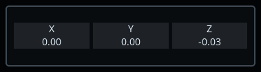

At its smallest, 272×89 px:

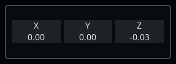

#### babystep

**Babystepping**: Move Z by small steps while printing

In Motion; placed in `dashboard`; component `dashboard_babystep` ([babystep.json](../assets/ui/widgets/motion/babystep.json)). In a free layout it is 272×372 px, and at least 180×278 px.


At its smallest, 180×278 px:

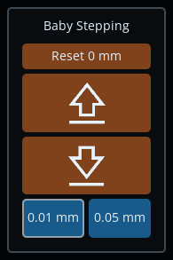

#### bar_gauge

**Bar gauge**: One value on a bar, such as a fan's speed or the job's progress; tap to change it

In Gauges; placed in `dashboard`; component `gauge_bar` ([bar_gauge.json](../assets/ui/widgets/gauges/bar_gauge.json)). In a free layout it is 272×89 px, and at least 180×89 px.

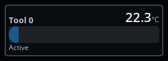

At its smallest, 180×89 px:

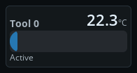

| Setting | Shown as | Takes | Default |
| --- | --- | --- | --- |
| `source` | Shows | a row of `source.gauge.gauges`, by its `id`, shown by its `name` | `bed.0` |

#### console

**Console**: The console: send G-code and read the replies

In Console; placed in `dashboard`; component `console` ([console.json](../assets/ui/widgets/console/console.json)). In a free layout it is 642×467 px, and at least 458×278 px.


At its smallest, 458×278 px:


#### console_command_list

**GCode command list**: Every G-code with what it does; tap one to put it in the console's input

In Console; placed in `dashboard`; component `console_command_list` ([console_command_list.json](../assets/ui/widgets/console/console_command_list.json)). In a free layout it is 458×278 px, and at least 272×136 px.

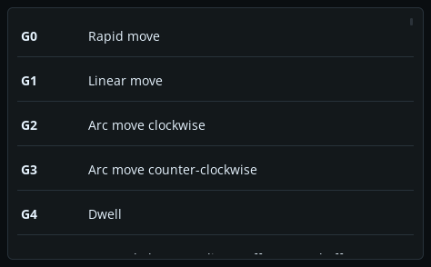

At its smallest, 272×136 px:


#### console_input

**Console input**: A line to type G-code into and send to the printer

In Console; placed in `dashboard`; component `console_input` ([console_input.json](../assets/ui/widgets/console/console_input.json)). In a free layout it is 300×100 px, and at least 200×60 px.


At its smallest, 200×60 px:


#### console_log

**Console log**: The printer's latest replies; tap to open the console

In Console; placed in `dashboard`; component `console_log` ([console_log.json](../assets/ui/widgets/console/console_log.json)). In a free layout it is 458×278 px, and at least 272×136 px.

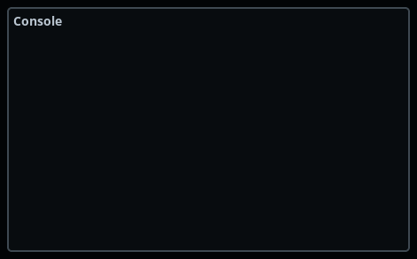

At its smallest, 272×136 px:


#### current_tool

**Current tool**: The tool in use, with its heaters' temperatures

In Temperatures; placed in `dashboard`; component `dashboard_current_tool` ([current_tool.json](../assets/ui/widgets/temperature/current_tool.json)). In a free layout it is 458×184 px, and at least 272×89 px.

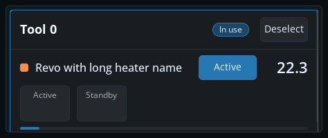

At its smallest, 272×89 px:

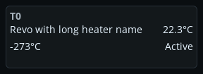

#### estop

**E-stop**: Drag across to stop the printer at once

In Safety; placed in `sidebar`, `dashboard`; component `sidebar_estop` ([estop.json](../assets/ui/widgets/safety/estop.json)). In a free layout it is 40×40 px, and at least 40×40 px.

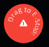

#### extrude

**Extrude**: Extrude or retract with the selected tool

In Motion; placed in `dashboard`; component `temperature_extrusion_card` ([extrude.json](../assets/ui/widgets/motion/extrude.json)). In a free layout it is 319×420 px, and at least 272×372 px.

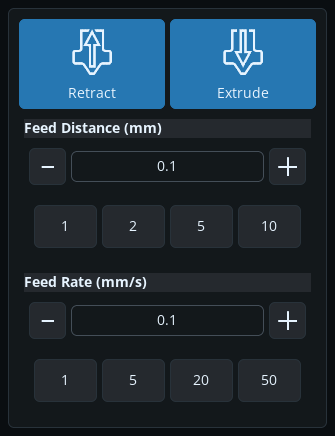

At its smallest, 272×372 px:


#### fan

**Fan**: One fan's speed, to change it

In Fans; placed in `dashboard`; component `dashboard_fan` ([fan.json](../assets/ui/widgets/fans/fan.json)). In a free layout it is 458×89 px, and at least 365×89 px.

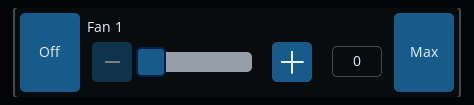

At its smallest, 365×89 px:


| Setting | Shown as | Takes | Default |
| --- | --- | --- | --- |
| `fan` | Fan | a row of `om.fans`, by its `index`, shown by its `name\|default:tr.fine_tune.fan` | `0` |

#### fans

**Fans**: Every fan's speed, to change them

In Fans; placed in `dashboard`; component `fans` ([fans.json](../assets/ui/widgets/fans/fans.json)). In a free layout it is 458×278 px, and at least 365×184 px.

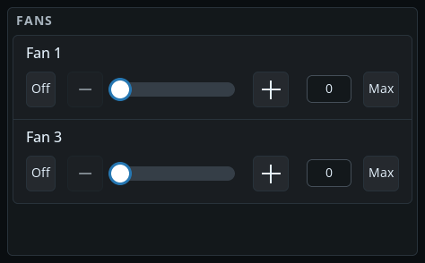

At its smallest, 365×184 px:

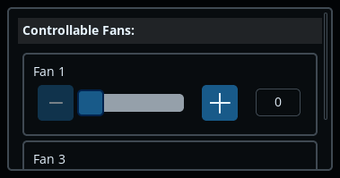

#### files

**Jobs, macros and status**: The jobs, macros and the job's status, as tabs

In Jobs; placed in `dashboard`; component `dashboard_files` ([files.json](../assets/ui/widgets/jobs/files.json)). In a free layout it is 365×561 px, and at least 272×278 px.

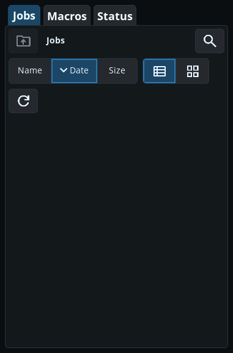

At its smallest, 272×278 px:

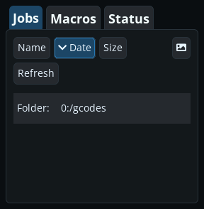

#### gcode_button

**G-code button**: Sends the G-code you choose, e.g. M98 P"0:/macros/name" to run a macro

In Commands; placed in `dashboard`; component `dashboard_gcode_button` ([gcode_button.json](../assets/ui/widgets/commands/gcode_button.json)). In a free layout it is 180×89 px, and at least 88×89 px.

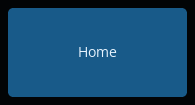

At its smallest, 88×89 px:


| Setting | Shown as | Takes | Default |
| --- | --- | --- | --- |
| `label` | Label | text, up to 32 bytes | `Home` |
| `gcode` | G-code | text, up to 120 bytes | `G28` |

#### heightmap

**Bed Levelling**: The bed's height map, levelling and probing

In Motion; placed in `dashboard`; component `heightmap` ([heightmap.json](../assets/ui/widgets/motion/heightmap.json)). In a free layout it is 642×467 px, and at least 550×372 px.

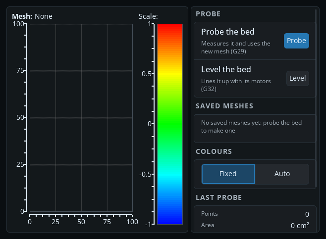

At its smallest, 550×372 px:

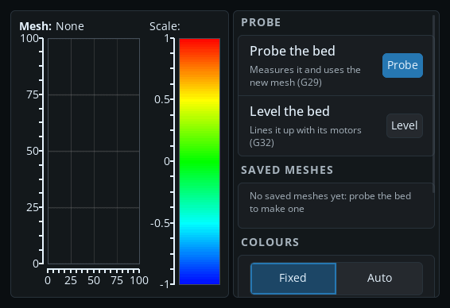

#### job_progress

**Job progress**: The job's file, progress, time taken and time left

In Jobs; placed in `dashboard`; component `dashboard_job_progress` ([job_progress.json](../assets/ui/widgets/jobs/job_progress.json)). In a free layout it is 365×89 px, and at least 272×89 px.

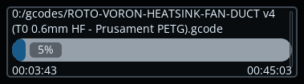

At its smallest, 272×89 px:

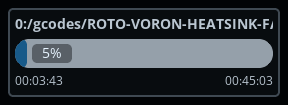

#### job_status

**Status**: The job's progress, times and controls

In Jobs; placed in `dashboard`; component `dashboard_job_status_card` ([job_status.json](../assets/ui/widgets/jobs/job_status.json)). In a free layout it is 365×372 px, and at least 365×372 px.

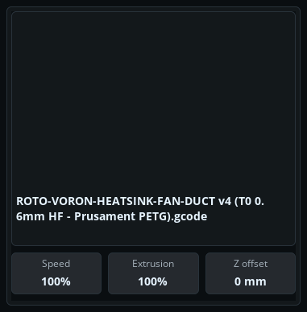

#### jobs

**Jobs**: The jobs on the printer, to start one

In Jobs; placed in `dashboard`; component `dashboard_jobs_card` ([jobs.json](../assets/ui/widgets/jobs/jobs.json)). In a free layout it is 365×372 px, and at least 272×184 px.


At its smallest, 272×184 px:

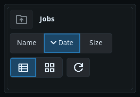

#### jog_choices

**Jog distance and speed**: How far and how fast every jog goes; hold one to change it

In Motion; placed in `dashboard`; component `move_jog_choices` ([jog_choices.json](../assets/ui/widgets/motion/jog_choices.json)). In a free layout it is 550×136 px, and at least 365×136 px.


At its smallest, 365×136 px:

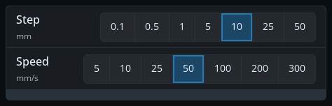

#### jog_xy

**XY jog**: Jog and home X and Y, home all and disable the motors

In Motion; placed in `dashboard`; component `move_xy_card` ([jog_xy.json](../assets/ui/widgets/motion/jog_xy.json)). In a free layout it is 272×278 px, and at least 180×184 px.


At its smallest, 180×184 px:

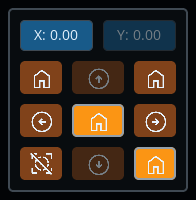

#### jog_z

**Z jog**: Jog Z up and down, home it, or move it to a position

In Motion; placed in `dashboard`; component `move_z_card` ([jog_z.json](../assets/ui/widgets/motion/jog_z.json)). In a free layout it is 134×278 px, and at least 88×231 px.


At its smallest, 88×231 px:

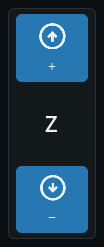

#### macros

**Macros**: The printer's macros, to run one

In Jobs; placed in `dashboard`; component `dashboard_macros_card` ([macros.json](../assets/ui/widgets/jobs/macros.json)). In a free layout it is 365×372 px, and at least 272×184 px.


At its smallest, 272×184 px:


#### move

**Move**: The Move tab: jog and home every axis, babystep, and choose the jog distance and speed

In Motion; placed in `dashboard`; component `move` ([move.json](../assets/ui/widgets/motion/move.json)). In a free layout it is 920×467 px, and at least 920×420 px.


At its smallest, 920×420 px:


#### object_cancel

**Object Cancel**: The job's objects, to cancel one

In Jobs; placed in `dashboard`; component `object_cancel` ([object_cancel.json](../assets/ui/widgets/jobs/object_cancel.json)). In a free layout it is 642×467 px, and at least 458×278 px.

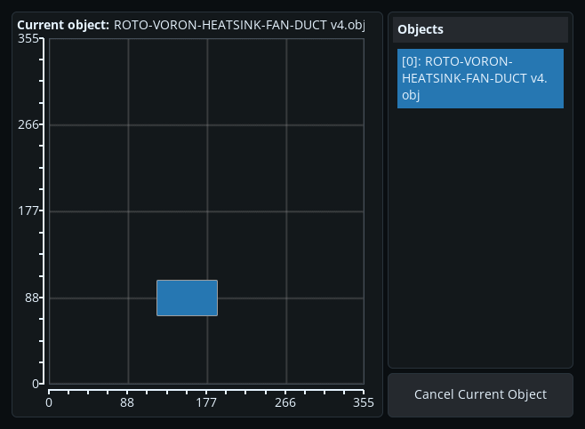

At its smallest, 458×278 px:

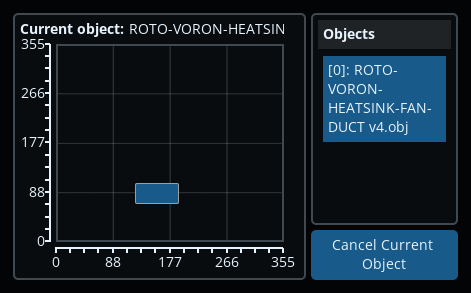

#### om_value

**Object model value**: Any value the printer reports, by its object model path, e.g. heat.heaters[1].current

In Gauges; placed in `dashboard`; component `gauge_om_value` ([om_value.json](../assets/ui/widgets/gauges/om_value.json)). In a free layout it is 180×89 px, and at least 134×89 px.

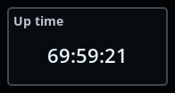

At its smallest, 134×89 px:

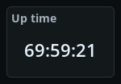

| Setting | Shown as | Takes | Default |
| --- | --- | --- | --- |
| `path` | Path | text, up to 120 bytes | `om.state.upTime|duration` |
| `label` | Label | text, up to 40 bytes | `Up time` |
| `unit` | Unit | text, up to 12 bytes | `` |

#### page_console

**Console**: Opens the console; flashes when the printer replies

In Navigation; placed in `sidebar`; component `sidebar_page_button` ([page_console.json](../assets/ui/widgets/navigation/page_console.json)).

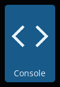

#### page_control

**Control**: Opens the controls: moving, temperatures, fans

In Navigation; placed in `sidebar`; component `sidebar_page_button` ([page_control.json](../assets/ui/widgets/navigation/page_control.json)).


#### page_files

**Files**: Opens the jobs and macros

In Navigation; placed in `sidebar`; component `sidebar_page_button` ([page_files.json](../assets/ui/widgets/navigation/page_files.json)).

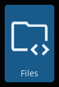

#### page_home

**Dashboard**: Opens the dashboard

In Navigation; placed in `sidebar`; component `sidebar_page_button` ([page_home.json](../assets/ui/widgets/navigation/page_home.json)).

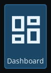

#### page_settings

**Settings**: Opens the settings

In Navigation; placed in `sidebar`; component `sidebar_page_button` ([page_settings.json](../assets/ui/widgets/navigation/page_settings.json)).


#### sidebar_gcode

**G-code button**: A sidebar button that sends the G-code you choose

In Commands; placed in `sidebar`; component `sidebar_gcode_button` ([sidebar_gcode.json](../assets/ui/widgets/commands/sidebar_gcode.json)).


| Setting | Shown as | Takes | Default |
| --- | --- | --- | --- |
| `label` | Label | text, up to 32 bytes | `Home` |
| `icon` | Icon | one of `send.png`, `home_axis.png`, `macros.png`, `move.png`, `extrude.png`, `retract.png`, `temperature.png`, `fine_tune.png`, `heightmap.png`, `babystep.png`, `disable_motors.png`, `pause.png`, `resume.png`, `cancel.png`, `print_again.png`, `status.png` | `send.png` |
| `gcode` | G-code | text, up to 120 bytes | `G28` |

#### status_extrusion

**Extrusion factor**: Shows the extrusion factor; tap to change it

In Motion; placed in `status_bar`; component `status_bar_factor_button` ([status_extrusion.json](../assets/ui/widgets/motion/status_extrusion.json)).


#### status_gcode

**G-code button**: A small button that sends the G-code you choose

In Commands; placed in `status_bar`; component `status_bar_gcode_button` ([status_gcode.json](../assets/ui/widgets/commands/status_gcode.json)).


| Setting | Shown as | Takes | Default |
| --- | --- | --- | --- |
| `label` | Label | text, up to 32 bytes | `G28` |
| `gcode` | G-code | text, up to 120 bytes | `G28` |

#### status_speed

**Speed factor**: Shows the speed factor; tap to change it

In Motion; placed in `status_bar`; component `status_bar_factor_button` ([status_speed.json](../assets/ui/widgets/motion/status_speed.json)).

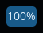

#### temperature_graph

**Temperature graph**: Every heater's temperature over the last minutes

In Temperatures; placed in `dashboard`; component `dashboard_temperature_graph` ([temperature_graph.json](../assets/ui/widgets/temperature/temperature_graph.json)). In a free layout it is 550×278 px, and at least 272×184 px.

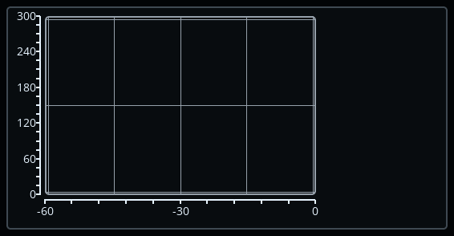

At its smallest, 272×184 px:

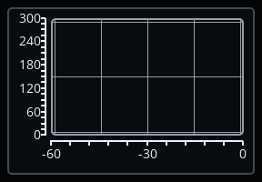

| Setting | Shown as | Takes | Default |
| --- | --- | --- | --- |
| `seconds` | Time shown | one of `30`, `60`, `120`, `300`, `600` | `60` |

#### temperatures

**Temperatures**: The Temperature tab: every tool, bed and chamber, filament, and the extruder

In Temperatures; placed in `dashboard`; component `temperature` ([temperatures.json](../assets/ui/widgets/temperature/temperatures.json)). In a free layout it is 920×561 px, and at least 735×467 px.

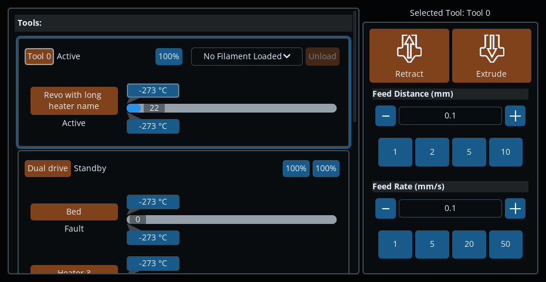

At its smallest, 735×467 px:


#### text

**Text**: Text you write, in the size and colour you choose

In Text; placed in `dashboard`; component `dashboard_text` ([text.json](../assets/ui/widgets/text/text.json)). In a free layout it is 272×89 px, and at least 88×42 px.


At its smallest, 88×42 px:


| Setting | Shown as | Takes | Default |
| --- | --- | --- | --- |
| `text` | Text | text, up to 120 bytes | `Printer` |
| `size` | Text size | one of `small`, `normal`, `emphasis`, `header`, `large`, `xlarge`, `huge` | `header` |
| `colour` | Colour | one of `text`, `text_muted`, `primary`, `secondary`, `success`, `warning`, `error` | `text` |
| `align` | Alignment | one of `left`, `center`, `right` | `center` |
| `background` | Background | one of `card`, `base` | `card` |

#### tool

**Tool**: One tool with its heaters' temperatures

In Temperatures; placed in `dashboard`; component `dashboard_tool_card` ([tool.json](../assets/ui/widgets/temperature/tool.json)). In a free layout it is 550×184 px, and at least 458×100 px.


At its smallest, 458×100 px:


| Setting | Shown as | Takes | Default |
| --- | --- | --- | --- |
| `tool` | Tool | a row of `om.tools`, by its `index`, shown by its `name\|default:tr.temperature.default_tool_name` | `0` |

#### tools

**Tools and heaters**: Every tool, bed and chamber with its temperatures

In Temperatures; placed in `dashboard`; component `dashboard_tools` ([tools.json](../assets/ui/widgets/temperature/tools.json)). In a free layout it is 550×278 px, and at least 272×100 px.


At its smallest, 272×100 px:


#### value_gauge

**Value**: One value as a large number, such as a temperature or a factor; tap to change it

In Gauges; placed in `dashboard`; component `gauge_value` ([value_gauge.json](../assets/ui/widgets/gauges/value_gauge.json)). In a free layout it is 180×89 px, and at least 134×89 px.


At its smallest, 134×89 px:


| Setting | Shown as | Takes | Default |
| --- | --- | --- | --- |
| `source` | Shows | a row of `source.gauge.gauges`, by its `id`, shown by its `name` | `job.progress` |

## Components

The components of the built-in bundle. A user bundle replaces one by giving its own the same name; a component is used as an element (`<fan_card/>`) or as a list's `item`.

| Component | Presenter | Props | Used by | File |
| --- | --- | --- | --- | --- |
| [`babystep`](#control) | `babystep` |  | `babystep_dialog`, `dashboard_babystep`, `move` | [babystep.xml](../assets/ui/components/common/babystep.xml) |
| `babystep_dialog` | `babystep_dialog` |  | `home` | [babystep_dialog.xml](../assets/ui/components/modals/babystep_dialog.xml) |
| `babystep_step` |  |  | `babystep` | [babystep_step.xml](../assets/ui/components/common/babystep_step.xml) |
| `confirm_dialog` |  | `open`, `title_tag`, `text_tag`, `confirm`, `close` | `job_cancel` | [confirm_dialog.xml](../assets/ui/components/common/confirm_dialog.xml) |
| [`console`](#console) | `console` |  | `home`, `console` | [console.xml](../assets/ui/components/console/console.xml) |
| `console_command_list` | `console` |  | `console`, `console_command_list` | [console_command_list.xml](../assets/ui/components/console/console_command_list.xml) |
| `console_gcode` |  |  | `console_command_list` | [console_gcode.xml](../assets/ui/components/console/console_gcode.xml) |
| `console_input` | `console` | `keyboard` | `console`, `console_input` | [console_input.xml](../assets/ui/components/console/console_input.xml) |
| `console_line` |  |  | `console`, `console_log` | [console_line.xml](../assets/ui/components/console/console_line.xml) |
| `console_log` |  |  | `console_log` | [console_log.xml](../assets/ui/components/console/console_log.xml) |
| [`control`](#control) |  |  | `home` | [control.xml](../assets/ui/components/control/control.xml) |
| [`customise`](#home) | `customise` |  | `home` | [customise.xml](../assets/ui/components/customise/customise.xml) |
| `customise_catalogue_category` |  |  | `customise` | [customise_catalogue_category.xml](../assets/ui/components/customise/customise_catalogue_category.xml) |
| `customise_catalogue_item` |  |  | `customise_catalogue_category` | [customise_catalogue_item.xml](../assets/ui/components/customise/customise_catalogue_item.xml) |
| [`customise_free_item`](#customise_free_item) |  | `key` |  | [customise_free_item.xml](../assets/ui/components/customise/customise_free_item.xml) |
| `customise_guide` |  |  |  | [customise_guide.xml](../assets/ui/components/customise/customise_guide.xml) |
| `customise_item` |  | `key` | `customise_free_item` | [customise_item.xml](../assets/ui/components/customise/customise_item.xml) |
| [`customise_missing`](#customise_missing) |  | `widget` |  | [customise_missing.xml](../assets/ui/components/customise/customise_missing.xml) |
| `customise_option` |  |  | `customise` | [customise_option.xml](../assets/ui/components/customise/customise_option.xml) |
| [`customise_place`](#customise_place) |  |  |  | [customise_place.xml](../assets/ui/components/customise/customise_place.xml) |
| `customise_saved_layout` |  |  | `customise` | [customise_saved_layout.xml](../assets/ui/components/customise/customise_saved_layout.xml) |
| `customise_setting` |  |  | `customise` | [customise_setting.xml](../assets/ui/components/customise/customise_setting.xml) |
| [`dashboard`](#home) |  |  | `home` | [dashboard.xml](../assets/ui/components/dashboard/dashboard.xml) |
| `dashboard_axes` |  |  | `axes` | [dashboard_axes.xml](../assets/ui/components/dashboard/dashboard_axes.xml) |
| `dashboard_axis` |  |  | `dashboard_axes`, `dashboard_job_status` | [dashboard_axis.xml](../assets/ui/components/dashboard/dashboard_axis.xml) |
| `dashboard_babystep` |  |  | `babystep` | [dashboard_babystep.xml](../assets/ui/components/dashboard/dashboard_babystep.xml) |
| `dashboard_current_tool` |  |  | `current_tool` | [dashboard_current_tool.xml](../assets/ui/components/dashboard/dashboard_current_tool.xml) |
| `dashboard_current_tool_card` |  |  | `dashboard_current_tool` | [dashboard_current_tool_card.xml](../assets/ui/components/dashboard/dashboard_current_tool_card.xml) |
| `dashboard_current_tool_heater` |  |  | `dashboard_current_tool_card` | [dashboard_current_tool_heater.xml](../assets/ui/components/dashboard/dashboard_current_tool_heater.xml) |
| `dashboard_fan` | `fans` | `fan` | `fan` | [dashboard_fan.xml](../assets/ui/components/dashboard/dashboard_fan.xml) |
| `dashboard_files` |  |  | `files` | [dashboard_files.xml](../assets/ui/components/dashboard/dashboard_files.xml) |
| `dashboard_gcode_button` |  | `label`, `gcode` | `gcode_button` | [dashboard_gcode_button.xml](../assets/ui/components/dashboard/dashboard_gcode_button.xml) |
| `dashboard_heater` |  |  | `dashboard_heater_card`, `dashboard_tool` | [dashboard_heater.xml](../assets/ui/components/dashboard/dashboard_heater.xml) |
| `dashboard_heater_card` |  |  | `dashboard_tools` | [dashboard_heater_card.xml](../assets/ui/components/dashboard/dashboard_heater_card.xml) |
| `dashboard_job_progress` |  |  | `job_progress` | [dashboard_job_progress.xml](../assets/ui/components/dashboard/dashboard_job_progress.xml) |
| [`dashboard_job_status`](#dashboard_job_status) |  |  | `dashboard_files`, `dashboard_job_status_card` | [dashboard_job_status.xml](../assets/ui/components/dashboard/dashboard_job_status.xml) |
| `dashboard_job_status_card` |  |  | `job_status` | [dashboard_job_status_card.xml](../assets/ui/components/dashboard/dashboard_job_status_card.xml) |
| `dashboard_jobs_card` |  |  | `jobs` | [dashboard_jobs_card.xml](../assets/ui/components/dashboard/dashboard_jobs_card.xml) |
| `dashboard_macros_card` |  |  | `macros` | [dashboard_macros_card.xml](../assets/ui/components/dashboard/dashboard_macros_card.xml) |
| `dashboard_temperature_graph` |  | `seconds` | `temperature_graph` | [dashboard_temperature_graph.xml](../assets/ui/components/dashboard/dashboard_temperature_graph.xml) |
| `dashboard_text` |  | `text`, `size`, `colour`, `align`, `background` | `text` | [dashboard_text.xml](../assets/ui/components/dashboard/dashboard_text.xml) |
| `dashboard_tool` |  |  | `dashboard_tool_card`, `dashboard_tools` | [dashboard_tool.xml](../assets/ui/components/dashboard/dashboard_tool.xml) |
| `dashboard_tool_card` |  | `tool` | `tool` | [dashboard_tool_card.xml](../assets/ui/components/dashboard/dashboard_tool_card.xml) |
| `dashboard_tools` |  |  | `tools` | [dashboard_tools.xml](../assets/ui/components/dashboard/dashboard_tools.xml) |
| `factors` | `factors` |  | `home` | [factors.xml](../assets/ui/components/modals/factors.xml) |
| `factors_dialog` |  | `dialog`, `open`, `title`, `factors`, `pad_shown`, `pad`, `pad_header`, `pad_text`, `pad_accepted`, `pad_confirmable`, `pad_signed` | `factors` | [factors_dialog.xml](../assets/ui/components/modals/factors_dialog.xml) |
| `factors_slider` |  |  | `factors_dialog` | [factors_slider.xml](../assets/ui/components/modals/factors_slider.xml) |
| `fan_card` |  |  | `dashboard_fan`, `fans` | [fan_card.xml](../assets/ui/components/control/fans/fan_card.xml) |
| [`fans`](#fans) | `fans` |  | `control`, `fans` | [fans.xml](../assets/ui/components/control/fans/fans.xml) |
| [`file_browser`](#files) |  |  | `dashboard_files`, `dashboard_jobs_card`, `dashboard_macros_card`, `files` | [file_browser.xml](../assets/ui/components/file_browser/file_browser.xml) |
| `file_browser_crumb` |  |  | `file_browser` | [file_browser_crumb.xml](../assets/ui/components/file_browser/file_browser_crumb.xml) |
| `file_browser_dialog` |  |  | `file_browser` | [file_browser_dialog.xml](../assets/ui/components/file_browser/file_browser_dialog.xml) |
| `file_browser_row` |  |  | `file_browser` | [file_browser_row.xml](../assets/ui/components/file_browser/file_browser_row.xml) |
| `file_browser_tile` |  |  | `file_browser` | [file_browser_tile.xml](../assets/ui/components/file_browser/file_browser_tile.xml) |
| [`files`](#files) |  |  | `home` | [files.xml](../assets/ui/components/files/files.xml) |
| `gauge_arc` |  | `source` | `arc_gauge` | [gauge_arc.xml](../assets/ui/components/gauge/gauge_arc.xml) |
| `gauge_arc_face` |  |  | `gauge_arc` | [gauge_arc_face.xml](../assets/ui/components/gauge/gauge_arc_face.xml) |
| `gauge_bar` |  | `source` | `bar_gauge` | [gauge_bar.xml](../assets/ui/components/gauge/gauge_bar.xml) |
| `gauge_bar_face` |  |  | `gauge_bar` | [gauge_bar_face.xml](../assets/ui/components/gauge/gauge_bar_face.xml) |
| `gauge_om_value` |  | `path`, `label`, `unit` | `om_value` | [gauge_om_value.xml](../assets/ui/components/gauge/gauge_om_value.xml) |
| `gauge_reading` |  |  | `gauge_arc_face`, `gauge_bar_face`, `gauge_value_face` | [gauge_reading.xml](../assets/ui/components/gauge/gauge_reading.xml) |
| `gauge_value` |  | `source` | `value_gauge` | [gauge_value.xml](../assets/ui/components/gauge/gauge_value.xml) |
| `gauge_value_face` |  |  | `gauge_value` | [gauge_value_face.xml](../assets/ui/components/gauge/gauge_value_face.xml) |
| [`hardware_test`](#hardware_test) | `hardware_test` |  |  | [hardware_test.xml](../assets/ui/components/hardware_test/hardware_test.xml) |
| `hardware_test_result` |  |  | `hardware_test` | [hardware_test_result.xml](../assets/ui/components/hardware_test/hardware_test_result.xml) |
| [`heightmap`](#heightmap) | `heightmap` |  | `control`, `heightmap` | [heightmap.xml](../assets/ui/components/control/heightmap/heightmap.xml) |
| `heightmap_file` |  |  | `heightmap` | [heightmap_file.xml](../assets/ui/components/control/heightmap/heightmap_file.xml) |
| [`home`](#home) |  |  |  | [home.xml](../assets/ui/components/home/home.xml) |
| [`home_main_window`](#home) |  |  | `home` | [home_main_window.xml](../assets/ui/components/home/home_main_window.xml) |
| `job_cancel` | `job_cancel` |  | `home` | [job_cancel.xml](../assets/ui/components/modals/job_cancel.xml) |
| [`move`](#control) | `move` |  | `control`, `move` | [move.xml](../assets/ui/components/control/move/move.xml) |
| `move_axis` |  |  | `move` | [move_axis.xml](../assets/ui/components/control/move/move_axis.xml) |
| `move_distance` |  |  | `move_jog_choices` | [move_distance.xml](../assets/ui/components/control/move/move_distance.xml) |
| `move_feedrate` |  |  | `move_jog_choices` | [move_feedrate.xml](../assets/ui/components/control/move/move_feedrate.xml) |
| `move_jog_choices` |  |  | `move`, `jog_choices` | [move_jog_choices.xml](../assets/ui/components/control/move/move_jog_choices.xml) |
| `move_xy` |  |  | `move`, `move_xy_card` | [move_xy.xml](../assets/ui/components/control/move/move_xy.xml) |
| `move_xy_card` | `move` |  | `jog_xy` | [move_xy_card.xml](../assets/ui/components/control/move/move_xy_card.xml) |
| `move_z` |  |  | `move`, `move_z_card` | [move_z.xml](../assets/ui/components/control/move/move_z.xml) |
| `move_z_card` | `move` |  | `jog_z` | [move_z_card.xml](../assets/ui/components/control/move/move_z_card.xml) |
| [`notifications`](#home) | `notifications` |  | `home` | [notifications.xml](../assets/ui/components/notifications/notifications.xml) |
| `notifications_alert_axis` |  |  | `notifications` | [notifications_alert_axis.xml](../assets/ui/components/notifications/notifications_alert_axis.xml) |
| `notifications_alert_choice` |  |  | `notifications` | [notifications_alert_choice.xml](../assets/ui/components/notifications/notifications_alert_choice.xml) |
| `numberpad` | `numberpad` |  | `home` | [numberpad.xml](../assets/ui/components/modals/numberpad.xml) |
| `numberpad_panel` |  | `entry`, `header`, `text`, `accepted`, `confirmable`, `signed` | `factors_dialog`, `numberpad` | [numberpad_panel.xml](../assets/ui/components/modals/numberpad_panel.xml) |
| [`object_cancel`](#object_cancel) | `object_cancel` |  | `control`, `object_cancel` | [object_cancel.xml](../assets/ui/components/control/object_cancel/object_cancel.xml) |
| `object_cancel_outline` |  |  | `object_cancel` | [object_cancel_outline.xml](../assets/ui/components/control/object_cancel/object_cancel_outline.xml) |
| `object_cancel_row` |  |  | `object_cancel` | [object_cancel_row.xml](../assets/ui/components/control/object_cancel/object_cancel_row.xml) |
| `question_dialog` |  | `open`, `title`, `text`, `confirm`, `close` | `customise`, `move`, `move_xy_card`, `move_z_card`, `object_cancel`, `settings_general` | [question_dialog.xml](../assets/ui/components/common/question_dialog.xml) |
| [`settings`](#settings) |  |  | `home` | [settings.xml](../assets/ui/components/settings/settings.xml) |
| [`settings_connection`](#settings_connection) | `settings_connection` |  | `settings` | [settings_connection.xml](../assets/ui/components/settings/settings_connection.xml) |
| [`settings_developer`](#settings_developer) | `settings_developer` |  | `settings` | [settings_developer.xml](../assets/ui/components/settings/settings_developer.xml) |
| [`settings_display`](#settings_display) | `settings_display` |  | `settings` | [settings_display.xml](../assets/ui/components/settings/settings_display.xml) |
| `settings_dropdown` |  | `options`, `selected`, `action` | `settings_connection`, `settings_developer`, `settings_display`, `settings_general` | [settings_dropdown.xml](../assets/ui/components/settings/settings_dropdown.xml) |
| [`settings_general`](#settings) | `settings_general` |  | `settings` | [settings_general.xml](../assets/ui/components/settings/settings_general.xml) |
| [`settings_theme_preview`](#settings_display) | `settings_theme_preview` |  | `settings_display` | [settings_theme_preview.xml](../assets/ui/components/settings/settings_theme_preview.xml) |
| `settings_theme_swatch` |  |  | `settings_theme_preview` | [settings_theme_swatch.xml](../assets/ui/components/settings/settings_theme_swatch.xml) |
| [`settings_wifi`](#settings_connection) | `settings_wifi` |  | `settings_connection` | [settings_wifi.xml](../assets/ui/components/settings/settings_wifi.xml) |
| `settings_wifi_network` |  |  | `settings_wifi` | [settings_wifi_network.xml](../assets/ui/components/settings/settings_wifi_network.xml) |
| [`sidebar`](#home) |  |  | `home` | [sidebar.xml](../assets/ui/components/sidebar/sidebar.xml) |
| `sidebar_estop` |  |  | `estop` | [sidebar_estop.xml](../assets/ui/components/sidebar/sidebar_estop.xml) |
| `sidebar_gcode_button` |  | `label`, `icon`, `gcode` | `sidebar_gcode` | [sidebar_gcode_button.xml](../assets/ui/components/sidebar/sidebar_gcode_button.xml) |
| `sidebar_page_button` |  | `page`, `action`, `label_tag`, `icon`, `flash` | `page_console`, `page_control`, `page_files`, `page_home`, `page_settings` | [sidebar_page_button.xml](../assets/ui/components/sidebar/sidebar_page_button.xml) |
| [`status_bar`](#home) |  |  | `home` | [status_bar.xml](../assets/ui/components/status_bar/status_bar.xml) |
| `status_bar_factor_button` |  | `value`, `action`, `icon` | `status_extrusion`, `status_speed` | [status_bar_factor_button.xml](../assets/ui/components/status_bar/status_bar_factor_button.xml) |
| `status_bar_gcode_button` |  | `label`, `gcode` | `status_gcode` | [status_bar_gcode_button.xml](../assets/ui/components/status_bar/status_bar_gcode_button.xml) |
| [`temperature`](#temperature) | `temperature` |  | `control`, `temperatures` | [temperature.xml](../assets/ui/components/control/temperature/temperature.xml) |
| `temperature_extruder` |  |  | `temperature_tool` | [temperature_extruder.xml](../assets/ui/components/control/temperature/temperature_extruder.xml) |
| [`temperature_extrusion`](#temperature) | `temperature_extrusion` |  | `temperature`, `temperature_extrusion_card` | [temperature_extrusion.xml](../assets/ui/components/control/temperature/temperature_extrusion.xml) |
| `temperature_extrusion_card` |  |  | `extrude` | [temperature_extrusion_card.xml](../assets/ui/components/control/temperature/temperature_extrusion_card.xml) |
| `temperature_heater` |  |  | `temperature_heater_card`, `temperature_tool` | [temperature_heater.xml](../assets/ui/components/control/temperature/temperature_heater.xml) |
| `temperature_heater_card` |  |  | `temperature` | [temperature_heater_card.xml](../assets/ui/components/control/temperature/temperature_heater_card.xml) |
| `temperature_tool` |  |  | `temperature` | [temperature_tool.xml](../assets/ui/components/control/temperature/temperature_tool.xml) |
| `value_selector` |  | `selector`, `title`, `value`, `choices` | `temperature_extrusion` | [value_selector.xml](../assets/ui/components/common/value_selector.xml) |
| `value_selector_choice` |  |  | `value_selector` | [value_selector_choice.xml](../assets/ui/components/common/value_selector_choice.xml) |

### Views

The components shown as views of their own, drawn with sample printer data in the `duetscreen` theme. A view that shows in another's picture (the status bar in the home screen's) is pictured only there.

#### console


#### control

Also shows `babystep`, `move`.


#### customise_free_item


#### customise_missing


#### customise_place


#### dashboard_job_status


#### fans


#### files

Also shows `file_browser`.


#### hardware_test


#### heightmap


#### home

Also shows `customise`, `dashboard`, `home_main_window`, `notifications`, `sidebar`, `status_bar`.


#### object_cancel


#### settings

Also shows `settings_general`.


#### settings_connection

Also shows `settings_wifi`.


#### settings_developer


#### settings_display

Also shows `settings_theme_preview`.


#### temperature

Also shows `temperature_extrusion`.


## Theme

Themes are described in [XML_UI.md](XML_UI.md#themes), and every built-in theme, with what it changes and how it looks, in [XML_UI_THEMES.md](XML_UI_THEMES.md). Everything here follows theme changes.

### Styles

Used with `<style name="…"/>`. The definition is the one in the `base` theme, which every theme extends; other themes change some of them.

The swatch is a box with some text, with the style added, in the `duetscreen` theme; a style that changes nothing on its own (a state's, or a part's) has none.

| Style | Swatch | Definition in `base` |
| --- | --- | --- |
| `base` |  | bg_opa=0 border_post=true |
| `bg_dark` |  | bg_color=#bg_dark bg_opa=100% bg_grad_dir=none |
| `bg` |  | bg_color=#bg bg_opa=100% bg_grad_dir=none |
| `bg_light` |  | bg_color=#bg_light bg_opa=100% bg_grad_dir=none |
| `bg_color_primary` |  | bg_color=#primary bg_opa=100% bg_grad_dir=none |
| `bg_color_primary_muted` |  | bg_color=#primary_muted bg_opa=100% bg_grad_dir=none |
| `bg_color_secondary` |  | bg_color=#secondary bg_opa=100% bg_grad_dir=none |
| `bg_color_secondary_muted` |  | bg_color=#secondary_muted bg_opa=100% bg_grad_dir=none |
| `bg_color_success` |  | bg_color=#success bg_opa=100% bg_grad_dir=none |
| `bg_color_warning` |  | bg_color=#warning bg_opa=100% bg_grad_dir=none |
| `bg_color_error` |  | bg_color=#error bg_opa=100% bg_grad_dir=none |
| `bg_color_header` |  | bg_color=0xffffff bg_opa=10% |
| `bg_color_list_item` |  | bg_color=#bg bg_opa=100% bg_grad_color=#bg_light |
| `bg_modal` |  | bg_color=#bg bg_opa=70% |
| `text` |  | text_color=#text text_font=font_normal |
| `text_muted` |  | text_color=#text_muted text_font=font_subdued |
| `text_emphasis` |  | text_color=#text text_font=font_emphasis |
| `text_header` |  | text_color=#text_header text_font=font_header |
| `text_warning` |  | text_color=#error text_font=font_emphasis |
| `border` |  | border_color=#border border_width=#border_width border_opa=100% border_side=full |
| `border_muted` |  | border_color=#border_muted border_width=#border_width border_opa=100% border_side=full |
| `border_highlight` |  | border_color=#highlight border_width=#border_width border_opa=100% border_side=full |
| `border_color_primary` |  | border_color=#primary border_width=#border_width border_opa=100% border_side=full |
| `border_color_secondary` |  | border_color=#secondary border_width=#border_width border_opa=100% border_side=full |
| `border_color_card` |  | *(not set)* |
| `screen` |  | bg_color=#bg_dark bg_opa=100% |
| `scrollbar` |  | bg_color=#bg_light border_color=#border border_width=1 radius=circle pad_all=7dpx width=5dpx bg_opa=40% |
| `scrollbar_scrolled` |  | bg_opa=100% |
| `card` |  | radius=#radius pad_all=#pad pad_row=#pad_small pad_column=#pad_small bg_opa=100% bg_color=#bg border_color=#border border_width=#border_width border_opa=100% border_side=full |
| `tab_card` |  | *(not set)* |
| `modal` |  | align=center |
| `btn` |  | radius=#radius bg_opa=100% bg_color=#primary |
| `btn_checked` |  | bg_grad_dir=none outline_color=#highlight outline_width=#border_width outline_pad=-#border_width outline_opa=100% |
| `icon` |  | *(not set)* |
| `icon_recolor` |  | recolor=#text recolor_opa=100% |
| `pressed` |  | recolor=0x000000 recolor_opa=35 |
| `disabled` |  | recolor=#bg recolor_opa=50% |
| `pad_base` |  | pad_all=#pad pad_row=#pad pad_column=#pad |
| `pad_zero` |  | pad_all=0 pad_row=0 pad_column=0 |
| `pad_tiny` |  | pad_all=#pad_tiny pad_row=#pad_tiny pad_column=#pad_tiny |
| `pad_small` |  | pad_all=#pad_small pad_gap=#pad_small |
| `pad_normal` |  | pad_all=#pad pad_row=#pad pad_column=#pad |
| `pad_large` |  | pad_all=#pad_large pad_row=#pad_large pad_column=#pad_large |
| `pad_gap` |  | pad_row=10dpx pad_column=10dpx |
| `line_space_large` |  | text_line_space=20dpx |
| `text_align_center` |  | text_align=center |
| `outline_primary` |  | outline_color=#primary outline_width=#outline_width outline_pad=#outline_width outline_opa=50% |
| `outline_secondary` |  | outline_color=#secondary outline_width=#outline_width outline_opa=50% |
| `circle` |  | radius=circle |
| `no_radius` |  | radius=0 |
| `no_border` |  | border_width=0 |
| `clip_corner` |  | clip_corner=true border_post=true |
| `rotary_scroll` |  | rotary_sensitivity=8192 |
| `grow` |  | transform_width=3dpx transform_height=3dpx |
| `transition_delayed` |  | *(not set)* |
| `transition_normal` |  | *(not set)* |
| `anim` |  | anim_duration=200 |
| `anim_fast` |  | anim_duration=120 |
| `action_btn` |  | bg_opa=100% bg_color=#secondary |
| `input` |  | border_color=#border border_width=1 pad_hor=20 pad_ver=0 text_align=center |
| `long_press` |  | *(not set)* |
| `draggable` |  | transition_props=transform_width transform_height transition_duration=200ms transition_easing=ease_in_out transition_delay=100ms |
| `dragging` |  | transform_width=20 transform_height=20 border_color=0xffffff border_opa=30% border_width=20 transition_props=outline_width transition_duration=#transition_time transition_easing=ease_in_out |
| `drag_complete` |  | outline_color=0xffffff outline_width=3 |
| `knob` |  | bg_color=#primary bg_opa=100% pad_all=6dpx radius=circle |
| `arc_indic` |  | arc_color=#highlight arc_width=15dpx arc_rounded=true |
| `arc_indic_primary` |  | arc_color=#primary |
| `bar` |  | bg_color=#highlight bg_opa=100% radius=circle |
| `bar_indic` |  | radius=circle |
| `btnm_bg` |  | *(not set)* |
| `btnm_btn` |  | merge=border_muted bg_color=#bg_light bg_grad_dir=none shadow_width=0 radius=#radius |
| `btnm_btn_checked` |  | bg_color=#primary bg_opa=100% text_color=#text |
| `chart_series` |  | line_width=3dpx radius=3dpx width=8dpx height=8dpx pad_column=2dpx |
| `chart_indic` |  | radius=circle width=8dpx height=8dpx bg_color=#primary bg_opa=100% |
| `chart_bg` |  | border_width=#border_width border_color=#highlight border_opa=100% border_post=false pad_column=10dpx line_color=#highlight |
| `dropdown` |  | pad_ver=#pad |
| `dropdown_list` |  | max_height=260 |
| `cb_marker` |  | pad_all=3dpx border_width=#border_width border_color=#primary bg_color=#bg bg_opa=100% radius=2 |
| `cb_marker_checked` |  | bg_image_src=symbol_ok |
| `bg_switch` |  | bg_color=#bg_light bg_opa=100% radius=circle |
| `switch_knob` |  | pad_all=-4dpx bg_color=#text radius=circle |
| `line` |  | line_width=1 line_color=#highlight |
| `table` |  | radius=0 |
| `table_cell` |  | bg_color=#bg bg_opa=100% text_color=#text border_width=1dpx border_color=#highlight border_side=top\|bottom |
| `text_area` |  | pad_all=#pad |
| `ta_cursor` |  | border_color=#text border_width=2dpx pad_left=-1dpx border_side=left anim_duration=400 |
| `ta_placeholder` |  | text_color=#text_muted |
| `calendar_btnm_bg` |  | pad_all=#pad_small pad_gap=1 |
| `calendar_btnm_day` |  | border_width=1dpx border_color=#highlight bg_color=#bg bg_opa=20% |
| `calendar_header` |  | pad_hor=#pad_small pad_top=#pad_small pad_bottom=#pad_tiny pad_gap=#pad_small |
| `canvas` |  | merge=bg merge=border |
| `menu_bg` |  | pad_all=0 pad_gap=0 radius=0 clip_corner=true border_side=none |
| `menu_cont` |  | pad_hor=#pad_small pad_ver=#pad_small pad_gap=#pad_small border_width=1dpx border_opa=10% border_color=#text border_side=none |
| `menu_sidebar_cont` |  | pad_all=0 pad_gap=0 border_width=1dpx border_opa=10% border_color=#text border_side=right |
| `menu_main_cont` |  | pad_all=0 pad_gap=0 |
| `menu_page` |  | pad_hor=0 pad_gap=0 |
| `menu_header_cont` |  | pad_hor=#pad_small pad_ver=#pad_tiny pad_gap=#pad_small |
| `menu_header_btn` |  | pad_hor=#pad_tiny pad_ver=#pad_tiny shadow_opa=0 bg_opa=0 text_color=#text |
| `menu_section` |  | radius=#radius clip_corner=true bg_opa=100% bg_color=#bg text_color=#text |
| `menu_pressed` |  | bg_opa=20% bg_color=#bg_light |
| `menu_separator` |  | bg_opa=0 pad_ver=#pad_tiny |
| `msgbox_backdrop_bg` |  | *(not set)* |
| `keyboard_button` |  | merge=border_muted bg_color=#bg_light shadow_width=0 radius=#radius |
| `keyboard_button_checked_bg` |  | bg_color=#primary bg_opa=100% text_color=#text |
| `list_bg` |  | pad_hor=#pad pad_ver=0 pad_gap=0 clip_corner=true |
| `list_btn` |  | border_width=1 border_color=#border border_side=bottom pad_all=#pad_small pad_column=#pad_small |
| `list_item_grow` |  | transform_width=#pad |
| `tab_bg_focus` |  | outline_pad=-#border_width |
| `tab_btn` |  | border_color=#primary border_width=4 border_side=bottom pad_top=4 |
| `led` |  | bg_opa=100% bg_color=0xffffff bg_grad_color=#bg_dark radius=circle shadow_width=15dpx shadow_color=0xffffff shadow_spread=5dpx |
| `scale` |  | line_color=#text line_width=2dpx arc_color=#text arc_width=2dpx length=6dpx |
| `slider` |  | height=20 bg_color=#highlight bg_opa=100% radius=#radius |
| `slider_indic` |  | radius=#radius |
| `slider_knob` |  | radius=#radius border_color=#primary_muted border_width=#border_width |
| `sidebar` |  | *(not set)* |
| `sidebar_btn` |  | *(not set)* |
| `console_btn_anim` |  | recolor=#secondary |
| `estop` |  | bg_color=0xf44336 text_color=0xffffff radius=circle |
| `file` |  | merge=btn merge=bg_light merge=border |
| `folder` |  | copy=btn |
| `unhomed` |  | bg_color=0xfb9514 border_width=0 |
| `temperature_bar` |  | bg_opa=100% bg_color=0x2196f3 bg_grad_color=0xf44336 bg_grad_dir=hor |
| `temperature_bar_indic` |  | bg_color=#border bg_opa=100% |
| `tool_list` |  | *(not set)* |
| `tool_list_tool` |  | copy=card |
| `tool_list_heater` |  | pad_all=0 |
| `tool_selected` |  | outline_color=#primary outline_opa=100% outline_width=3 shadow_color=rgb_darken(#primary, 10) shadow_opa=50% shadow_width=0 shadow_offset_x=-#shadow_offset shadow_offset_y=#shadow_offset |
| `tab_button` |  | *(not set)* |
| `slider_buttons` |  | width=40 height=40 |
| `list_header` |  | *(not set)* |
| `list_title` |  | merge=text_emphasis |
| `graph_legend` |  | min_width=150 |
| `bar_label_bg` |  | bg_color=#bg_light bg_opa=50% radius=#radius pad_hor=#pad |
| `bar_label` |  | *(not set)* |
| `widget_title` |  | text_color=#text_muted text_font=font_emphasis |
| `widget_value` |  | text_color=#text text_font=font_large |
| `widget_value_large` |  | text_font=font_xlarge |
| `widget_value_huge` |  | text_font=font_huge |
| `widget_detail` |  | text_color=#text_muted text_font=font_small |
| `gauge_arc` |  | arc_color=#bg_light arc_width=10dpx arc_rounded=true bg_opa=0 pad_all=0 |
| `gauge_arc_indic` |  | arc_color=#primary arc_width=10dpx arc_rounded=true |
| `gauge_arc_target` |  | arc_color=#primary_muted |
| `gauge_bar` |  | bg_color=#bg_light bg_opa=100% radius=#radius pad_all=0 |
| `gauge_bar_indic` |  | bg_color=#primary bg_opa=100% radius=#radius |
| `gauge_bar_target` |  | bg_color=#primary_muted |
| `gauge_standby` |  | arc_color=#secondary bg_color=#secondary |
| `gauge_standby_target` |  | arc_color=#secondary_muted bg_color=#secondary_muted |
| `gauge_off` |  | arc_color=#text_muted bg_color=#text_muted |
| `gauge_fault` |  | arc_color=#error bg_color=#error |
| `object_cancel_base` |  | copy=card bg_color=#bg_light bg_opa=50% |
| `object_cancel_current` |  | bg_color=#primary bg_opa=100% |
| `object_cancel_cancelled` |  | bg_color=#error bg_opa=100% |
| `debug_borders` |  | outline_color=#text outline_width=1 outline_opa=100% |

### Colours

Palette colours, used as attribute values, e.g. `style_bg_color="#primary"`:

`#bg_dark`, `#bg`, `#bg_light`, `#primary`, `#primary_muted`, `#secondary`, `#secondary_muted`, `#text`, `#text_muted`, `#text_header`, `#border`, `#border_muted`, `#highlight`, `#shadow`, `#success`, `#warning`, `#error`


### Consts

Used as attribute values, e.g. `style_radius="#radius"`.

| Const | Value in `base` |
| --- | --- |
| `#border_width` | 2 |
| `#outline_width` | 3 |
| `#radius` | 5 |
| `#pad_large` | 10 |
| `#pad` | 5 |
| `#pad_small` | 2 |
| `#pad_tiny` | 1 |
| `#shadow_offset` | 3 |
| `#transition_time` | 80 |
| `#widget_regular_min` | 180 |
| `#widget_expanded_min` | 400 |
| `#widget_gap` | 5 |

### Fonts

Used as `style_text_font="…"`: `font_header`, `font_normal`, `font_emphasis`, `font_subdued`, `font_small`, `font_large`, `font_xlarge`, `font_huge`


### Images

Used as image sources, e.g. `style_bg_image_src="…"`: `symbol_ok`

