# Built-in themes

<!-- Generated from the code by tests/src/test_cases/UI/test_xml_ui_api.cpp, like XML_UI_API.md. Don't edit it. -->

The themes the firmware comes with: what each one's file sets, and how it draws. A theme extends another and changes only what makes it different (see [XML_UI.md](XML_UI.md#themes)); the names it uses are in [XML_UI_API.md](XML_UI_API.md#theme). A style's swatch is a box with some text, with the style added; a style that changes nothing on its own (a state's, or a part's) has none.

- [base](#base)
- [3d](#3d)
- [duetscreen](#duetscreen)
- [flat](#flat)
- [grey](#grey)
- [industrial](#industrial)
- [neon](#neon)
- [retro](#retro)
- [soft](#soft)
- [Styles](#styles), in every theme

## base

The root theme; only a base for other themes, so not offered in the settings. Its file is [base.xml](../assets/ui/themes/base.xml).

Palette: `chroma=0.02`, `customisable=true`, `dark=true`, `primary_hue=245`, `secondary_hue=50`

Fonts: emphasis: 14 px, weight 700, bold; header: 18 px, weight 700, bold; normal: 14 px, weight 400, normal; subdued: 12 px, weight 200, italic

Consts: `#border_width=2`, `#outline_width=3`, `#radius=5`, `#pad_large=10`, `#pad=5`, `#pad_small=2`, `#pad_tiny=1`, `#shadow_offset=3`, `#transition_time=80`

## 3d

Extends `base`. Its file is [3d.xml](../assets/ui/themes/3d.xml).

Palette: `chroma=0.06`, `dark=false`, `primary_hue=220`, `secondary_hue=160`

Colour adjustments: `bg_light lightness=+0.04`

Fonts: emphasis: 14 px, weight 600, bold; header: 18 px, weight 700, bold; normal: 14 px, weight 450, normal; subdued: 12 px, weight 350, normal

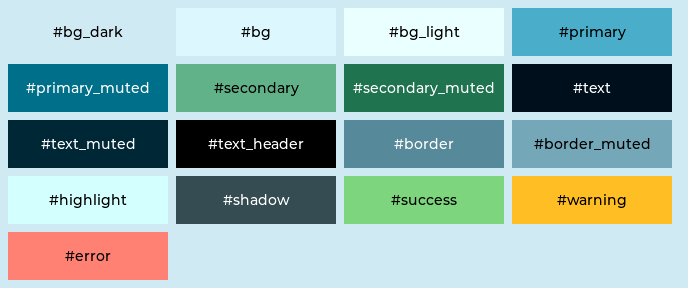

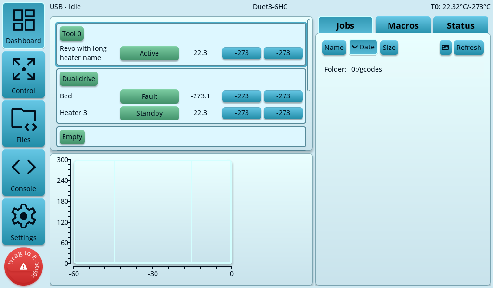

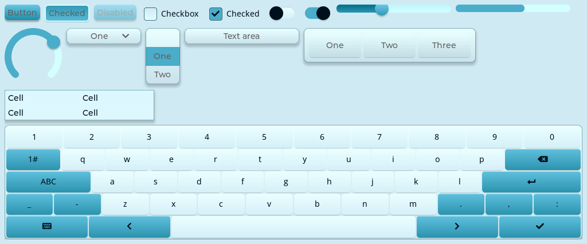

| Widget | Its example |
| --- | --- |
| [`ds_bar`](XML_UI_API.md#ds_bar) |  |
| [`ds_bar_marker`](XML_UI_API.md#ds_bar_marker) |  |
| [`ds_button`](XML_UI_API.md#ds_button) |  |
| [`ds_dropdown`](XML_UI_API.md#ds_dropdown) |  |
| [`ds_graph`](XML_UI_API.md#ds_graph) | 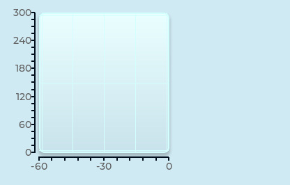 |
| [`ds_heatmap`](XML_UI_API.md#ds_heatmap) | 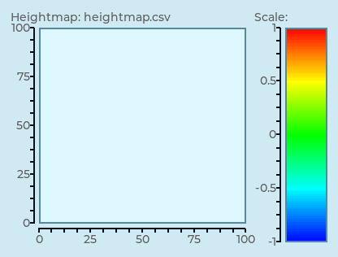 |
| [`ds_hue_slider`](XML_UI_API.md#ds_hue_slider) | 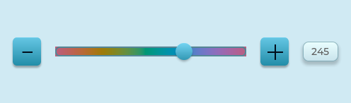 |
| [`ds_icon`](XML_UI_API.md#ds_icon) |  |
| [`ds_keyboard`](XML_UI_API.md#ds_keyboard) | 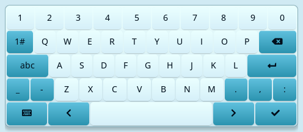 |
| [`ds_password_toggle`](XML_UI_API.md#ds_password_toggle) |  |
| [`ds_plot`](XML_UI_API.md#ds_plot) | 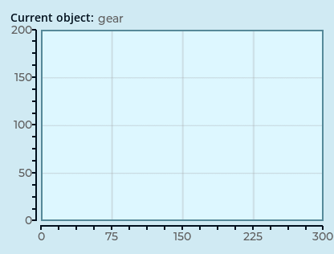 |
| [`ds_slider`](XML_UI_API.md#ds_slider) | 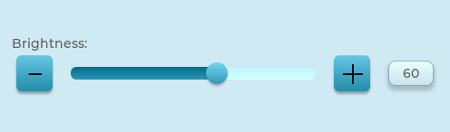 |
| [`ds_tabs`](XML_UI_API.md#ds_tabs) |  |
| [`ds_textarea`](XML_UI_API.md#ds_textarea) |  |
| [`ds_toggle`](XML_UI_API.md#ds_toggle) |  |

## duetscreen

Extends `base`. Its file is [duetscreen.xml](../assets/ui/themes/duetscreen.xml).

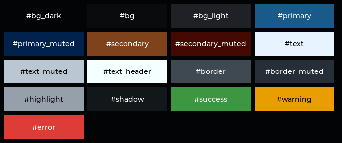

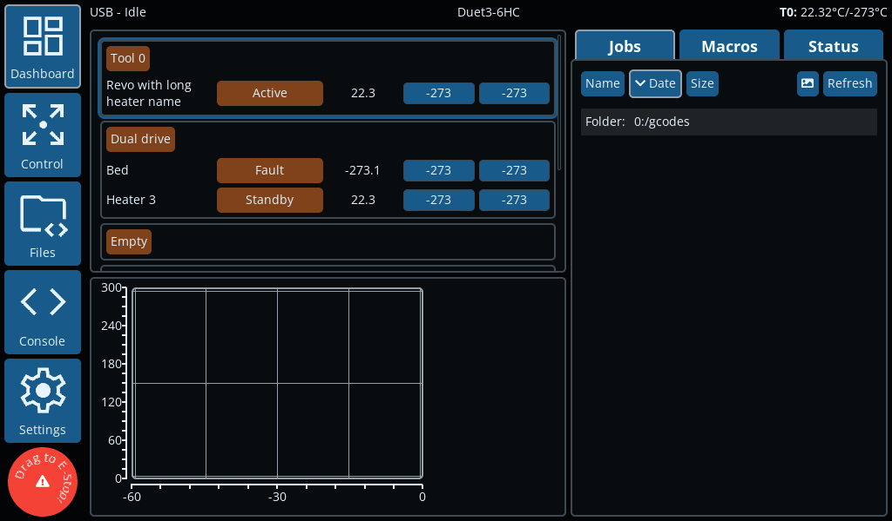

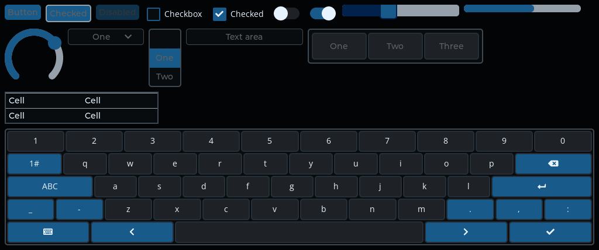

| Widget | Its example |
| --- | --- |
| [`ds_bar`](XML_UI_API.md#ds_bar) |  |
| [`ds_bar_marker`](XML_UI_API.md#ds_bar_marker) |  |
| [`ds_button`](XML_UI_API.md#ds_button) |  |
| [`ds_dropdown`](XML_UI_API.md#ds_dropdown) |  |
| [`ds_graph`](XML_UI_API.md#ds_graph) | 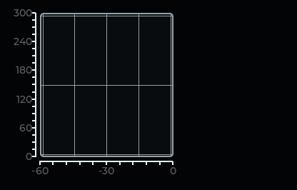 |
| [`ds_heatmap`](XML_UI_API.md#ds_heatmap) | 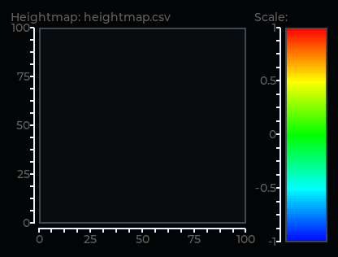 |
| [`ds_hue_slider`](XML_UI_API.md#ds_hue_slider) | 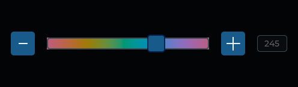 |
| [`ds_icon`](XML_UI_API.md#ds_icon) |  |
| [`ds_keyboard`](XML_UI_API.md#ds_keyboard) | 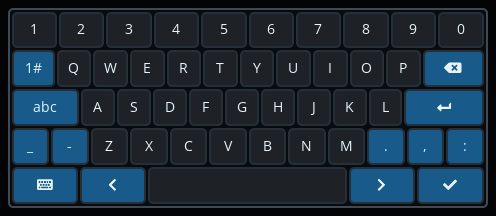 |
| [`ds_password_toggle`](XML_UI_API.md#ds_password_toggle) |  |
| [`ds_plot`](XML_UI_API.md#ds_plot) | 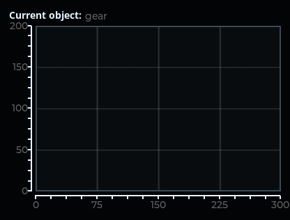 |
| [`ds_slider`](XML_UI_API.md#ds_slider) | 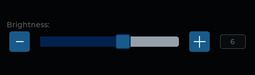 |
| [`ds_tabs`](XML_UI_API.md#ds_tabs) |  |
| [`ds_textarea`](XML_UI_API.md#ds_textarea) |  |
| [`ds_toggle`](XML_UI_API.md#ds_toggle) |  |

## flat

Extends `base`. Its file is [flat.xml](../assets/ui/themes/flat.xml).

Palette: `chroma=0`, `dark=true`, `primary_hue=80`, `secondary_hue=30`

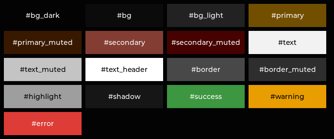

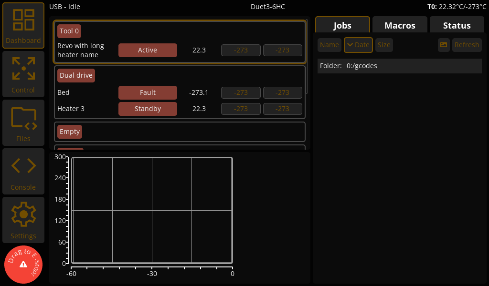

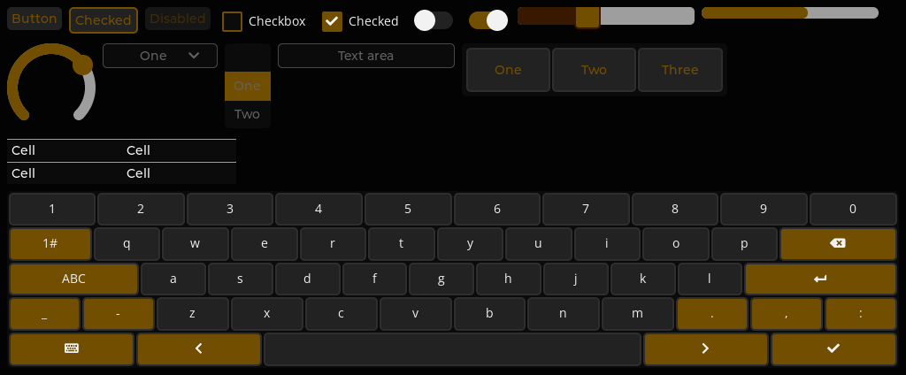

| Widget | Its example |
| --- | --- |
| [`ds_bar`](XML_UI_API.md#ds_bar) |  |
| [`ds_bar_marker`](XML_UI_API.md#ds_bar_marker) |  |
| [`ds_button`](XML_UI_API.md#ds_button) |  |
| [`ds_dropdown`](XML_UI_API.md#ds_dropdown) |  |
| [`ds_graph`](XML_UI_API.md#ds_graph) |  |
| [`ds_heatmap`](XML_UI_API.md#ds_heatmap) | 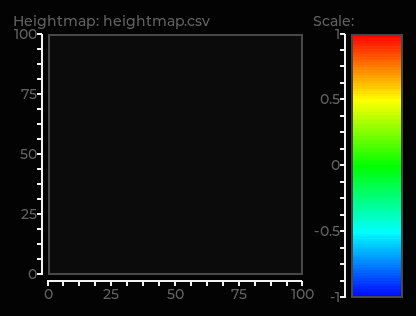 |
| [`ds_hue_slider`](XML_UI_API.md#ds_hue_slider) | 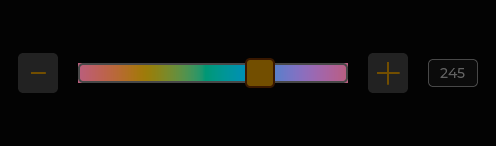 |
| [`ds_icon`](XML_UI_API.md#ds_icon) |  |
| [`ds_keyboard`](XML_UI_API.md#ds_keyboard) | 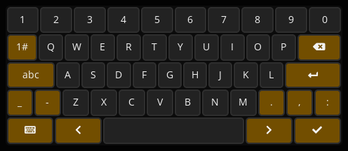 |
| [`ds_password_toggle`](XML_UI_API.md#ds_password_toggle) |  |
| [`ds_plot`](XML_UI_API.md#ds_plot) |  |
| [`ds_slider`](XML_UI_API.md#ds_slider) | 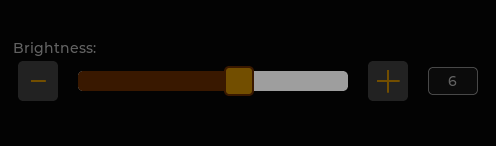 |
| [`ds_tabs`](XML_UI_API.md#ds_tabs) |  |
| [`ds_textarea`](XML_UI_API.md#ds_textarea) |  |
| [`ds_toggle`](XML_UI_API.md#ds_toggle) |  |

## grey

Extends `base`. Its file is [grey.xml](../assets/ui/themes/grey.xml).

Palette: `chroma=0`, `customisable=false`, `dark=true`, `primary_hue=245`, `secondary_hue=190`

Colour adjustments: `primary chroma=0`, `primary_muted chroma=0`, `secondary chroma=0`, `secondary_muted chroma=0`

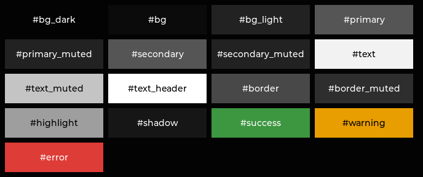

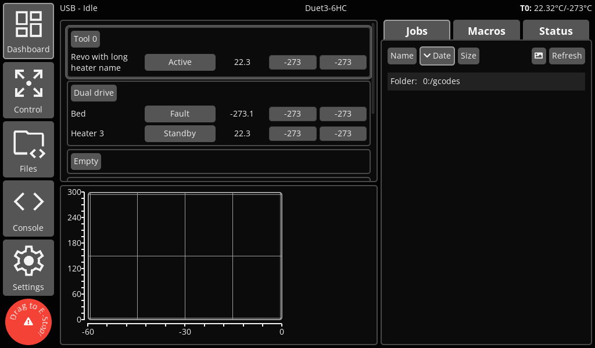

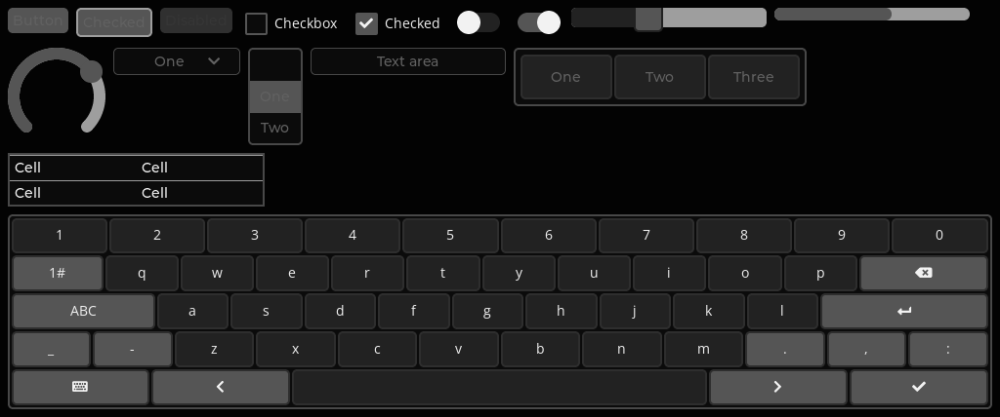

| Widget | Its example |
| --- | --- |
| [`ds_bar`](XML_UI_API.md#ds_bar) |  |
| [`ds_bar_marker`](XML_UI_API.md#ds_bar_marker) |  |
| [`ds_button`](XML_UI_API.md#ds_button) |  |
| [`ds_dropdown`](XML_UI_API.md#ds_dropdown) |  |
| [`ds_graph`](XML_UI_API.md#ds_graph) | 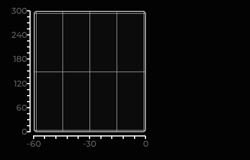 |
| [`ds_heatmap`](XML_UI_API.md#ds_heatmap) |  |
| [`ds_hue_slider`](XML_UI_API.md#ds_hue_slider) | 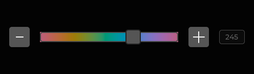 |
| [`ds_icon`](XML_UI_API.md#ds_icon) |  |
| [`ds_keyboard`](XML_UI_API.md#ds_keyboard) |  |
| [`ds_password_toggle`](XML_UI_API.md#ds_password_toggle) |  |
| [`ds_plot`](XML_UI_API.md#ds_plot) | 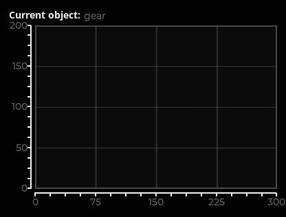 |
| [`ds_slider`](XML_UI_API.md#ds_slider) | 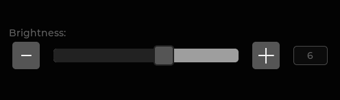 |
| [`ds_tabs`](XML_UI_API.md#ds_tabs) |  |
| [`ds_textarea`](XML_UI_API.md#ds_textarea) |  |
| [`ds_toggle`](XML_UI_API.md#ds_toggle) |  |

## industrial

Extends `base`. Its file is [industrial.xml](../assets/ui/themes/industrial.xml).

Palette: `chroma=0.02`, `dark=false`, `primary_hue=245`, `secondary_hue=50`

Fonts: emphasis: 14 px, weight 700, bold; header: 18 px, weight 800, bold; normal: 14 px, weight 500, normal; subdued: 12 px, weight 300, normal

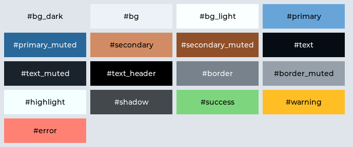

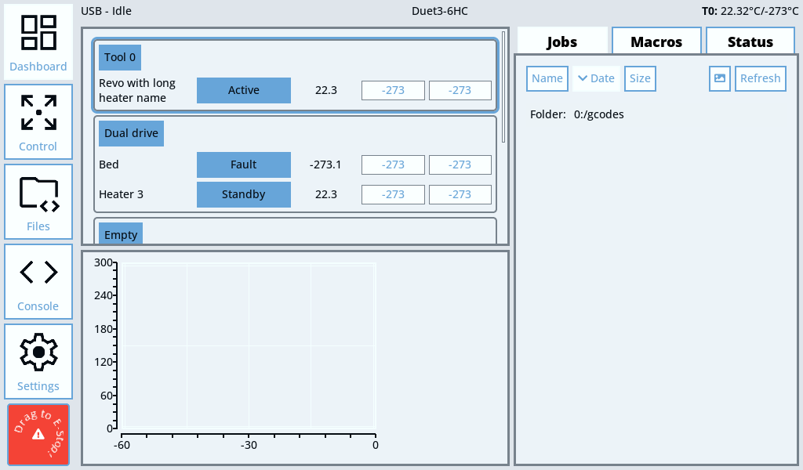

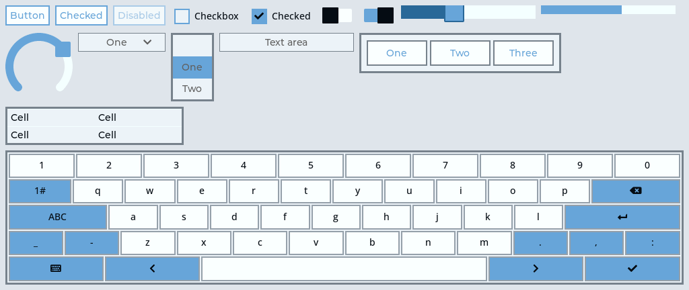

| Widget | Its example |
| --- | --- |
| [`ds_bar`](XML_UI_API.md#ds_bar) |  |
| [`ds_bar_marker`](XML_UI_API.md#ds_bar_marker) |  |
| [`ds_button`](XML_UI_API.md#ds_button) |  |
| [`ds_dropdown`](XML_UI_API.md#ds_dropdown) |  |
| [`ds_graph`](XML_UI_API.md#ds_graph) | 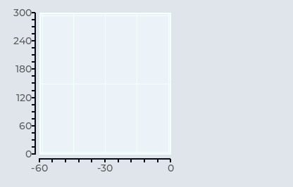 |
| [`ds_heatmap`](XML_UI_API.md#ds_heatmap) |  |
| [`ds_hue_slider`](XML_UI_API.md#ds_hue_slider) | 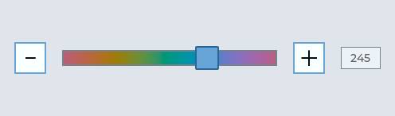 |
| [`ds_icon`](XML_UI_API.md#ds_icon) |  |
| [`ds_keyboard`](XML_UI_API.md#ds_keyboard) | 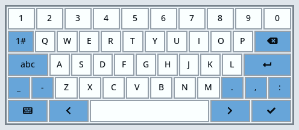 |
| [`ds_password_toggle`](XML_UI_API.md#ds_password_toggle) |  |
| [`ds_plot`](XML_UI_API.md#ds_plot) | 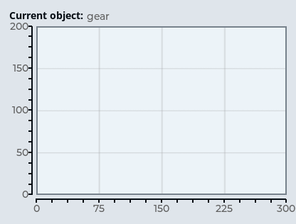 |
| [`ds_slider`](XML_UI_API.md#ds_slider) | 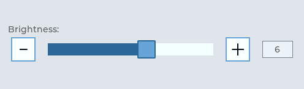 |
| [`ds_tabs`](XML_UI_API.md#ds_tabs) |  |
| [`ds_textarea`](XML_UI_API.md#ds_textarea) |  |
| [`ds_toggle`](XML_UI_API.md#ds_toggle) |  |

## neon

Extends `base`. Its file is [neon.xml](../assets/ui/themes/neon.xml).

Palette: `chroma=0.05`, `dark=true`, `primary_hue=340`, `secondary_hue=45`

Colour adjustments: `primary chroma=+0.1`, `secondary chroma=+0.1`, `primary lightness=+0.2 when=dark`, `secondary lightness=+0.2 when=dark`, `primary_muted from=primary lightness=+0.2 chroma=*0.5 when=dark`, `secondary_muted from=secondary lightness=+0.2 chroma=*0.5 when=dark`, `text_header from=text lightness=+0.3 chroma=+0.1 when=dark`

Fonts: emphasis: 14 px, weight 600, bold; header: 18 px, weight 700, bold; normal: 13 px, weight 400, normal; subdued: 11 px, weight 300, normal

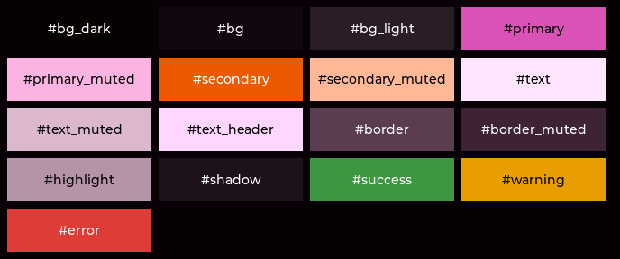

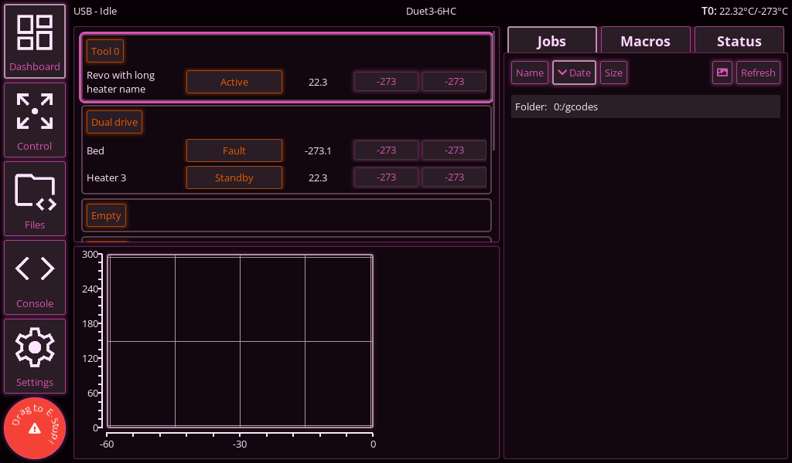

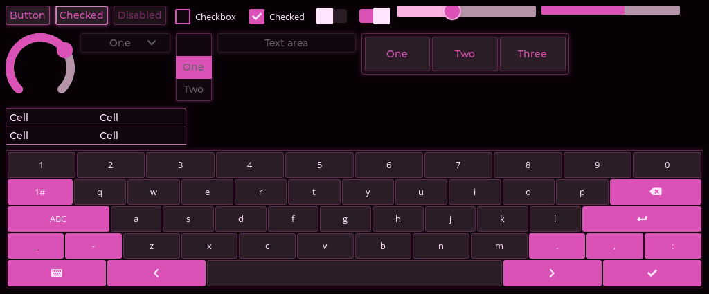

| Widget | Its example |
| --- | --- |
| [`ds_bar`](XML_UI_API.md#ds_bar) |  |
| [`ds_bar_marker`](XML_UI_API.md#ds_bar_marker) |  |
| [`ds_button`](XML_UI_API.md#ds_button) |  |
| [`ds_dropdown`](XML_UI_API.md#ds_dropdown) |  |
| [`ds_graph`](XML_UI_API.md#ds_graph) | 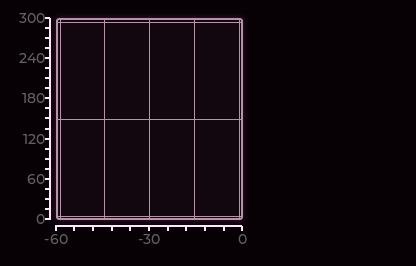 |
| [`ds_heatmap`](XML_UI_API.md#ds_heatmap) |  |
| [`ds_hue_slider`](XML_UI_API.md#ds_hue_slider) | 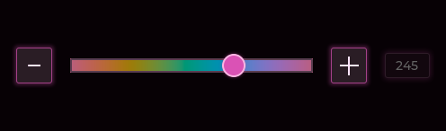 |
| [`ds_icon`](XML_UI_API.md#ds_icon) |  |
| [`ds_keyboard`](XML_UI_API.md#ds_keyboard) | 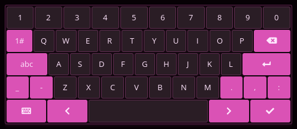 |
| [`ds_password_toggle`](XML_UI_API.md#ds_password_toggle) |  |
| [`ds_plot`](XML_UI_API.md#ds_plot) | 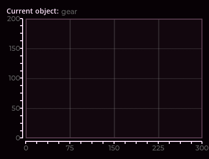 |
| [`ds_slider`](XML_UI_API.md#ds_slider) | 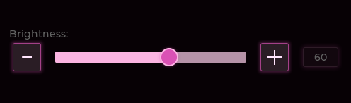 |
| [`ds_tabs`](XML_UI_API.md#ds_tabs) |  |
| [`ds_textarea`](XML_UI_API.md#ds_textarea) |  |
| [`ds_toggle`](XML_UI_API.md#ds_toggle) |  |

## retro

Extends `base`. Its file is [retro.xml](../assets/ui/themes/retro.xml).

Palette: `chroma=0.03`, `dark=false`, `primary_hue=65`, `secondary_hue=115`

Fonts: emphasis: 15 px, weight 700, bold; header: 20 px, weight 800, bold; normal: 14 px, weight 500, normal; subdued: 12 px, weight 400, normal

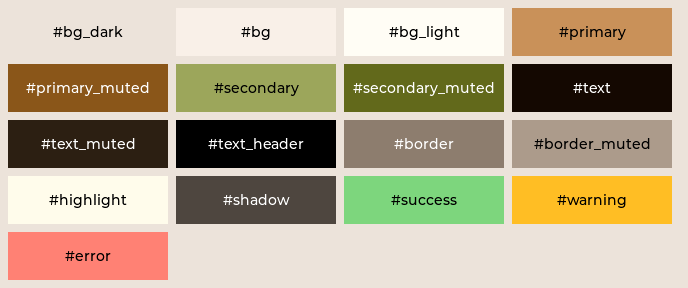

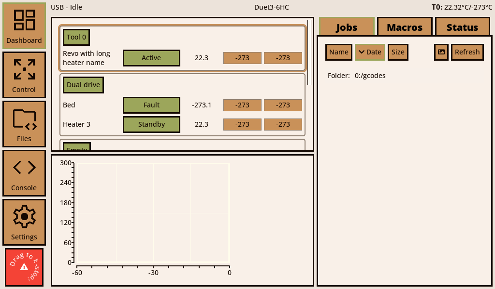

| Widget | Its example |
| --- | --- |
| [`ds_bar`](XML_UI_API.md#ds_bar) |  |
| [`ds_bar_marker`](XML_UI_API.md#ds_bar_marker) |  |
| [`ds_button`](XML_UI_API.md#ds_button) |  |
| [`ds_dropdown`](XML_UI_API.md#ds_dropdown) |  |
| [`ds_graph`](XML_UI_API.md#ds_graph) |  |
| [`ds_heatmap`](XML_UI_API.md#ds_heatmap) |  |
| [`ds_hue_slider`](XML_UI_API.md#ds_hue_slider) |  |
| [`ds_icon`](XML_UI_API.md#ds_icon) |  |
| [`ds_keyboard`](XML_UI_API.md#ds_keyboard) |  |
| [`ds_password_toggle`](XML_UI_API.md#ds_password_toggle) |  |
| [`ds_plot`](XML_UI_API.md#ds_plot) |  |
| [`ds_slider`](XML_UI_API.md#ds_slider) |  |
| [`ds_tabs`](XML_UI_API.md#ds_tabs) |  |
| [`ds_textarea`](XML_UI_API.md#ds_textarea) |  |
| [`ds_toggle`](XML_UI_API.md#ds_toggle) |  |

## soft

Extends `base`. Its file is [soft.xml](../assets/ui/themes/soft.xml).

Palette: `chroma=0.08`, `dark=false`, `primary_hue=250`, `secondary_hue=180`

Fonts: emphasis: 14 px, weight 600, bold; header: 18 px, weight 600, bold; normal: 14 px, weight 400, normal; subdued: 12 px, weight 300, italic

| Widget | Its example |
| --- | --- |
| [`ds_bar`](XML_UI_API.md#ds_bar) |  |
| [`ds_bar_marker`](XML_UI_API.md#ds_bar_marker) |  |
| [`ds_button`](XML_UI_API.md#ds_button) |  |
| [`ds_dropdown`](XML_UI_API.md#ds_dropdown) |  |
| [`ds_graph`](XML_UI_API.md#ds_graph) |  |
| [`ds_heatmap`](XML_UI_API.md#ds_heatmap) |  |
| [`ds_hue_slider`](XML_UI_API.md#ds_hue_slider) |  |
| [`ds_icon`](XML_UI_API.md#ds_icon) |  |
| [`ds_keyboard`](XML_UI_API.md#ds_keyboard) |  |
| [`ds_password_toggle`](XML_UI_API.md#ds_password_toggle) |  |
| [`ds_plot`](XML_UI_API.md#ds_plot) |  |
| [`ds_slider`](XML_UI_API.md#ds_slider) |  |
| [`ds_tabs`](XML_UI_API.md#ds_tabs) |  |
| [`ds_textarea`](XML_UI_API.md#ds_textarea) |  |
| [`ds_toggle`](XML_UI_API.md#ds_toggle) |  |

## Styles

Each style's swatch in each theme. What `base` sets in each is in [XML_UI_API.md](XML_UI_API.md#styles); what a theme changes is in its file.

| Style | 3d | duetscreen | flat | grey | industrial | neon | retro | soft |
| --- | --- | --- | --- | --- | --- | --- | --- | --- |
| `base` |  |  |  |  |  |  |  |  |
| `bg_dark` |  |  |  |  |  |  |  |  |
| `bg` |  |  |  |  |  |  |  |  |
| `bg_light` |  |  |  |  |  |  |  |  |
| `bg_color_primary` |  |  |  |  |  |  |  |  |
| `bg_color_primary_muted` |  |  |  |  |  |  |  |  |
| `bg_color_secondary` |  |  |  |  |  |  |  |  |
| `bg_color_secondary_muted` |  |  |  |  |  |  |  |  |
| `bg_color_success` |  |  |  |  |  |  |  |  |
| `bg_color_warning` |  |  |  |  |  |  |  |  |
| `bg_color_error` |  |  |  |  |  |  |  |  |
| `bg_color_header` |  |  |  |  |  |  |  |  |
| `bg_color_list_item` |  |  |  |  |  |  |  |  |
| `bg_modal` |  |  |  |  |  |  |  |  |
| `text` |  |  |  |  |  |  |  |  |
| `text_muted` |  |  |  |  |  |  |  |  |
| `text_emphasis` |  |  |  |  |  |  |  |  |
| `text_header` |  |  |  |  |  |  |  |  |
| `text_warning` |  |  |  |  |  |  |  |  |
| `border` |  |  |  |  |  |  |  |  |
| `border_muted` |  |  |  |  |  |  |  |  |
| `border_highlight` |  |  |  |  |  |  |  |  |
| `border_color_primary` |  |  |  |  |  |  |  |  |
| `border_color_secondary` |  |  |  |  |  |  |  |  |
| `border_color_card` |  |  |  |  |  |  |  |  |
| `screen` |  |  |  |  |  |  |  |  |
| `scrollbar` |  |  |  |  |  |  |  |  |
| `scrollbar_scrolled` |  |  |  |  |  |  |  |  |
| `card` |  |  |  |  |  |  |  |  |
| `tab_card` |  |  |  |  |  |  |  |  |
| `modal` |  |  |  |  |  |  |  |  |
| `btn` |  |  |  |  |  |  |  |  |
| `btn_checked` |  |  |  |  |  |  |  |  |
| `icon` |  |  |  |  |  |  |  |  |
| `icon_recolor` |  |  |  |  |  |  |  |  |
| `pressed` |  |  |  |  |  |  |  |  |
| `disabled` |  |  |  |  |  |  |  |  |
| `pad_base` |  |  |  |  |  |  |  |  |
| `pad_zero` |  |  |  |  |  |  |  |  |
| `pad_tiny` |  |  |  |  |  |  |  |  |
| `pad_small` |  |  |  |  |  |  |  |  |
| `pad_normal` |  |  |  |  |  |  |  |  |
| `pad_large` |  |  |  |  |  |  |  |  |
| `pad_gap` |  |  |  |  |  |  |  |  |
| `line_space_large` |  |  |  |  |  |  |  |  |
| `text_align_center` |  |  |  |  |  |  |  |  |
| `outline_primary` |  |  |  |  |  |  |  |  |
| `outline_secondary` |  |  |  |  |  |  |  |  |
| `circle` |  |  |  |  |  |  |  |  |
| `no_radius` |  |  |  |  |  |  |  |  |
| `no_border` |  |  |  |  |  |  |  |  |
| `clip_corner` |  |  |  |  |  |  |  |  |
| `rotary_scroll` |  |  |  |  |  |  |  |  |
| `grow` |  |  |  |  |  |  |  |  |
| `transition_delayed` |  |  |  |  |  |  |  |  |
| `transition_normal` |  |  |  |  |  |  |  |  |
| `anim` |  |  |  |  |  |  |  |  |
| `anim_fast` |  |  |  |  |  |  |  |  |
| `action_btn` |  |  |  |  |  |  |  |  |
| `input` |  |  |  |  |  |  |  |  |
| `long_press` |  |  |  |  |  |  |  |  |
| `draggable` |  |  |  |  |  |  |  |  |
| `dragging` |  |  |  |  |  |  |  |  |
| `drag_complete` |  |  |  |  |  |  |  |  |
| `knob` |  |  |  |  |  |  |  |  |
| `arc_indic` |  |  |  |  |  |  |  |  |
| `arc_indic_primary` |  |  |  |  |  |  |  |  |
| `bar` |  |  |  |  |  |  |  |  |
| `bar_indic` |  |  |  |  |  |  |  |  |
| `btnm_bg` |  |  |  |  |  |  |  |  |
| `btnm_btn` |  |  |  |  |  |  |  |  |
| `btnm_btn_checked` |  |  |  |  |  |  |  |  |
| `chart_series` |  |  |  |  |  |  |  |  |
| `chart_indic` |  |  |  |  |  |  |  |  |
| `chart_bg` |  |  |  |  |  |  |  |  |
| `dropdown` |  |  |  |  |  |  |  |  |
| `dropdown_list` |  |  |  |  |  |  |  |  |
| `cb_marker` |  |  |  |  |  |  |  |  |
| `cb_marker_checked` |  |  |  |  |  |  |  |  |
| `bg_switch` |  |  |  |  |  |  |  |  |
| `switch_knob` |  |  |  |  |  |  |  |  |
| `line` |  |  |  |  |  |  |  |  |
| `table` |  |  |  |  |  |  |  |  |
| `table_cell` |  |  |  |  |  |  |  |  |
| `text_area` |  |  |  |  |  |  |  |  |
| `ta_cursor` |  |  |  |  |  |  |  |  |
| `ta_placeholder` |  |  |  |  |  |  |  |  |
| `calendar_btnm_bg` |  |  |  |  |  |  |  |  |
| `calendar_btnm_day` |  |  |  |  |  |  |  |  |
| `calendar_header` |  |  |  |  |  |  |  |  |
| `canvas` |  |  |  |  |  |  |  |  |
| `menu_bg` |  |  |  |  |  |  |  |  |
| `menu_cont` |  |  |  |  |  |  |  |  |
| `menu_sidebar_cont` |  |  |  |  |  |  |  |  |
| `menu_main_cont` |  |  |  |  |  |  |  |  |
| `menu_page` |  |  |  |  |  |  |  |  |
| `menu_header_cont` |  |  |  |  |  |  |  |  |
| `menu_header_btn` |  |  |  |  |  |  |  |  |
| `menu_section` |  |  |  |  |  |  |  |  |
| `menu_pressed` |  |  |  |  |  |  |  |  |
| `menu_separator` |  |  |  |  |  |  |  |  |
| `msgbox_backdrop_bg` |  |  |  |  |  |  |  |  |
| `keyboard_button` |  |  |  |  |  |  |  |  |
| `keyboard_button_checked_bg` |  |  |  |  |  |  |  |  |
| `list_bg` |  |  |  |  |  |  |  |  |
| `list_btn` |  |  |  |  |  |  |  |  |
| `list_item_grow` |  |  |  |  |  |  |  |  |
| `tab_bg_focus` |  |  |  |  |  |  |  |  |
| `tab_btn` |  |  |  |  |  |  |  |  |
| `led` |  |  |  |  |  |  |  |  |
| `scale` |  |  |  |  |  |  |  |  |
| `slider` |  |  |  |  |  |  |  |  |
| `slider_indic` |  |  |  |  |  |  |  |  |
| `slider_knob` |  |  |  |  |  |  |  |  |
| `sidebar` |  |  |  |  |  |  |  |  |
| `sidebar_btn` |  |  |  |  |  |  |  |  |
| `console_btn_anim` |  |  |  |  |  |  |  |  |
| `estop` |  |  |  |  |  |  |  |  |
| `file` |  |  |  |  |  |  |  |  |
| `folder` |  |  |  |  |  |  |  |  |
| `unhomed` |  |  |  |  |  |  |  |  |
| `temperature_bar` |  |  |  |  |  |  |  |  |
| `temperature_bar_indic` |  |  |  |  |  |  |  |  |
| `tool_list` |  |  |  |  |  |  |  |  |
| `tool_list_tool` |  |  |  |  |  |  |  |  |
| `tool_list_heater` |  |  |  |  |  |  |  |  |
| `tool_selected` |  |  |  |  |  |  |  |  |
| `tab_button` |  |  |  |  |  |  |  |  |
| `slider_buttons` |  |  |  |  |  |  |  |  |
| `list_header` |  |  |  |  |  |  |  |  |
| `list_title` |  |  |  |  |  |  |  |  |
| `graph_legend` |  |  |  |  |  |  |  |  |
| `bar_label_bg` |  |  |  |  |  |  |  |  |
| `bar_label` |  |  |  |  |  |  |  |  |
| `object_cancel_base` |  |  |  |  |  |  |  |  |
| `object_cancel_current` |  |  |  |  |  |  |  |  |
| `object_cancel_cancelled` |  |  |  |  |  |  |  |  |
| `debug_borders` |  |  |  |  |  |  |  |  |

